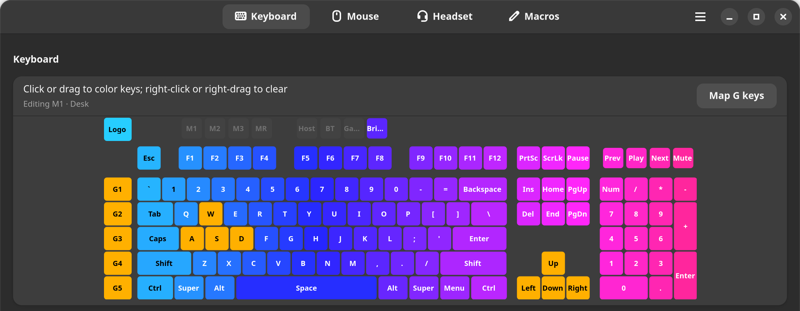
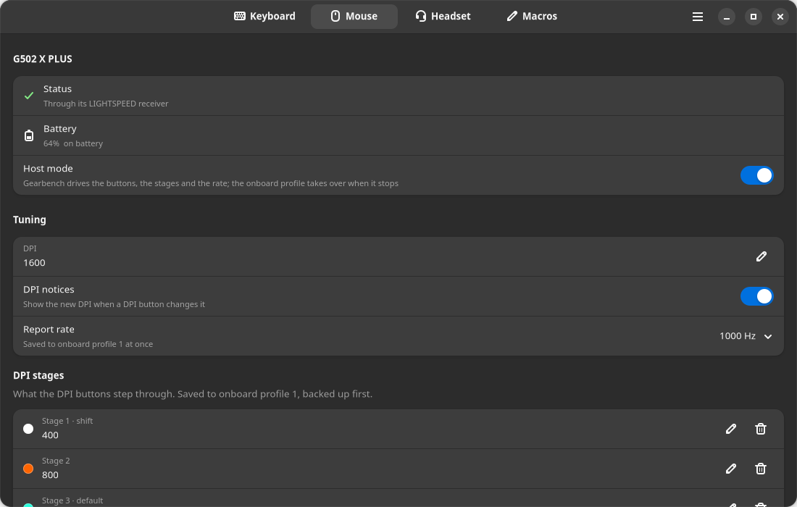
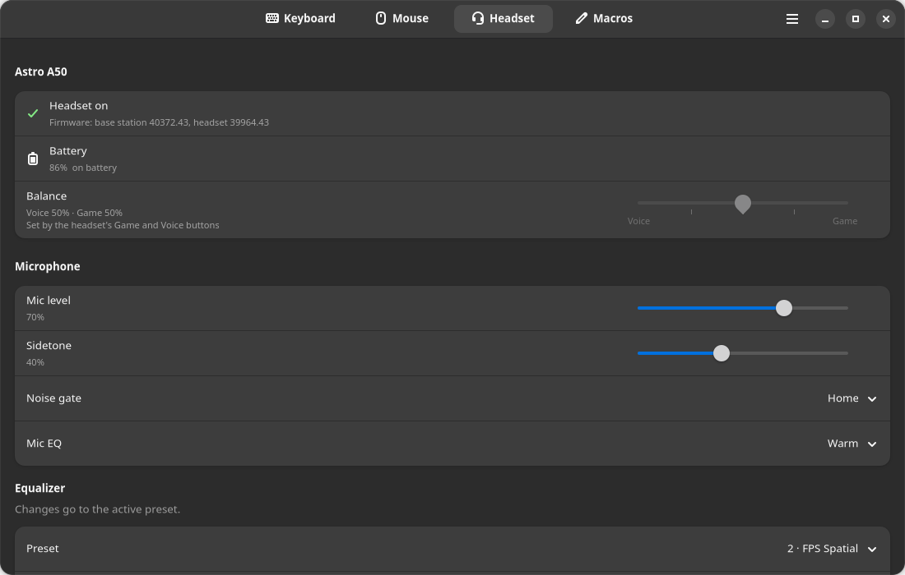
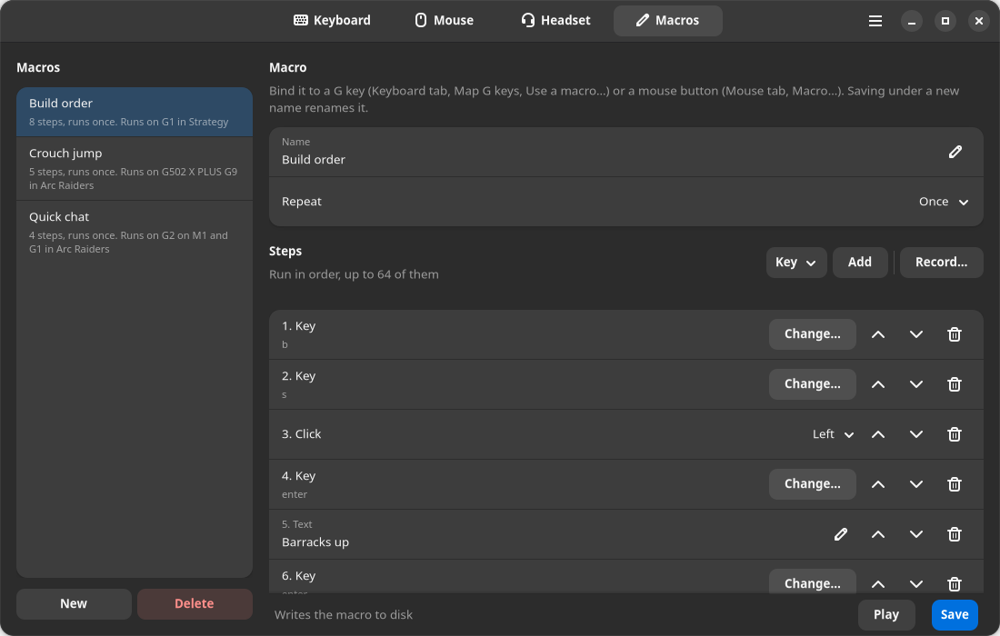
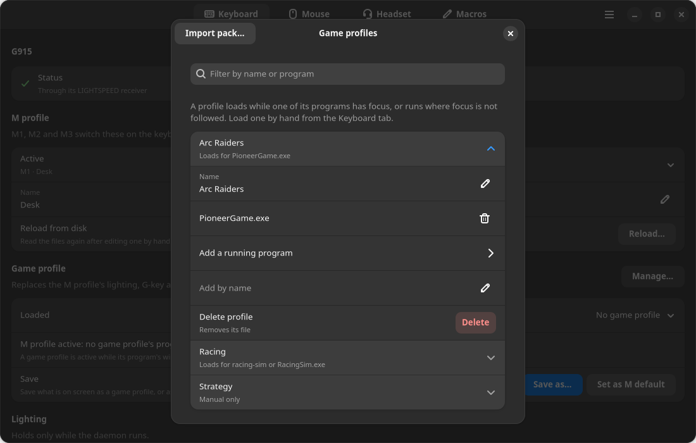

<div align="center">


# Gearbench

Gearbench is an open-source Linux app for Logitech G keyboards and mice:
per-key lighting, G keys, macros, DPI stages and game profiles. Two headsets
get equalizers and spatial sound.

It is made for Ubuntu 26.04 with GNOME 50 on Wayland. It is physically tested
on the G915 and G515 TKL keyboards, the G502 X PLUS, G502 HERO and G305 mice,
and the Astro A50 Gen 4 and Logitech G432 headsets.
[Ten more models](#supported-devices) are built and wait for their first
physical test.

**[Download](https://github.com/gearbench/gearbench/releases/latest)** ·
[Install](#install) · [Supported devices](#supported-devices) ·
[User guide](docs/GUIDE.md) · [Moving from G HUB](docs/GUIDE.md#moving-from-g-hub)



[Keyboard](docs/GUIDE.md#the-keyboard): keys painted by click or drag, G keys and M profiles

|  |  |
| :---: | :---: |
| [Mouse](docs/GUIDE.md#the-mouse): DPI stages and the report rate | [Headset](docs/GUIDE.md#the-headset): the A50's microphone, sidetone and EQ presets |
|  |  |
| [Macros](docs/GUIDE.md#macros): keys, text, clicks and delays, added or recorded | [Game profiles](docs/GUIDE.md#game-profiles): lighting and bindings that load while their game has focus |

</div>

## Supported devices

| Device | Physically tested | What Gearbench drives |
| --- | --- | --- |
| G915 keyboard (cable or receiver) | Yes | G1 to G5, M1 to M3, MR, per-key lighting, animations, brightness, battery |
| G515 TKL keyboard (cable) | Yes | per-key lighting, animations, brightness |
| G515 LIGHTSPEED TKL keyboard (cable or receiver) | No | per-key lighting, animations, brightness, battery |
| G915 TKL and G913 TKL keyboards (cable or receiver) | No | F1 to F12 as G keys, M1 to M3, MR, per-key lighting, animations, brightness, battery |
| G815 and G813 keyboards (cable) | No | G1 to G5, M1 to M3, MR, per-key lighting, animations, brightness |
| G502 X PLUS mouse (cable or receiver) | Yes | G4 to G9, DPI stages, report rate, lighting, battery |
| G305 mouse (receiver) | Yes | DPI stages and its DPI button, report rate, a coarse battery level |
| G502 HERO mouse (cable) | Yes | G4 to G9, DPI stages, report rate, lighting |
| G502 X LIGHTSPEED mouse (cable or receiver) | No | G4 to G9, DPI, report rate, battery |
| PRO X SUPERLIGHT mouse (cable or receiver) | No | G4 and G5, DPI, report rate, battery |
| G502 X mouse (cable) | No | G4 to G9, DPI, report rate |
| G502 X PLUS MILLENNIUM FALCON mouse (cable or receiver) | No | G4 to G9, DPI, report rate, lighting, battery |
| G502 LIGHTSPEED mouse (cable or receiver) | No | G4 to G9, DPI, report rate, lighting, battery |
| PRO WIRELESS mouse (cable or receiver) | No | G4 to G8, DPI, report rate, lighting, battery |
| G903 LIGHTSPEED HERO mouse (cable or receiver) | No | G4 to G9, DPI, report rate, lighting, battery |
| Astro A50 Gen 4 headset (base station on USB, its switch on PC) | Yes | microphone, EQ presets, base station settings, Game and Chat outputs, spatial sound, battery |
| Logitech G432 headset (USB adapter) | Yes | sidetone, a ten-band equalizer, microphone noise suppression, spatial sound |

Gearbench attaches to these models by their product ids, and to no other.
Several mice can be attached at once, and one keyboard is driven at a time.
The G915 and the G915 TKL are not driven over Bluetooth.

The ten marked No were built with none on hand, from published sources, G HUB's
files and, for some, their firmware. On the seven mice marked No, Gearbench
drives the buttons and sets the report rate live, in host mode, the default.
It writes nothing to their onboard memory, or to that of the G915 TKL or the
G815. Until a model has been physically tested,
`gearbench-ctl status`, the journal and its tab ask for a device report from
it, as [Your device isn't supported yet?](#your-device-isnt-supported-yet)
says.

The G502 HERO's G4 to G9 and its report rate are not physically tested yet,
nor are some features of the A50 and the G432.
[The models and their ids](docs/GUIDE.md#the-models-and-their-ids) lists them,
with each model's ids and what it was built from.
[Why and how we built it](docs/GUIDE.md#why-and-how-we-built-it) says how
Gearbench was built and tested.

## Install

Gearbench is made for Ubuntu 26.04 with GNOME 50 on Wayland. Install it one of
two ways, the package or a git checkout, never both.

Both install udev rules that let any program you run open each supported device
and `/dev/uinput`, through which bindings and macros type. With the `gearbench`
group, the rules are all that needs root. On the G815, G515 LIGHTSPEED TKL,
G915 TKL, G502 HERO and G502 X, a connection the rules open can also carry what
you type. So a program you run can read that typing, another account's
included; Gearbench drops it unread. [The udev rules](docs/GUIDE.md#the-udev-rules)
names each such connection and says how to limit the rules to one group's
accounts on a computer several people use.

To install the package, download `gearbench_X.Y.Z_all.deb` from the
[Releases page](https://github.com/gearbench/gearbench/releases). Then run this
in a terminal in the folder you saved it to; apt pulls in what it needs:

```
sudo apt install ./gearbench_*_all.deb
```

To install from a git checkout, clone it into a folder only you can write, such
as your home folder. Run `install.sh` as yourself, not with `sudo`; it asks for
your password to install the udev rules and the `gearbench` group:

```
git clone https://github.com/gearbench/gearbench.git
cd gearbench
./install.sh
```

Either way, the service starts at once in your desktop session, and at each
graphical login after it. Run no other program that drives these devices
alongside Gearbench. When the daemon finds one it knows, `gearbench-ctl status`
and a banner in the window say so.

Next, follow [First-time setup](docs/GUIDE.md#first-time-setup).
[Install in detail](docs/GUIDE.md#install-in-detail) has what each way installs
and where, building the package and what the window needs.
[Upgrading and removing](docs/GUIDE.md#upgrading-and-removing) covers a new
version and taking Gearbench off.

## Your device isn't supported yet?

If you have a Logitech keyboard, mouse or headset that
[Supported devices](#supported-devices) leaves out, or one it lists that
misbehaves, a report from it is how support gets built and fixed. With
Gearbench installed:

1. Plug the device in over USB.
2. Run `gearbench-ctl report`. It reads what each Logitech device on USB says
   about itself and writes nothing to any of them. Nothing in the block it
   prints names you, your computer or the unit. It holds no serial number, no
   computer or user name, no folder, and nothing from the part of a mouse's
   memory that can hold your macros.
3. Paste the block into a
   [device report](https://github.com/gearbench/gearbench/issues/new?template=device-report.yml),
   with the model in the title.

While the service runs, the report gives only what Gearbench already knows of a
device it drives, and reads no other device Gearbench supports, since the
service opens those as it looks for them. It says how to stop the service for
the full read and start it again.

Your account may not be allowed to open a device that no rule of Gearbench's
grants. The report then prints a `sudo setfacl` command that lets it open that
one device until you unplug it; nothing is installed. Some devices send what is
typed over that same connection, keyboards among them and mice that send the
keystrokes of a button bound to a key. For those the report warns that until
you unplug the device, any program you run could read what is typed on it.
Unplug it once the report is done, which ends that access.

[Reporting a device](docs/GUIDE.md#reporting-a-device) has what the report asks
each device, and its `--json` form.

## License

GPL-3.0-or-later; the full text is in [LICENSE](LICENSE). The head
measurements in `spatial/sadie-ii/` are SADIE II's, from the University of
York, under Apache-2.0 ([spatial/sadie-ii/LICENSE.txt](spatial/sadie-ii/LICENSE.txt)).
[spatial/README.md](spatial/README.md) has their attribution and where they
came from. The AppStream metadata,
`desktop/io.github.gearbench.Gearbench.metainfo.xml`, is under CC0-1.0.

## Trademarks

Gearbench is an independent project, not affiliated with or endorsed by
Logitech. Logitech, Logitech G, LIGHTSPEED, G HUB and ASTRO are trademarks of
Logitech. Dolby is a trademark of Dolby Laboratories.
