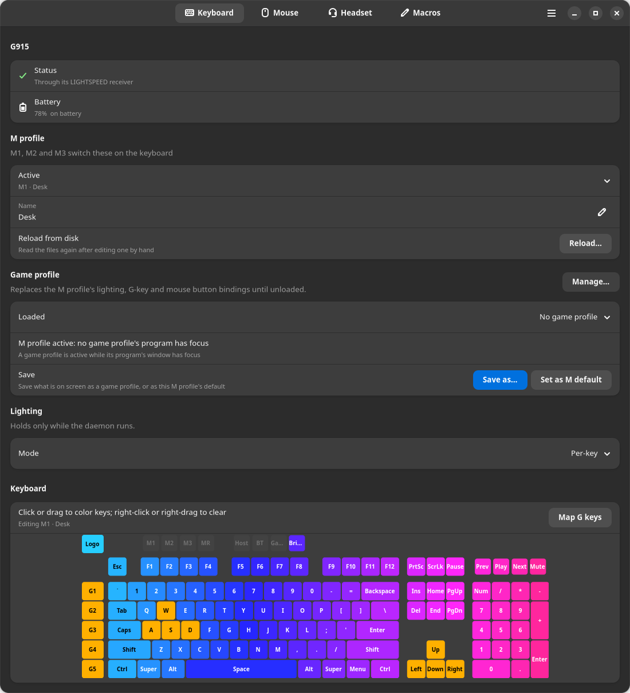
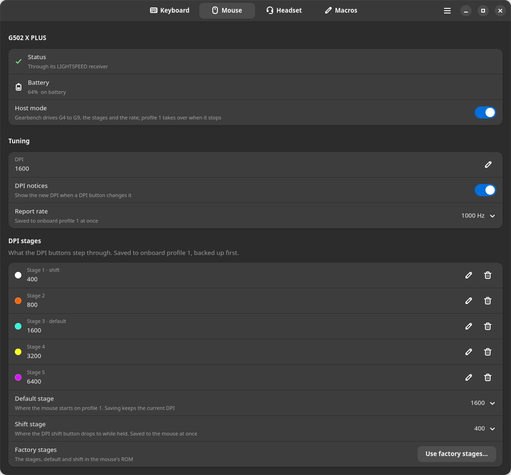
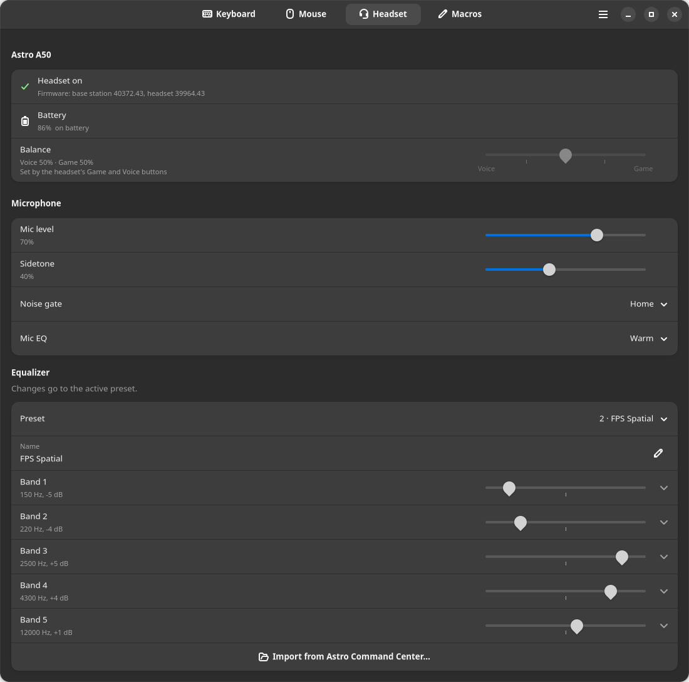
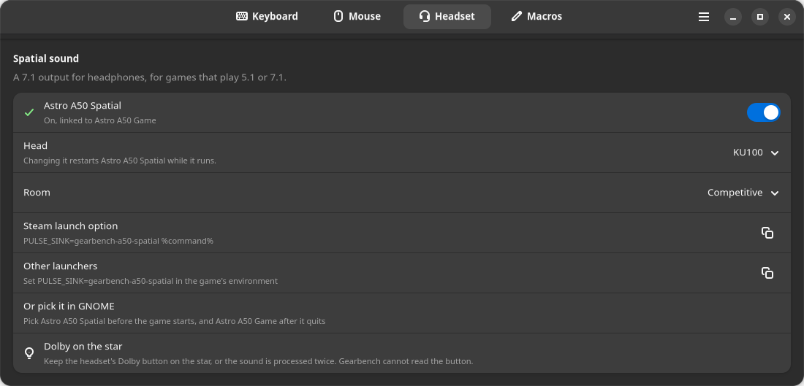
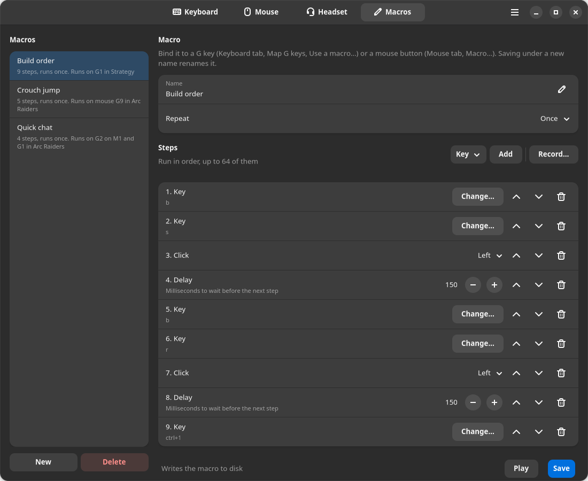
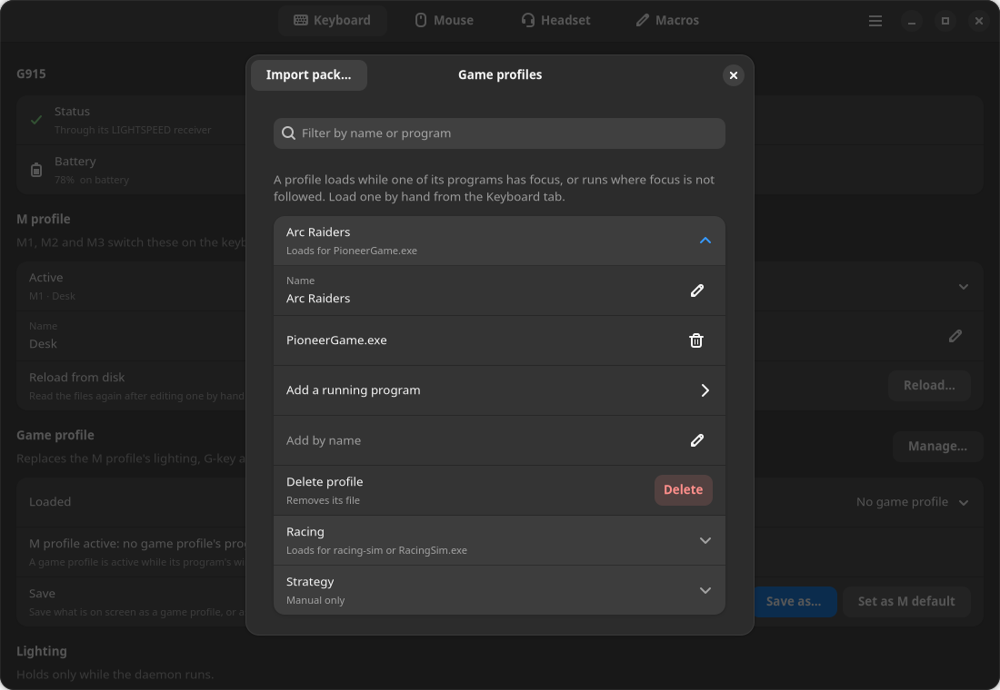

# Gearbench

Gearbench controls a Logitech G915 keyboard, G502 X PLUS and G305 mice, and an
Astro A50 Gen 4 headset on Linux. It binds the keyboard's G keys and the
G502 X PLUS's extra buttons, runs macros, paints the keyboard key by key,
sets each mouse's DPI stages and report rate, and loads a game profile while
its game has focus. For the headset it sets the microphone, the mix and the
equalizer, and adds a spatial output for games.

Gearbench is built for these four devices alone. More will be added over
time, each one once it has been tested on the hardware.

A user service owns the devices, and a window and a command line
(`gearbench-ctl`) both talk to it. The G915 and the G502 X PLUS can be on
their cable or on their wireless receiver; Gearbench finds out which, and the
window shows only what the attached device can do.

## Why and how we built it

The vendor apps for these devices run on Windows, some on macOS too, and none
on Linux. Linux is our daily system, games under Steam and Proton included,
and we wanted everything this hardware can do without booting Windows to set
it. The Linux tools that exist each cover part of that, one device family or
one feature at a time, and two programs with one device open each read the
other's replies. So Gearbench drives all four devices, and it has to be the
only program that does.

We are a team: the project's owner and Claude Code, Anthropic's AI coding
agent. The owner makes the decisions, and since 2026-09-30 has left some of
them to Claude Code. The owner checks the changes that touch a device on the
hardware, one step at a time; some have not been checked there yet. Claude
Code does the research and writes the code, the tests and the docs.

Four kinds of work went into it. First, published research: we researched
other open-source code for the keyboard's and mice's protocol and for the
headset's, and copied no source code from it. Second, our own captures of the
USB traffic of Logitech's G HUB driving the keyboard and mice on Windows.
Third, reverse engineering: G HUB's own files, two builds of Astro's control
app, and the firmware of the G915 and the base station answered what the
captures and the research could not. Last, testing on the wire: what
Gearbench does with each device rests on requests sent to it and its replies
measured.

## Supported hardware

| Device | Connection | Id | What works |
| --- | --- | --- | --- |
| G915 keyboard | its cable | 046d:c33e | G1 to G5 and their MR layer, M1 to M3, per-key lighting and the keyboard's animations, brightness, battery |
| G915 keyboard | its receiver | 046d:c541 | the same |
| G502 X PLUS mouse | its receiver | 046d:4099, on receiver 046d:c547 | G4 to G9, DPI and DPI stages, report rate, lighting, battery |
| G502 X PLUS mouse | its cable | 046d:c095 | the same |
| G305 mouse | its receiver | 046d:4074, on receiver 046d:c53f | DPI and DPI stages, its DPI button, report rate, a coarse battery level |
| Astro A50 Gen 4 headset | its base station on USB, switch on PC | 9886:002c | battery, microphone, the three EQ presets, the base station's settings, Game and Chat as two outputs, a spatial 7.1 output for games (Astro A50 Spatial); built, not yet checked on the hardware: the stream port mix |

Only these ids attach. Several mice can be attached at once. The G915 over Bluetooth is not
supported, and the G305 has no lights and no buttons to bind.

Pair nothing else to either mouse's receiver. Going by the kernel's source, a
keyboard paired there could have its keystrokes arrive where Gearbench's rules
grant access: the G305's node, or the G502 X PLUS's node and event node. This
has not been checked on the hardware. In host mode, a key on the G502 X PLUS's
event node brings a warning: in the journal once each time the mouse attaches,
and in `gearbench-ctl status`, the tray and the Mouse tab until the mouse
detaches.

With its switch on Console the A50's base station has no control interface,
so Gearbench works with it on PC only. Its low-battery notices and Auto
shut-off's idle wait have not run on the hardware yet.

## Install

Gearbench is made for Ubuntu 26.04 with GNOME 50 on Wayland. It needs Python
3.14 and a kernel with uinput. The window needs GTK 4 and libadwaita for
Python (`python3-gi`, `gir1.2-gtk-4.0`, `gir1.2-adw-1`) from the
distribution, never from pip. The service uses `python3-gi` too: to exit at
the login screen, where the package's service also starts, and for the
screen lock, suspend, notices, the tray icon, a synced mouse's idle dimming,
the GNOME Shell extension's focus reports, and holding bindings and macros
back while another account or a text console has the seat. Without it the
service runs at the login screen as well, those are off, and game profiles
follow only X11 windows, a Proton game's among them unless it runs Wine's
Wayland driver; the journal says python3-gi is missing when the service
starts.

Install one way, the Debian package or `install.sh` from a git checkout,
never both: the checkout's service file and launcher would shadow the
package's, so `install.sh` refuses while the package is installed. A udev
rule that a checkout install left in `/usr/local/lib/udev/rules.d/` takes the
place of the package's rule of the same name. The package warns about each
one and never deletes them, and after `apt remove` they keep granting access;
`./install.sh --uninstall` in that checkout removes them.

Each release on the repository's Releases page has the Debian package,
`gearbench_X.Y.Z_all.deb`. Install it with apt, which pulls in what it
needs:

```
sudo apt install ./gearbench_*_all.deb
```

To build it yourself from a checkout, install `build-essential` and the
build dependencies `debian/control` lists, then run
`dpkg-buildpackage -us -uc -b`.

The package puts `gearbench-ctl` in `/usr/bin`, creates the `gearbench` group
and installs the udev rules, applying them to devices already plugged in. The
user service starts at once in each desktop session already open, and with
each graphical login after that. The package also carries the
window's desktop entry and icons, the man page, this README and the guide,
and the A50's audio profile: an ALSA profile set in
`/usr/share/alsa-card-profile/mixer/profile-sets/` and a WirePlumber rule in
`/usr/share/wireplumber/wireplumber.conf.d/`, which list Game and Chat as two
outputs. WirePlumber reads them when your user manager next starts, the same
wait the `gearbench` group has below, or at once after `systemctl --user
restart wireplumber`, which stops all sound for a moment.
The spatial sound service, `gearbench-spatial.service`, with its data in
`/usr/share/gearbench/spatial` (see "The Headset tab"), the
`gearbench-spatial-login.service` that starts it at login, and Gearbench's
GNOME Shell extension (step 3 below) stay off until you turn them on.

From a git checkout:

```
./install.sh               install
./install.sh --uninstall   remove all but your settings and the gearbench group; the keyboard goes back to its onboard profile
```

Run it as yourself from a terminal in your desktop session, not with `sudo`;
it refuses to run as root. It creates
the `gearbench` group, adds you to it and installs the udev rules through
sudo, asking for your password there. The rest goes in as you: a user
service that runs the checkout, a `gearbench-ctl` launcher in
`~/.local/bin`, the icons, the desktop entry when GTK 4 and libadwaita
import, the A50's audio profile under `~/.config/alsa-card-profile/` and
`~/.config/wireplumber/`, the spatial sound service, written and left off,
and the GNOME Shell extension, turned on for your next login. It starts the
service, and restarts WirePlumber only when one of the two audio files is new
or changed, which stops all sound for a moment; if WirePlumber does not
restart, they apply when it next starts. Run it again after moving the
checkout. It refuses a checkout under `/tmp`, or anywhere else another account
owns or can write, a write through your own group aside: the service runs the
checkout's code as you, so keep the checkout in a folder only you can write,
such as your home folder.

Only the udev rules and the `gearbench` group need root. The service always
runs as you: manage it with `systemctl --user`, never with `sudo`. Both
routes install five rules:

- `70-g915.rules`, `70-g502x.rules` and `70-g305.rules` let you open the
  control interface of the keyboard and of the cabled G502 X PLUS, and the
  node of each mouse behind its receiver, which carries the mouse's motion
  and buttons too. The G502 X PLUS's event node, where the service reads G4
  to G9 with host mode off, is readable by the `gearbench` group and writable
  by root alone, since a program that could write it could type. No other
  node of the devices is granted. With host mode on, the default, G4 to G9
  come in the mouse's button reports. The group is still needed for G4 to G9
  whenever host mode does not take, and for the warning about a keyboard
  paired to the mouse's receiver.

  Both routes create the group. `install.sh` adds you to it; with the
  package, run `sudo usermod -aG gearbench $USER`. The service gets the
  group at your next login once every session of yours has ended, or, with
  lingering on for your account (`loginctl show-user $USER -p Linger` says
  `Linger=yes`), when the machine next restarts. Until then, with host mode
  off or not taken, `gearbench-ctl status` says what is missing.
- `70-astro-a50.rules` lets you open the A50 base station's one control
  interface, which carries its settings and no keystrokes. Its audio needs
  no rule.
- `70-gearbench-uinput.rules` lets you open `/dev/uinput`, where the service
  makes the virtual keyboard and mouse that bindings and macros type
  through. It is the line the steam-devices package ships, and it lets any
  program you run create a virtual keyboard. The grant also crosses
  accounts: a program that opened `/dev/uinput` keeps its keyboard after a
  user switch, or after a logout that leaves its processes running, and can
  type into a later account's session. The rule's comment, in
  `/usr/lib/udev/rules.d/` with the package or `/usr/local/lib/udev/rules.d/`
  from a checkout, has the trade-off and, for a machine several people use,
  a group grant to use instead. Without the rule the lighting works and a
  bound key types nothing:
  `gearbench-ctl status` lists `no virtual keyboard`, the window shows a
  banner, and the service tries again every 30 seconds, so a rule added later
  needs no restart.

Do not run another program that drives these devices alongside Gearbench.
When the service finds one it knows running, `gearbench-ctl status` and a
banner in the window say so and what to do.

### Upgrading and removing

A new `.deb` installs over the old one with `sudo apt install`, which
restarts a running service on the new code. From a checkout, `git pull` and
run `./install.sh` again, which restarts the service on the new code, or
starts it if it was stopped.

To remove the package, run `sudo apt purge gearbench` (or `remove`, which
keeps the service's enablement), then `systemctl --user restart wireplumber`.
The removal stops the service and spatial sound in each session first, which
hands the keyboard back. If you switched spatial sound on, run `systemctl
--user disable gearbench-spatial.service` before it, so no link to the unit
stays in your settings. From a checkout, `./install.sh --uninstall` does the
same. Neither touches your settings in `~/.config/gearbench/`.

Removing the rules, by either route, does not take away the access they
gave: you keep it to the devices plugged in until they are replugged, and to
`/dev/uinput` until the machine restarts. The G502 X PLUS's event nodes go
back to `root:input` at once. The `gearbench` group stays, with you in it;
`sudo groupdel gearbench` removes it.

## First-time setup

1. The service is running: `install.sh` and the package start it in your
   desktop session, and `systemctl --user start gearbench` starts it if it
   was stopped. From then on it starts with each graphical login and stops at logout, which hands the keyboard back to its
   onboard profile.
2. Run `gearbench-ctl status`. It says what the service found, the keyboard
   with its connection, and lists anything wrong under `problems`, a line
   each. With the rules installed, `no virtual keyboard` there means the
   service could not open `/dev/uinput`. When `getfacl /dev/uinput` lists no
   `user:` line with your name, the rule has not reached the node yet, as
   happens where uinput is a module not loaded yet. It applies at the next
   boot, or at once after:

   ```
   sudo modprobe uinput
   sudo udevadm trigger --subsystem-match=misc --sysname-match=uinput --action=add
   ```

3. Log out of every session and back in, so GNOME Shell loads Gearbench's
   extension, which tells the service which window has focus. With the
   package, the window (step 4) then has a banner with Turn on, which
   enables it; `install.sh` has enabled it already. Until it runs, game
   profiles follow only X11 windows, a Proton game's among them unless it
   runs Wine's Wayland driver. Once it runs, the `focus:` line of
   `gearbench-ctl status` names the program you are in. On a G502 X PLUS
   with host mode off, G4 to G9 also need your account in the `gearbench`
   group: with the package, run `sudo usermod -aG gearbench $USER` before
   that logout (`install.sh` has done it). With lingering on, only
   restarting the machine gives the service the group.
4. Open the window: Gearbench in the app grid, or `gearbench-ctl gui`.
5. Bind the G keys, which ship unbound: on the Keyboard tab turn on Map G
   keys and click a G key (see "The Keyboard tab"), or run
   `gearbench-ctl bind G1 f15`.
6. On a G502 X PLUS, G4 to G9 work at once while Gearbench runs. Write the
   fallback once, so that without Gearbench, at the login screen or on
   another computer, G4 to G8 do what they did from the factory (back,
   forward, the DPI shift and the two DPI steps) and G9, which from the
   factory cycles the onboard profiles, does nothing. Choose Write fallback…
   under Onboard profile 1 on the Mouse tab, or run
   `gearbench-ctl mouse-fallback-buttons`. It is written into the mouse, so
   each G502 X PLUS needs its own. With host mode turned off, run Enable…
   (or `gearbench-ctl mouse-enable-buttons`) instead, so that G4 to G9 reach
   Gearbench; without Gearbench they then do nothing, G4 and G5 included.
   The G305 needs nothing.
7. For the A50, set the base station's switch to PC. With Gearbench's audio
   profile, GNOME's Sound settings list two outputs, Astro A50 Game and
   Astro A50 Chat, and a microphone, Astro A50 Chat. Games go on Game and
   voice chat on Chat: set your voice chat program's output to Astro A50
   Chat in its own settings. Game becomes the default output unless another
   one was chosen before; if Chat was, pick Astro A50 Game in Sound
   settings.
8. Coming from Windows, Import from G HUB… in the window's main menu brings
   over G HUB's profiles, bindings and macros (see "Game profiles").

## The window

The window has four tabs, Keyboard, Mouse, Headset and Macros, and opens on
the Keyboard tab. It shows the service's live state, so a change made with
an M key or from the command line shows in it too. Every keyboard and mouse
change is saved as it is made. A headset change applies at once, and Save
writes it to the base station's flash, except in the Spatial sound group,
which has no Save: its choices are kept as they are made.

The main menu, at the top right, has Game profiles…, Import from G HUB…,
Tray icon, and About Gearbench, whose Debugging Information page, under
Troubleshooting, gathers what a bug report needs.

Each device tab shows only what the attached device can do: a G305 gets no
lighting rows, no button rows and no Shift stage row. Its first group names
the device. A green check mark means the device is there, a red error sign
that it is gone or the service does not answer, and an amber warning sign
that it or its receiver does not answer, with what to do. The group also
gives the battery, amber at 30 % and red at 15 % while not charging, and on
the Keyboard and Mouse tabs the connection.

A banner under the header stays up while one of these lasts: the service
not running, with Start it, or not answering in time, sending a reply that
cannot be read, or behind a socket that cannot be used; no virtual keyboard
or mouse, when the service could not open `/dev/uinput` (see its rule under
"Install", and step 2 of "First-time setup"); another program driving the
same devices; a settings file that cannot be read or was edited by hand,
with Reload…; and a macro running or counting down to its start, with Stop.
A refused change comes back as a toast, or a dialog when it is long; one
refused because a settings file was edited by hand goes on that banner. A
device failure is said in plain words, with what the device said behind
Details on a toast and under the words in a dialog.

## The Keyboard tab



Top to bottom: the G915's status, the M profile, the Game profile group (see
"Game profiles"), the lighting mode, the drawn keyboard, then the colors,
brightness and the lock and idle settings.

M1, M2 and M3 on the keyboard switch between three M profiles, and their
LEDs show which is active. Each has its own lighting, G-key bindings, MR
layer and mouse button bindings. The M profile group's Active row switches
from the window, and Name renames the one shown.

To bind a G key, turn on Map G keys over the drawn keyboard: each G key then
shows its binding in its tooltip and, unless the window is narrow, under its
name. Click one for the Press a key dialog, press what it should send, and
choose Set; until then you can press again. Held modifiers are part of the
binding, `ctrl+f15`, and keys pressed together bind together. Choose from a
list… has F13 to F24, the media keys, the modifiers alone, the main keys,
the navigation keys and the keypad. GNOME takes F13 (Settings), F20 (mic
mute) and F21 to F23, so F14 to F19 and F24 are free. Use a macro… binds a
macro, and Unbind clears the key. A G key bound to a key holds it for as
long as you hold the G key, so it works for push to talk.

MR is a shift layer while held: a G key sends its MR binding, or its base
binding when it has none. The window has no editor for the MR layer; bind it
with `gearbench-ctl bind G1 f15 --shift`. The keyboard's Game key is its own
game mode, which turns off both Super keys and the Menu key; Gearbench leaves
it alone, so if Super does nothing, press Game again.

The Mode row picks Static, one color for every key, Per-key, or one of the
keyboard's animations: Breathe, Cycle, Wave and Ripple. An animation shows a
Speed slider, and Wave a Direction row. Breathe and Ripple run in the Static
color; Cycle and Wave have none. The lighting lasts only while the service
runs; when it stops, the keyboard shows its own again.

In Per-key mode the color picker is the Brush. Click a key to paint it and
right-click to clear it, or drag across keys to paint or clear each one you
cross. Groups paints a set in one click, from WASD, Arrows and F-keys to All
keys, and Sample takes the next clicked key's color into the brush.
Background sets what an unpainted key shows: Use brush color, or Black to
leave it unlit. Static and the animations keep the painted keys, and
switching back to Per-key brings them back.

In Static mode the picker is live on the keyboard as you drag and saves when
you let go; the Brush is saved only with the keys it paints. Its Hex row
takes six hex digits, `#0080ff`. The + in Saved colors keeps the current
color, and a 25th color drops the oldest; a right-click removes one.
Brightness sets 0, 12, 25, 50 or 100 %, the levels the firmware keeps; the
keyboard's own brightness key works too. The rows under it are in "Idle,
lock and suspend".

## The Mouse tab



With more than one mouse attached, the Device row at the top chooses which
one the tab shows and the mouse commands act on (`gearbench-ctl
mouse-select`). Every mouse keeps working whichever is shown.

Type a DPI into the DPI row and press its apply button, or run
`gearbench-ctl mouse-dpi 1600`. It snaps to the sensor's steps of 50: 100 to
25600 on the G502 X PLUS, 200 to 12000 on the G305. The DPI you last chose is
put back whenever the mouse switches on. Report rate sets 1000, 500, 250 or
125 Hz. DPI notices shows a desktop notice with the new value when a DPI
button steps it.

The DPI stages are what the DPI buttons step through: one to five, with a
default stage and a shift stage, where the G6 paddle drops while held. Each
stage's row has a dot in the color the mouse flashes on that stage. Edit a
row and press apply to send the list; the trash button removes a stage, Add
a stage adds one, and Use factory stages… puts back the factory list, on the
G502 X PLUS 800, 1200, 1600, 2400 and 3200 with default 1600 and shift 800.
A stage outside the sensor's range is refused. The G305's DPI button steps
through its stages by itself, and Gearbench follows it.

The Host mode switch, on by default, is for the G502 X PLUS. While the
service runs, G4 to G9 reach Gearbench as the mouse's button reports, with
no write to the mouse's onboard memory, and Gearbench steps the DPI through
the stages itself and sends the report rate live. When the service stops,
the mouse runs its onboard profile 1 again.

Under Buttons, G4 (side, rear), G5 (side, front), G6 (paddle), G7 (DPI down),
G8 (DPI up) and G9 (behind the wheel) each have a dropdown: Nothing, Back,
Forward, DPI shift, DPI up, DPI down, Keystroke… and Macro…. The defaults are
the factory's, back, forward, DPI shift and the two DPI steps, with nothing
on G9, and Restore defaults puts them back. Left, right, the wheel click and
the wheel tilts are not remapped. The bindings belong to the M profile, or to
the loaded game profile, as the G keys' do.

On a G502 X PLUS, Sync with keyboard makes the mouse follow the keyboard's
color, the background in Per-key mode, scaled by the keyboard's brightness.
It also goes off with the screen lock, and dims and goes dark with the
keyboard once you have left both alone. With it off, the Effect row sets the
mouse's own effect and the picker its color, live as you drag.

Onboard profile 1 is what the mouse runs without Gearbench. Write fallback…
or Enable…, the stage and rate rows, Use factory stages…, and Restore profile
backup… write it; Restore puts back the model's newest backup, whichever
mouse of that model wrote it. Each write first backs up every profile sector
to `~/.config/gearbench/backup/`, then reads the sector back to compare it,
and takes effect at once. On a mouse that runs another onboard profile it is
not in effect until the mouse runs profile 1; the Profile backup row and the
Enable… and Restore profile backup… dialogs say so before the write, and the
write's note after it. In host mode Gearbench uses the new stages and rate at
once, and the mouse runs the rest of the profile when the service stops.

While a mouse is switched off behind its receiver, the Status row has an
amber warning sign and the tab keeps the mouse's last readings. The mouse is
set up again, lighting and DPI included, when it comes back.

## The Headset tab



A change to the headset's settings is in effect at once and stays in the base
station's memory. A banner lists what is not saved, with Save, which writes
every setting and preset to the base station's flash in a few seconds.
Unplugging the base station drops what was not saved. Revert to saved, under
Base station, puts back what the flash holds. The settings live in the base
station, so the headset keeps them with Gearbench stopped.

The first group, Astro A50, says Headset on with a green check mark, or
Headset off or out of range, or Not answering, with an amber warning sign,
and gives the firmware versions and the battery. Balance shows the live mix
between Game and Voice, which the headset's own Game and Voice buttons set.

Microphone has Mic level, Sidetone (your own voice in the headset), Noise
gate and Mic EQ, which is Bright, Airy or Warm. Noise gate runs from
Streaming, the lightest, through Night and Home, Astro's default, to
Tournament, which gates the sidetone too.

The base station holds three EQ presets and plays the active one. The Preset
row switches it, and the rows under it edit it: Name, and Band 1 to Band 5,
each a gain slider from -7 to +7 dB. Expand a band for its Frequency, 80 to
15000 Hz, and on bands 2 to 4 its Width. The last row, Import from Astro
Command Center…, loads an `.astroeq` preset file from Astro's app into the
active preset.

Stream port sets the Game, Chat, Mic and Aux levels of the mix the base
station sends to its stream port; these have not run on the hardware yet.
The Base station group has Default balance, which also moves the live mix,
Alert volume and Auto shut-off, 10 to 30 minutes. The base station reports
no saved value for Auto shut-off or for which preset is active, so Revert
puts back neither.

The headset's Dolby button is the only switch for its Dolby processing: no
USB command reads or sets it, so the tab cannot show it. Its EQ button steps
the active preset, and the tab follows within 5 seconds, or about 10 while
another window has focus.



Spatial sound, the last group, is off until you turn on its Astro A50
Spatial switch. Astro A50 Spatial is a 7.1 output that renders a game's
surround channels for headphones and plays them on Astro A50 Game. Once on,
it runs whenever the base station is plugged in, from the moment you plug it
in or log in. Head picks a measured
head from the SADIE II set, KU100 (the default) or KEMAR, and changing it
restarts the output while it runs. Room is Competitive, the default, which
gives direction alone, or Immersive, which adds a short, dry room; a change
takes effect while the output plays. A game reaches the output through the
Steam launch option the group shows or the environment variable under Other
launchers.
You can also choose Astro A50 Spatial as the output in GNOME before the game
starts, and Astro A50 Game again after it quits. While a game plays on it,
keep the headset's Dolby button on the star, which is off, or the base
station processes the sound a second time.

## Macros



The Macros tab lists the macros on the left and edits one on the right: its
Name, its Repeat mode (Once, While held or Toggle) and its Steps. Pick a step
type (Key, Key down, Key up, Text, Delay, Click, Click down or Click up) and
press Add, or press Record… to record the keys and clicks you make in the
recording dialog, with the time between them as delays. Play runs the macro
3 seconds after the click, time to click into the window it is for; Save
writes it. Each macro in the list says which keys and buttons run it.

To run a macro from a key, turn on Map G keys on the Keyboard tab, click a G
key and choose Use a macro…; a mouse button's dropdown has Macro…. While held
repeats the macro until the key comes up, and Toggle runs it until the same
key is pressed again. While any macro runs, a banner shows it with Stop. A
lock, a screen blank, a suspend or a switch to another account stops a macro
and releases what it held.

A macro holds up to 64 steps, 256 characters in a text step and 60 seconds
in a delay. Text steps type as a US keyboard would. For a runaway macro, give
`gearbench-ctl macro-stop` a shortcut in GNOME Settings, Keyboard, View and
Customize Shortcuts, Custom Shortcuts; [docs/GUIDE.md](docs/GUIDE.md) has the
commands to set it from a terminal.

## Game profiles



A game profile loads on top of the active M profile and replaces its
lighting, G-key bindings with their MR layer, and mouse button bindings until
it unloads. On a G502 X PLUS in host mode it can also have its own DPI stages
and report rate.

To make one, set up the lighting and bindings you want, then choose Save as…
in the Keyboard tab's Game profile group and name it. The window loads the
new profile, and from then on the Keyboard and Mouse tabs edit it: the line
over the drawn keyboard says `Editing` and its name. Set as M default copies
the loaded profile's lighting and bindings into the active M profile and
unloads it.

The Auto-load row lists the programs that load the profile, with Edit….
Game profiles… in the main menu, or Manage… beside the group's heading,
lists every profile under a filter. Open a profile to rename or delete it,
or to add a program: Add a running program picks one from what you are
running, and Add by name takes a typed one. A program matches by its whole
name, ignoring case, with `.exe` optional. A Proton game matches by its
Windows `.exe`, and in Add a running program a game started from Steam is
listed under its own name, with Running in Steam under it.

Import pack…, at the top left of the Game profiles dialog, lists the game
lighting profiles and macros that come with Gearbench, each one ticked, and
nothing is written until you confirm on the next page. For a name you
already have, Keep mine is the default. For a game profile, Use the pack's
takes the pack's lighting, and its programs while Load for is ticked, and
leaves your bindings; for a macro, it writes the pack's macro over yours.
`gearbench-ctl import-pack` imports them from the command line, and
[docs/GUIDE.md](docs/GUIDE.md) has what the pack holds.

A profile is active while its program's window has focus: with two games
running, the one in front has its profile, and focus anywhere else shows
what showed before. Gearbench's GNOME Shell extension reports the focused
window, native Wayland ones included. Without it Gearbench follows X11
windows, a Proton game's among them unless it runs Wine's Wayland driver, and
without either a profile loads while its program runs.

The Loaded row loads a profile by hand, and its list opens with a search
that matches any part of a name. If the profile showing is the one for the
program that has focus, choosing another there holds that profile off,
however it was loaded, until focus moves away from its programs. Where focus
is not followed, a running program's profile is held off the same way until
none of its programs runs. Load it now ends every hold-off. Keep loaded
keeps a profile you loaded by hand when another profile's program gets
focus, or runs where focus is not followed.

With a game profile loaded and host mode on, the G502 X PLUS's stage and
rate rows save to the game profile and leave onboard profile 1 alone; Use
profile 1's drops them. While a game profile has its own stages, the stage
you pick in its game is put back when you return to it, until the service
stops; with none picked yet, the mouse starts on the profile's default
stage.

Import from G HUB…, in the main menu, reads G HUB's settings database,
`settings.db`, with `settings.db-wal` beside it if there is one, copied over
from Windows while G HUB is closed. It lists the profiles found, each with its G keys,
mouse buttons, lighting and macros, every step of each macro included; you
pick which come over, and nothing is written until you confirm on the next
page. Sequences become Gearbench macros. An imported profile loads by hand
unless you check Load for under it, there when G HUB names a program such as
`firefox.exe`; checked, it loads for that program and for a Linux program
named `firefox`, and the list says so. Otherwise, one that replaces a game
profile of yours keeps that profile's programs. The desktop default profile
replaces the G-key, MR and mouse bindings of your M1 to M3, and their
lighting if it has any, so it comes over only when you check it. The service
writes the files, so it has to be running. [docs/GUIDE.md](docs/GUIDE.md)
has where the file is on Windows and what does not come over.

## The tray icon and notices

Where the desktop has a tray, Gearbench shows its icon in the top bar.
Ubuntu's GNOME has one, its AppIndicators extension, on by default; stock
GNOME has none, and there Gearbench works the same without the icon. The
icon turns into a warning sign while anything is wrong, and, with nothing
wrong, into a low battery while a device is below 15 % and not charging. The
icon and its menu answer only the tray, under GNOME only GNOME Shell, so
another program cannot ask for the menu or click it. When a line of the menu
changes, such as a battery level or a switch, its new text or state is still
announced to the whole session, where any program that is not a Flatpak app
can read it, and so can a Flatpak app given the whole session bus.

A click opens its menu: what is wrong, each device's battery, Open
Gearbench, the selected mouse's DPI stages to pick from, the game profiles
with Keep loaded once there is a game profile, and the switches Lights off
when locked, DPI notices and, while a mouse with lighting is attached, Sync
mouse with keyboard. Tray icon in the window's main menu, or
`gearbench-ctl tray off`, takes the icon away.

Desktop notices come from Gearbench: a low battery on the G915 on its
receiver and on the A50, under 30 % and again under 15 %; the new DPI when a
DPI button steps it, which the DPI notices switch turns off; and a tray
choice the service refused. GNOME Settings, Notifications, Gearbench turns
them all off.

## Idle, lock and suspend

While the screen is locked or blank, the keyboard's lights go off, and a
synced mouse's with them. Any input brings them back while it is still
locked; after 30 seconds without input they dim to half, and at 60 seconds
they go off again. Unlocking brings them back. A keyboard its own idle
dimming has dimmed or turned off stays so until the next keypress; a synced
mouse comes back with any input. Turning off the Lights off when locked
switch on the Keyboard tab, or running `gearbench-ctl lock-lights off`,
keeps them on. With the switch on, the
lights also go off before a suspend. After the resume the keyboard and mice
are set up again.

Left alone, the keyboard dims to half brightness a minute after the last
keypress and goes dark five minutes after that; the next keypress brings it
back. Dim after and Lights off after on the Keyboard tab change the two
times, 10 to 3600 seconds each, and Never dim keeps the lights from dimming
or going off. `gearbench-ctl idle` does the same. A synced mouse stays lit
while you use it; once nothing on the desktop, the mouse and the keyboard
included, has been touched for the Dim after time, it dims and goes dark
with the keyboard until the next input lights it.

A lock, a blank or a suspend stops a running macro and lets go of whatever a
G key or mouse button holds. So does switching to another account or a text
console, and until you are back no G key or mouse button binding types and
no macro starts. When the service stops, the keyboard goes back to its own
lighting and power saving, and G1 to G5 type its onboard bindings: F1 to F5
on M1, 1 to 5 on M2 and 6 to 0 on M3. A service that is killed hands nothing
back, and G1 to G5 can be left typing nothing. When the machine shuts down or
reboots, the service turns the keyboard's lights off instead, and a synced
mouse's with them, so the keyboard does not light up with the PC off. By
2026-10-03 this had run at reboots, not yet at a power-off.

## The command line

`man gearbench-ctl` has every subcommand and option; from a checkout,
`man ./man/gearbench-ctl.1`.

```
gearbench-ctl status                 what the service and the devices are doing, and any problems
gearbench-ctl gui                    open the window
gearbench-ctl profile 2              switch the M profile, as M2 does
gearbench-ctl bind G1 ctrl+f15       bind a G key; --shift for the MR layer, macro:NAME for a macro
gearbench-ctl load Shooter           load a game profile over the M profile
gearbench-ctl mouse                  the selected mouse: DPI, rate, profile 1, buttons, bindings
gearbench-ctl headset                the A50: on or off, battery, settings, EQ presets, what is not saved
```

The guide's [command line](docs/GUIDE.md#the-command-line) section lists
every subcommand by group.

`--json`, before or after the subcommand, prints JSON in place of the
formatted output (`keys`, `gui` and `daemon` ignore it). For a request to
the service the exit code follows the reply's `ok`, except that
`headset-revert` exits 1 while a setting or an EQ preset still differs from
the base station's flash. The exit code is 2 when the service cannot be
reached, does not answer in time, closes the connection without answering
or sends a reply that cannot be read, and when the command line does not
parse. `--version` prints the version. `probe`, `keys`, `config`, `gui`,
`daemon` and `headset-spatial` need no service, nor do `import-ghub` and
`import-pack` until they import; every other command is a request to it.

## Settings and files

Gearbench keeps your settings as files in `~/.config/gearbench/`:
`config.json` holds the three M profiles, the switches and idle times, the
brightness, the saved colors, the game profile loaded by hand and the DPI
last chosen for each mouse. `profiles/` holds the game profiles and
`macros/` the macros, one JSON file each, `spatial.json` the spatial
output's head and room, and `backup/` the mouse's onboard sectors saved
before each write. The headset's settings live in its base station. The
mouse's DPI stages, report rate and what G4 to G9 send without Gearbench
live in its onboard profile 1, and a game profile's own stages and rate in
its file. Whether spatial sound is on is whether `gearbench-spatial.service`
is enabled, and nothing else records it.

You can edit these files by hand. Once you edit `config.json`, the loaded
game profile or a macro, the service refuses to save over it until Reload
from disk on the Keyboard tab, or `gearbench-ctl reload`, reads it again.
For `config.json` and the loaded game profile, `gearbench-ctl save` instead
writes the service's copy over your edit; it writes no macro.

## When something goes wrong

About Gearbench, in the window's main menu, has a Troubleshooting page, and
its Debugging Information page gathers the version, the service's status and
problems, whether you may open each device's node and `/dev/uinput`, the
state of spatial sound, and the service's last 30 journal lines, ready to
copy or save. From a terminal, run `gearbench-ctl status`
and `journalctl --user -u gearbench`; `-u` also shows any line another
program of yours logs under the service's name, which the page leaves out.
To recover a mouse whose onboard memory a write left in doubt, follow
RECOVERY in `man gearbench-ctl`. Report a problem at
https://github.com/wmuschetto/gearbench/issues, with the Debugging
Information page's text; the project takes issues, not pull requests.

## More documentation

- [docs/GUIDE.md](docs/GUIDE.md): the full user guide, every part of the
  window and the command line.
- [`man gearbench-ctl`](man/gearbench-ctl.1): every subcommand and option,
  the files Gearbench keeps, and recovery.

## License

GPL-3.0-or-later; the full text is in [LICENSE](LICENSE). The head
measurements in `spatial/sadie-ii/` are SADIE II's, from the University of
York, under Apache-2.0 ([spatial/sadie-ii/LICENSE.txt](spatial/sadie-ii/LICENSE.txt));
[spatial/README.md](spatial/README.md) has their attribution and where they
came from. The AppStream metadata,
`desktop/io.github.wmuschetto.Gearbench.metainfo.xml`, is under CC0-1.0.

## Trademarks

Gearbench is an independent project, not affiliated with or endorsed by
Logitech. Logitech, Logitech G, LIGHTSPEED, G HUB and ASTRO are trademarks of
Logitech. Dolby is a trademark of Dolby Laboratories.
