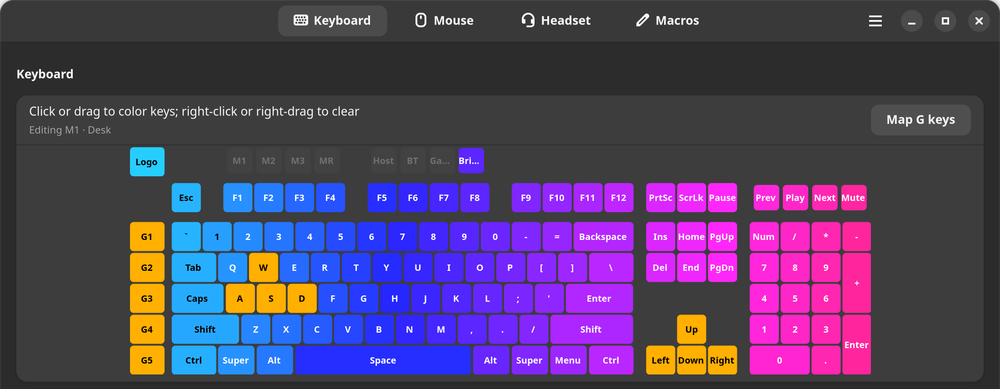
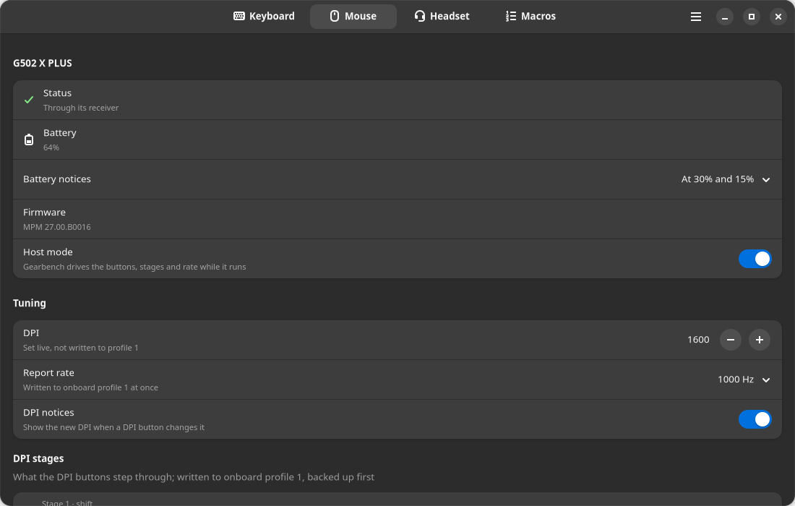
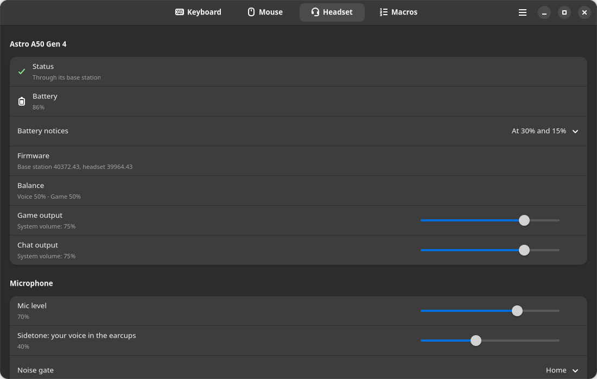
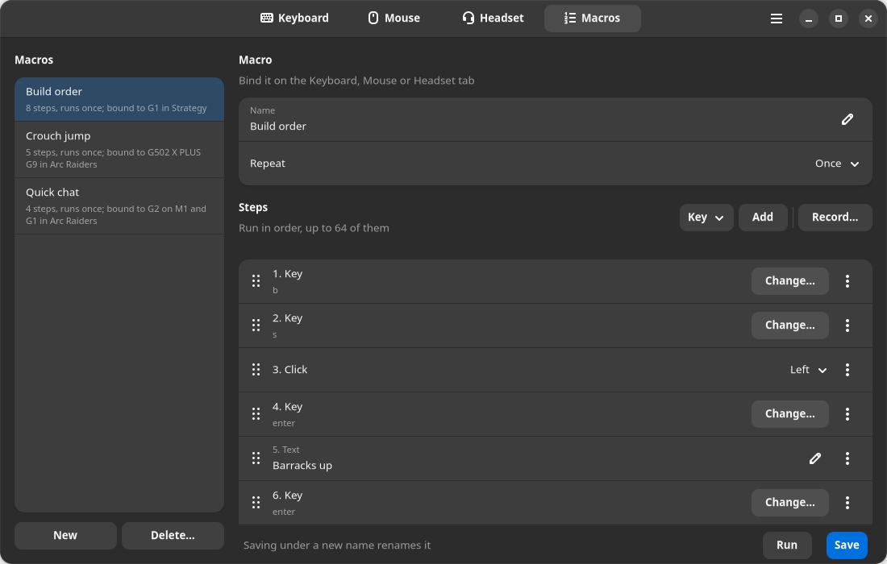
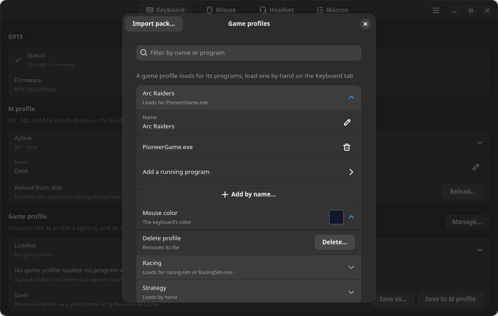

<div align="center">


# Gearbench

</div>

Gearbench is an open-source Linux app for Logitech G keyboards, mice and
headsets. It imports your G HUB profiles, bindings and macros from a copy of
G HUB's settings file. The keyboards and mice get per-key lighting, G keys,
macros, DPI stages, game profiles and a G-Shift layer, used while you hold
MR, or a G key or mouse button you bind to G-Shift. The headsets get
equalizers, spatial sound and outputs of their own for games, voice chat and
music.

<div align="center">

**[Install](#install)** ·
[Download](https://github.com/gearbench/gearbench/releases/latest) ·
[Supported devices](#supported-devices) · [User guide](docs/GUIDE.md) ·
[Moving from G HUB](docs/GUIDE.md#moving-from-g-hub) ·
[Troubleshooting](docs/GUIDE.md#troubleshooting)



[Keyboard](docs/GUIDE.md#the-keyboard): keys painted by click or drag, G keys and M profiles

</div>

It is made for Ubuntu 26.04 with GNOME 50 on Wayland and has also run on
[Fedora 44, Arch Linux and CachyOS](docs/GUIDE.md#systems-and-desktops),
tested there with a mouse and a headset but no keyboard. It is
[tested on the hardware](docs/GUIDE.md#the-models-and-their-ids) on the G915,
G515 TKL and G915 X LIGHTSPEED keyboards, the G502 X PLUS, G502 HERO and G305
mice, and the Astro A50 Gen 4, Astro A50 X, G432 and G933 headsets.
[Forty more models](#supported-devices) are built and wait for their first
test on the hardware.

Gearbench needs no online account and sends nothing over the network. Its
daemon runs as you, not as root, and the window and `gearbench-ctl` reach it
through a socket in your runtime folder. It opens a web page in your browser
only when you click a link to one: the Device report button of a model not
yet tested, or the website and license links in About Gearbench.

<div align="center">

|  |  |
| :---: | :---: |
| [Mouse](docs/GUIDE.md#the-mouse): DPI stages and the report rate | [Headset](docs/GUIDE.md#the-headset): the A50 Gen 4's Game output and Chat output, microphone and sidetone |
|  |  |
| [Macros](docs/GUIDE.md#macros): keys, text, clicks and delays, added or recorded | [Game profiles](docs/GUIDE.md#game-profiles): lighting and bindings that load for their game |

</div>

## Supported devices

Gearbench attaches to these models by their product ids, and to no other.
It drives no device over Bluetooth. Several mice and several keyboards can be
attached at once. One keyboard leads: the others show its lighting unless
set to keep their own, and a mouse's or a headset's lights can follow it.

The Tested on the hardware column says Yes for a model Gearbench has run on,
and the row names what is not tested on it yet. The models marked No were
built without one on hand, from published sources, G HUB's files and, for
some, their firmware.

Until a model is tested on the hardware, its tab, the journal and the
`gearbench-ctl` command ask for a device report from it.
[Your device isn't supported yet?](#your-device-isnt-supported-yet) says how
to make one. [The models and their ids](docs/GUIDE.md#the-models-and-their-ids)
lists each model's ids, what it was built from and what is not tested on it
yet.

### Keyboards

Gearbench writes nothing to the onboard memory of the G915 TKL or the G815.
The PRO X TKL LIGHTSPEED may store the brightness Gearbench sets, as a G515
does; nothing else is written to its onboard memory.

| Device | Tested on the hardware | What Gearbench drives |
| --- | --- | --- |
| G915 (cable or receiver) | Yes | G1 to G5, M1 to M3, MR, per-key lighting, animations, brightness, battery |
| G515 TKL (cable) | Yes | per-key lighting, animations, brightness, FN keys lit while FN is held, Game Mode's state; F1 to F12 bind after they are tested on the model |
| G515 LIGHTSPEED TKL (cable or receiver) | No | per-key lighting, animations, brightness, FN keys lit while FN is held, battery, Game Mode's state; F1 to F12 bind after they are tested on the model |
| G915 TKL and G913 TKL (cable or receiver) | No | F1 to F12 as G keys, M1 to M3, MR, per-key lighting, animations, brightness, battery |
| G815 and G813 (cable) | No | G1 to G5, M1 to M3, MR, per-key lighting, animations, brightness |
| PRO X TKL LIGHTSPEED (cable or receiver) | No | F1 to F12 as G keys, per-key lighting, animations, brightness, battery |
| G915 X (cable) | No | per-key lighting, animations, brightness, FN keys lit while FN is held, Game Mode's state; G1 to G9 bind after they are tested on the model |
| G915 X LIGHTSPEED (cable or receiver) | Yes | G1 to G9, per-key lighting, animations, brightness, FN keys lit while FN is held, battery, Game Mode's state; wave's six directions are not tested on it yet |
| G915 X LIGHTSPEED TKL (cable or receiver) | No | per-key lighting, animations, brightness, FN keys lit while FN is held, battery, Game Mode's state; F1 to F12 bind after they are tested on the model |
| G316 X and G316 X 98 (cable) | No | per-key lighting, animations, brightness, FN keys lit while FN is held, Game Mode's state; F1 to F12 bind after they are tested on the model; the light bar is not drawn on the tab |
| G512 X 75 and G512 X 98 (cable) | No | per-key lighting, animations, brightness, FN keys lit while FN is held, Game Mode's state; F1 to F12 bind after they are tested on the model; the analog keys are not set yet, and the light bar is not drawn on the tab |
| G213 Prodigy (cable) | No | lighting in five areas, a color each, animations |

### Mice

Gearbench writes nothing to the onboard memory of the mice marked No. On
those it drives the buttons and sets the report rate live, in
[host mode](docs/GUIDE.md#host-mode), the default, where the mouse runs no
onboard profile. Before each write to a mouse's onboard profile 1,
Gearbench backs up the mouse's onboard profiles. Restore profile backup… on
the Mouse tab writes the newest backup back
([The onboard profile and its backups](docs/GUIDE.md#the-onboard-profile-and-its-backups)).

| Device | Tested on the hardware | What Gearbench drives |
| --- | --- | --- |
| G502 X PLUS (cable or receiver) | Yes | G4 to G9, DPI stages, report rate, lighting, battery |
| G305 (receiver) | Yes | DPI stages and its DPI button, report rate, a coarse battery level |
| G502 HERO (cable) | Yes | G4 to G9, DPI stages, report rate, lighting; not yet tested: G4 to G9, the DPI stage write in host mode, and every other write to its onboard memory, the report rate included |
| G502 X LIGHTSPEED (cable or receiver) | No | G4 to G9, DPI, report rate, battery |
| PRO X SUPERLIGHT (cable or receiver) | No | G4 and G5, DPI, report rate, battery |
| G502 X (cable) | No | G4 to G9, DPI, report rate |
| G502 X PLUS MILLENNIUM FALCON (cable or receiver) | No | G4 to G9, DPI, report rate, lighting, battery |
| G502 LIGHTSPEED (cable or receiver) | No | G4 to G9, DPI, report rate, lighting, battery |
| PRO WIRELESS (cable or receiver) | No | G4 to G8, DPI, report rate, lighting, battery |
| G903 LIGHTSPEED HERO (cable or receiver) | No | G4 to G9, DPI, report rate, lighting, battery |
| PRO X SUPERLIGHT 2 and PRO X SUPERLIGHT 2 SE (cable or receiver) | No | G4 and G5, DPI and report rate in host mode alone, battery |
| PRO X SUPERLIGHT 2 DEX (cable or receiver) | No | G4 and G5, DPI and report rate in host mode alone, battery |
| PRO X SUPERLIGHT 2c (cable or receiver) | No | G4 and G5, DPI and report rate in host mode alone, battery |
| PRO X2 SUPERSTRIKE (cable or receiver) | No | G4 and G5, DPI and report rate in host mode alone, battery; its analog button settings are not set yet |
| G203 LIGHTSYNC and G102 LIGHTSYNC (cable) | No | G4 to G6, DPI, report rate, lighting |

### Headsets

Gearbench reads the A50 Gen 5, PRO X 2 LIGHTSPEED, G522 LIGHTSPEED and G325
LIGHTSPEED but changes nothing on them until each change is tested.

| Device | Tested on the hardware | What Gearbench drives |
| --- | --- | --- |
| Astro A50 Gen 4 (base station on USB, its switch on PC) | Yes | microphone and its noise suppression, equalizer presets, base station settings, the base station's Game and Chat outputs and their volume, spatial sound, battery; some features not yet tested, named in [The models and their ids](docs/GUIDE.md#the-models-and-their-ids) |
| G432 (USB adapter) | Yes | sidetone, a ten-band equalizer, microphone noise suppression, spatial sound; some features not yet tested, named in [The models and their ids](docs/GUIDE.md#the-models-and-their-ids) |
| G431 and G433 (USB adapter) | No | sidetone, a ten-band equalizer, microphone noise suppression, spatial sound |
| G633 and G635 (cable) | No | sidetone, lights, the G633's equalizer in the headset and its presets, the G635's ten-band equalizer, G1 to G3, microphone noise suppression, spatial sound |
| G533 (receiver) | No | sidetone, battery, a ten-band equalizer, microphone noise suppression, spatial sound |
| G535 (receiver) | No | sidetone, battery, a ten-band equalizer, microphone noise suppression, spatial sound |
| G733 (receiver) | No | sidetone, battery, lights, a ten-band equalizer, microphone noise suppression, spatial sound |
| G933 (receiver) | Yes | sidetone, battery, lights, the equalizer in the headset and its presets, G1 to G3, microphone noise suppression, spatial sound; its lights following the keyboard not yet tested |
| G935 (receiver) | No | sidetone, battery, lights, the equalizer in the headset and its presets, G1 to G3, microphone noise suppression, spatial sound |
| PRO X Wireless (receiver) | No | sidetone, battery, a ten-band equalizer, microphone noise suppression, spatial sound |
| Astro A50 X (base station on USB) | Yes | battery, sidetone, volume, Game and Voice balance, noise gate, auto sleep, tones, the stream mix, the microphone's boom, the base station's deep sleep and brightness, and the headset's two equalizers, their presets and presets of your own<br>the base station's Game and Chat outputs and their volume, microphone noise suppression, spatial sound; some features not yet tested, named in [The models and their ids](docs/GUIDE.md#the-models-and-their-ids) |
| Astro A50 Gen 5 (base station on USB) | No | read-only until tested: battery, sidetone, volume, Game and Voice balance, noise gate, auto sleep, tones, the stream mix, the microphone's boom, the base station's brightness and the headset's two equalizers; microphone noise suppression, spatial sound |
| PRO X 2 LIGHTSPEED (receiver) | No | read-only until tested: battery, sidetone, auto sleep, microphone noise suppression and the equalizer in the headset; spatial sound |
| G522 LIGHTSPEED (receiver or cable) | No | read-only until tested: battery, sidetone, auto sleep, eco mode and the equalizer in the headset; microphone noise suppression, spatial sound |
| G325 LIGHTSPEED (receiver) | No | read-only until tested: battery, sidetone, auto sleep, eco mode, microphone noise suppression and the equalizer in the headset; spatial sound |

Each headset's page in the Headset tab also sets its microphone's volume, the
level GNOME's Sound settings show for it. Every headset but the PRO X 2
LIGHTSPEED and the G325 LIGHTSPEED also has a Noise suppression switch, run
on the computer, and under it a 5-second test that plays your voice back.
Those two have their noise suppression in the headset, read-only on their
pages until tested. Every headset in the table also gets Gearbench Game, Chat
and Media, three outputs for games, voice chat and music. They are off until
you switch them on in its page's Outputs group, which also moves each program
to one of them ([Outputs](docs/GUIDE.md#outputs)).

Ten of the headsets are the rest of the G432's family: the G431, G433, G533,
G535, G633, G635, G733, G933, G935 and PRO X Wireless. Gearbench drives one
of these or the G432 at a time, and names any other plugged in. Of the
settings these headsets keep, Gearbench writes the sidetone. On the G933, the
one of them tested on the hardware, it also writes its auto shut-off time, its
startup effect and the lighting it shows on its own.

[Why and how we built it](docs/GUIDE.md#why-and-how-we-built-it) says how
Gearbench was built and tested.

## Install

Gearbench is made for Ubuntu 26.04 with GNOME 50 on Wayland. It has also
been tested on Fedora 44 and Arch Linux with GNOME and on CachyOS with KDE
Plasma, each on Wayland and installed both ways below. Those tests used a
G305 mouse and a G432 headset, but no keyboard. Under KDE Plasma, game
profiles follow only X11 windows, and while the screen is locked only a G, M
or MR key brings the keyboard's lights back. Other distributions and
desktops are not tested. Gearbench needs Python 3.14 and a kernel with
uinput, through which bindings and macros type.
[Systems and desktops](docs/GUIDE.md#systems-and-desktops) has the versions
tested and what changes on another desktop.

Install it one of two ways, a package or a git checkout, never both. Run no
other program that drives these devices alongside Gearbench: when two
programs have one device open, each reads the other's replies. When
Gearbench's service, the daemon, recognizes another program that drives
these devices, `gearbench-ctl status` and a banner in the window say so.

Gearbench runs as you, not as root, so both ways install udev rules that let
any program you run open each supported device and `/dev/uinput`. They also
add each supported mouse to the system's hardware database, so its pointer
moves at the DPI you set. The rules, that entry and the `gearbench` group
are all that needs root.

On the models below, a connection the rules open also carries what you type,
or the modifier keys you press, so a program you run can read them, what a
later account types included. Gearbench reads only FN, and the F keys it
types itself on the G915 TKL, G913 TKL and PRO X TKL LIGHTSPEED, and drops
the rest unread.

- What you type, on the G815, G813 and G213 Prodigy keyboards; through
  their receivers, on the G515 LIGHTSPEED TKL, PRO X TKL LIGHTSPEED, G915 X
  LIGHTSPEED and G915 X LIGHTSPEED TKL, and on Linux 7.3 or later the G915
  TKL and G913 TKL; on the G502 HERO, G502 X, G203 LIGHTSYNC and G102
  LIGHTSYNC mice; and on each mouse through its receiver.
- The modifier keys you press, on the G515 TKL, the G515 LIGHTSPEED TKL on
  its cable and the G915 X, G316 X and G512 X models: each press and release
  of Ctrl, Shift, Alt and Super, and of FN while its
  [custom assignments](docs/GUIDE.md#custom-assignments) are on, once a
  program asks the keyboard for them. Gearbench asks each time it sets the
  keyboard up. The keyboard keeps sending them until it loses power:
  switched off, or unplugged where it has no battery. A program can also
  set the keyboard's keys to come over that connection in place of typing,
  and read them there.

Through `/dev/uinput`, a program you run can also type, even into a later
account's session. On a computer several people use, limit the rules to one
group's accounts, as [The udev rules](docs/GUIDE.md#the-udev-rules) says; it
also names each such connection.

To install a package:

1. Download the one for your system from the
   [Releases page](https://github.com/gearbench/gearbench/releases):
   `gearbench_X.Y.Z_all.deb` for Ubuntu, `gearbench-X.Y.Z-1.fc44.noarch.rpm`
   for Fedora, or `gearbench-X.Y.Z-1-any.pkg.tar.zst` for Arch and CachyOS.
2. In a terminal, in the folder you saved it to, run the lines for your
   system. apt and dnf pull in what it needs. On Ubuntu:

   ```
   sudo apt install ./gearbench_*_all.deb
   ```

   On Fedora:

   ```
   sudo dnf install ./gearbench-*.noarch.rpm
   ```

   On Arch and CachyOS, the first line installs what the window and the
   headsets' sound need:

   ```
   sudo pacman -S --needed gtk4 libadwaita pipewire-audio
   sudo pacman -U ./gearbench-*-any.pkg.tar.zst
   ```

To install from a git checkout, clone it into a folder only you can write,
such as your home folder: the daemon runs the checkout's code as you. The
window needs GTK 4 and libadwaita for Python from the distribution, never
from pip: on Ubuntu `python3-gi`, `gir1.2-gtk-4.0` and `gir1.2-adw-1`
([GTK and python3-gi](docs/GUIDE.md#gtk-and-python3-gi) names Fedora's and
Arch's). Without them, `install.sh` installs the daemon and the command line
without the window, and names the packages to install before you run it
again.
Run `install.sh` as yourself, not with `sudo`. It asks for your password to
install the udev rules, the mice's hardware database entry and the
`gearbench` group:

```
git clone https://github.com/gearbench/gearbench.git
cd gearbench
./install.sh
```

Either way, the daemon starts as soon as the install ends, in your desktop
session, and at each graphical login after that. Then, under GNOME, log out
of every session and back in once: GNOME loads the Gearbench focus extension
only at a login. The extension lets game profiles follow every window. After
a package install, the Turn on button in the window's banner then enables it.

Next, follow [First-time setup](docs/GUIDE.md#first-time-setup). In it,
`gearbench-ctl status` shows what the daemon found and says `none` under
`problems` when nothing is wrong. The window opens as Gearbench from your
applications and, with a keyboard, a key lights at a click.
[Install in detail](docs/GUIDE.md#install-in-detail) has what each way installs
and where, how to build the packages and what the window needs.
[Upgrading and removing](docs/GUIDE.md#upgrading-and-removing) covers a new
version and taking Gearbench off. If something does not work,
[Troubleshooting](docs/GUIDE.md#troubleshooting) says what to gather and where
to report it.

## Your device isn't supported yet?

A device report is how support for a device gets built and fixed: it shows
what works and what to fix. Send one from a Logitech keyboard, mouse or
headset that [Supported devices](#supported-devices) leaves out or marks No,
or from a listed one that misbehaves.

`gearbench-ctl report` writes nothing to any device: it reads what each
Logitech device on USB says about itself. For a model Gearbench already
drives, it then checks the device's answers against what Gearbench assumes
about that model: the features Gearbench counts on it having, a keyboard's
lighting zones and the battery. It says which assumptions the answers
confirm and which they do not. The block it prints holds no serial
number, no folder and no name for you, your computer or the unit, and
nothing from the part of a mouse's memory that can hold your macros.

With Gearbench installed:

1. Plug the device in over USB.
2. Run this in a terminal:

   ```
   gearbench-ctl report
   ```

   While the Gearbench daemon runs, the report gives only what Gearbench
   already knows of a device it drives, and reads no other device Gearbench
   supports: the daemon opens those as it looks for them. For the full read,
   the report says how to stop the daemon and how to start it again.
3. If the report prints a `sudo setfacl` command, your account has no
   permission to open that device. The command lets your account open that
   one device until you unplug it, and installs nothing. Some devices send
   what is typed over that same connection, keyboards among them and mice
   that send the keystrokes of a button bound to a key. For those, the
   report warns that any program you run could read what is typed on the
   device until you unplug it. Run the command, then run the report again.
4. Paste the block into a
   [device report](https://github.com/gearbench/gearbench/issues/new?template=device-report.yml),
   with the model in the title. The form also asks how it was plugged in.
5. If you ran the `sudo setfacl` command, unplug the device once the report
   is done; that ends the access.

[Reporting a device](docs/GUIDE.md#reporting-a-device) has what the report asks
each device and its `--json` form. Report a security problem privately
instead, as [SECURITY.md](SECURITY.md) says.

## License

GPL-3.0-or-later; the full text is in [LICENSE](LICENSE). The head
measurements in `spatial/sadie-ii/` are SADIE II's, from the University of
York, under Apache-2.0 ([spatial/sadie-ii/LICENSE.txt](spatial/sadie-ii/LICENSE.txt)).
[spatial/README.md](spatial/README.md) has their attribution and where they
came from. The AppStream metadata,
`desktop/io.github.gearbench.Gearbench.metainfo.xml`, is under CC0-1.0. The
icons in `gearbench/gui/icons/` are the GNOME Project's, from its Adwaita
icon theme, under LGPL-3 or CC-BY-SA-3.0-US; `COPYING` beside them has the
theme's own words and says what Gearbench changed.

## Trademarks

Gearbench is an independent project, not affiliated with or endorsed by
Logitech. Logitech, Logitech G, LIGHTSPEED, G HUB and ASTRO are trademarks of
Logitech. Dolby is a trademark of Dolby Laboratories.
