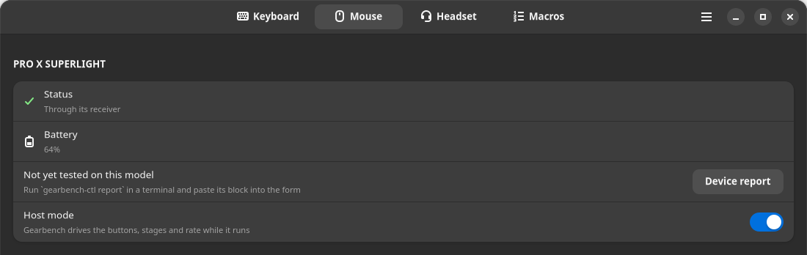
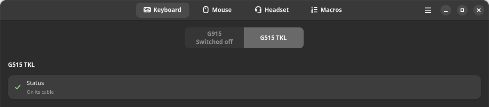
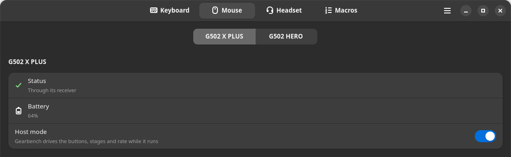
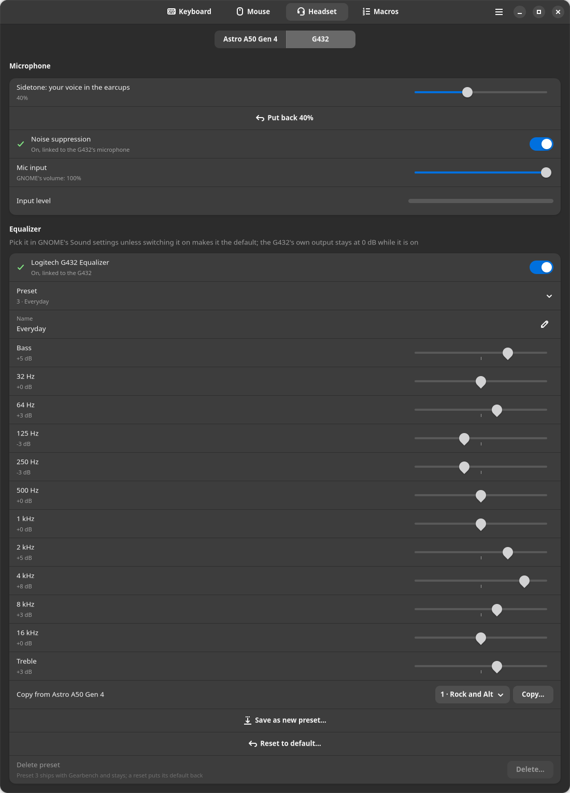
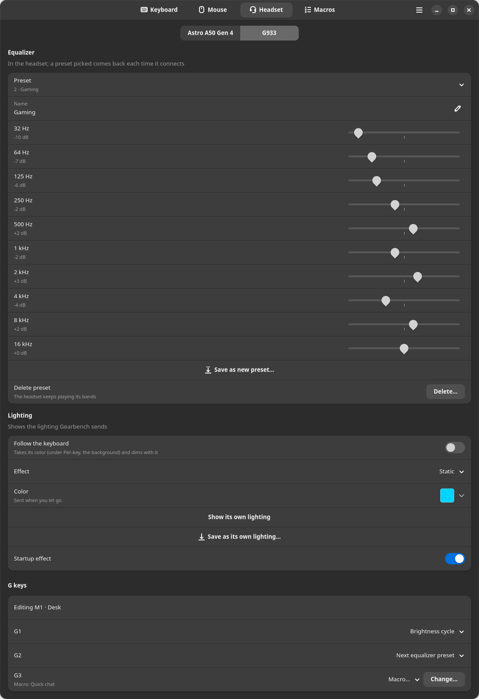
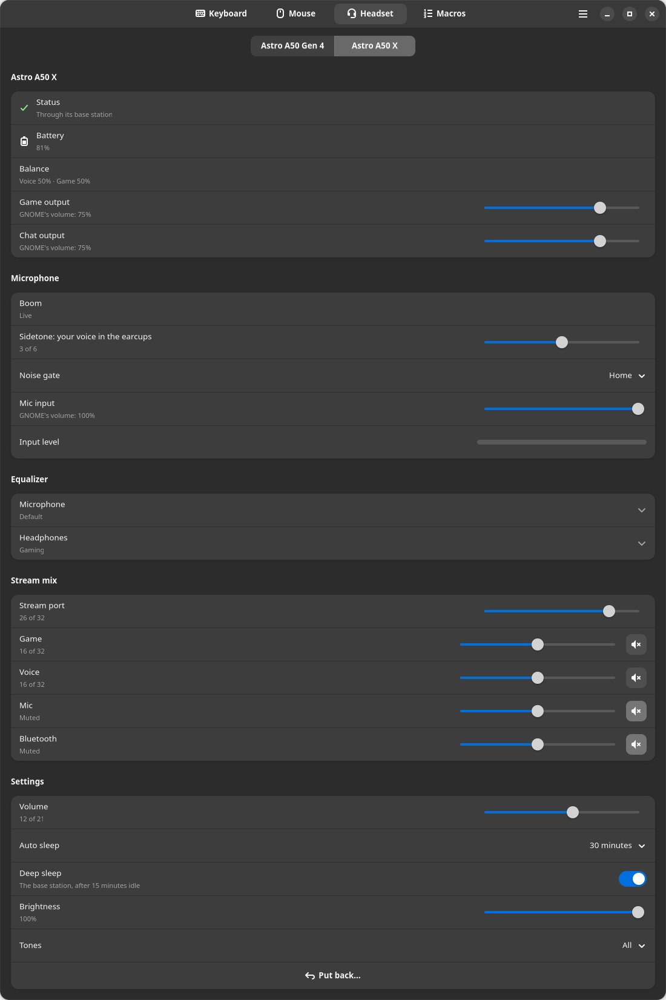
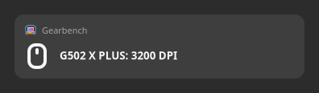
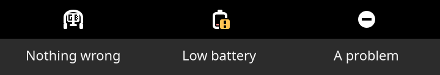
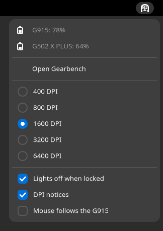

# Gearbench user guide

This guide covers installing Gearbench, every control in the window and
every `gearbench-ctl` command. The README lists the devices Gearbench drives,
the two ways to install it and how to ask for a device it does not drive yet.
`man gearbench-ctl` has every option; from a checkout,
`man ./man/gearbench-ctl.1`.

Just installed: start with [First-time setup](#first-time-setup). Coming
from Windows and G HUB: [Moving from G HUB](#moving-from-g-hub). Looking for
your model: [The models and their ids](#the-models-and-their-ids) names the
section that covers it.

The daemon runs as your user service, `gearbench.service`, and owns the
devices. The window and the command line, `gearbench-ctl`, send it requests
over its control socket. This guide calls the service the daemon, as
`gearbench-ctl` and the window's messages do.

The sections:

- [First-time setup](#first-time-setup): the steps after an install.
- [Moving from G HUB](#moving-from-g-hub): G HUB's profiles, bindings and
  macros, read from its settings database copied over from Windows.
- [The window](#the-window): the four tabs, the main menu and the banners
  that say what is wrong and what to do.
- [The keyboard](#the-keyboard): three M profiles, G keys and the MR layer,
  Static, Per-key and the keyboard's animations, keys painted by click or
  drag, brightness, FN keys lit while FN is held on the G515 and its newer
  relatives (the G915 X, G316 X and G512 X models) and more than one keyboard
  at once.
- [Keyboard models](#keyboard-models): the G515s, the G915 TKL, the G815, the
  PRO X TKL LIGHTSPEED, the G515's newer relatives and the G213 Prodigy, what
  each does and lacks.
- [Game profiles](#game-profiles): lighting and bindings that load while
  their game has focus, a Proton game's by its Windows `.exe`; a pack with
  per-key lighting for 67 games and 10 macros.
- [Macros](#macros): up to 64 steps of keys, text, clicks and delays, added
  one by one or recorded, played once, while held or as a toggle.
- [The mouse](#the-mouse): the buttons G4 to G9, DPI and its one to five
  stages, host mode, the report rate, following the keyboard's color and
  onboard profile 1 with its backups.
- [Mouse models](#mouse-models): the G502 HERO and the mice built without
  one on hand, what each does and lacks.
- [The headset](#the-headset): the Headset tab's pages and the Mic input and
  Input level rows on each; the Astro A50 Gen 4's microphone, equalizer
  presets, base station and its Game and Chat outputs.
- [The Logitech G432](#the-logitech-g432): the G432's sidetone, equalizer
  and noise suppression, and its ten relatives: the G431, G433, G533, G535,
  G633, G635, G733, G933, G935 and PRO X Wireless.
- [The Astro A50 X and A50 Gen 5](#the-astro-a50-x-and-a50-gen-5): their
  battery, settings and equalizers, read on both and changed on the A50 X.
- [The PRO X 2, G522 and G325 LIGHTSPEED](#the-pro-x-2-g522-and-g325-lightspeed):
  their battery, settings and equalizer through their receiver, read now and
  changed once tested; the PRO X 2's equalizer is only read.
- [Spatial sound](#spatial-sound): Gearbench Spatial, a 7.1 output that
  renders a game's surround channels for headphones with a measured head
  from the SADIE II set.
- [Idle, lock and suspend](#idle-lock-and-suspend): the keyboard dims a
  minute after the last keypress and goes dark five minutes later, times you
  can change; by default its lights also go off while the screen is locked or
  blank.
- [Battery and DPI notices](#battery-and-dpi-notices): a low battery under
  30% and again under 15%, the new DPI when a DPI button steps it and a
  keyboard's custom assignments turned off or on.
- [The tray icon](#the-tray-icon): a menu in the top bar with the
  batteries, the DPI stages, the game profiles and the switches.
- [The command line](#the-command-line): every subcommand, by group.
- [Settings files](#settings-files): what Gearbench keeps in
  `~/.config/gearbench/` and editing it by hand.
- [Install in detail](#install-in-detail), [The udev rules](#the-udev-rules)
  and [Upgrading and removing](#upgrading-and-removing): putting Gearbench on
  a machine; what its rules grant and to whom; moving to a new version or
  taking it off.
- [The models and their ids](#the-models-and-their-ids): each model's ids
  and what it was built from; which models were tested on the hardware, in
  full or in part; what Gearbench writes to a model not yet tested.
- [Troubleshooting](#troubleshooting): what you see and where its fix is,
  what to gather and where to report a problem, a security problem privately
  included.
- [Reporting a device](#reporting-a-device): the report from a model not yet
  tested or not listed, what it reads and what it leaves out.
- [Why and how we built it](#why-and-how-we-built-it): how the project came
  about.

## First-time setup

The install started Gearbench's service, the daemon, in your desktop
session. From then on it starts with each graphical login and stops at
logout, which hands the keyboard back to its onboard profile. These steps
check it, light a key, bring over your G HUB setup and bind your G keys.

1. Run `gearbench-ctl status`. It lists the keyboard, each mouse and each
   headset the daemon found, with its connection. Under `problems` it says
   `none`, or lists anything wrong, a line each. If the daemon was stopped,
   `systemctl --user start gearbench` starts it. If `problems` lists
   `no virtual keyboard`, see [No virtual keyboard](#no-virtual-keyboard) under "Troubleshooting".
2. Open the window: Gearbench in the app grid, or `gearbench-ctl gui`. It
   opens on the Keyboard tab.
3. With a keyboard, set the Keyboard tab's Effect to Per-key (Per-area on a
   G213 Prodigy) and click a key on the drawn keyboard: it lights at once
   (see [Painting keys](#painting-keys)).
4. If you come from Windows, choose Import from G HUB… in the window's main
   menu to bring over G HUB's profiles, bindings and macros (see [Moving from
   G HUB](#moving-from-g-hub)). Do it before you bind G keys by hand. Nothing undoes its desktop
   default, if you check it: it replaces the G keys, MR layer and mouse
   buttons of M1 to M3, and a G915's lighting if the default has any.
5. Bind the G keys, which ship unbound. On the Keyboard tab, turn on Bind G
   keys and click a G key (see [G keys and the MR layer](#g-keys-and-the-mr-layer)), or run
   `gearbench-ctl bind G1 f15`.
6. On a G502 X PLUS, G4 to G9 need your account in the `gearbench` group
   while host mode is off or did not take (see [Host mode](#host-mode)). With the
   package, run `sudo usermod -aG gearbench $USER` before you log out. From a
   checkout, `install.sh` has done it. If lingering is on for your account
   (`loginctl show-user $USER -p Linger` says `Linger=yes`), the daemon gets
   the group only when the machine restarts.
7. Log out of every session and back in, so GNOME Shell loads the Gearbench
   focus extension. The extension tells the daemon which window has focus.
   With the package, the window (step 2) then shows a banner: press its Turn
   on to enable the extension. From a checkout, `install.sh` has enabled it
   already. Until the extension runs, game profiles follow only X11 windows,
   which include a Proton game's unless it runs Wine's Wayland driver. Once
   it runs, the `focus:` line of `gearbench-ctl status` names the program you
   are in (see [Following the game in front](#following-the-game-in-front)).

### For your device

- On a G502 X PLUS, G4 to G9 work at once while Gearbench runs. Then give
  the mouse one of these two writes; each G502 X PLUS needs its own.
  Gearbench backs up every profile sector first (see [The onboard profile
  and its backups](#the-onboard-profile-and-its-backups)).
  - With host mode on, the default, write the fallback once: choose Write
    fallback… under Onboard profile 1 on the Mouse tab, or run
    `gearbench-ctl mouse-fallback-buttons`. Without Gearbench, at the login
    screen or on another computer, the fallback gives G4 to G8 their factory
    jobs: back, forward, the DPI shift and the two DPI steps. G9 then does
    nothing, though from the factory it cycles the onboard profiles.
  - With host mode turned off, run Enable… (or
    `gearbench-ctl mouse-enable-buttons`) instead, so G4 to G9 reach
    Gearbench. Without Gearbench they then do nothing, G4 and G5 included
    (see [The buttons, G4 to G9](#the-buttons-g4-to-g9)).
- The G305 needs nothing. For any other mouse, see [Mouse models](#mouse-models) for its
  section.
- For the Astro A50 Gen 4, set the base station's switch to PC. With
  Gearbench's audio profile, GNOME's Sound settings list two outputs, Astro
  A50 Game and Astro A50 Chat, and one microphone, Astro A50 Chat. Games go
  on Game and voice chat on Chat: in your voice chat program's own settings,
  set its output to Astro A50 Chat. Game becomes the default output unless
  another output was chosen before; if Chat was, pick Astro A50 Game in Sound
  settings (see [Game and Chat](#game-and-chat)). For any other headset, see its section,
  from "The Logitech G432" on.
- For lighting made for a game, in the Game profiles dialog, choose Import
  pack… at its top left: per-key lighting for 67 games and 10 macros,
  imported only as you choose (see [The profiles and macros pack](#the-profiles-and-macros-pack)).

## Moving from G HUB

G HUB has no per-profile export. It keeps every profile, binding and macro in
one SQLite database on Windows, `%LOCALAPPDATA%\LGHUB\settings.db`: on most
machines, `C:\Users\<you>\AppData\Local\LGHUB\settings.db`. A
`settings.db-wal` beside it, if there is one, holds your newest changes.

1. On Windows, quit G HUB from its tray icon, so nothing is writing the
   files.
2. Copy `settings.db`, and `settings.db-wal` if there is one, into one
   folder that Linux can read.
3. If you will import G HUB's desktop default, copy
   `~/.config/gearbench/config.json` first in case you want your own M
   profiles back. The desktop default replaces the G keys, MR layer and mouse
   buttons of your M1 to M3, and a G915's lighting if it has any; nothing
   undoes it.
4. On Linux, in the window's main menu, choose Import from G HUB… and pick
   `settings.db`, or run `gearbench-ctl import-ghub settings.db --list`. The
   daemon writes each file, so it must be running.

The window lists the G HUB profiles found, each with a check box, its G keys,
mouse buttons and lighting and the macros it uses. Nothing is written until
you press Import on the review page that follows, which lists what will be
written. Gearbench reads the database from a private copy and never writes
it.

Each profile is named by its application. Where G HUB has more than one
profile for an application, a profile with a name of its own is named by
both, as "Apex Legends: Ranked". `--profile` takes these names. Under each
macro is each of its steps, a line each, named as the macro editor names
them. The review page, `import-ghub --list` and `--dry-run` list them too. In
the list, a row under a profile that runs past 2,000 lines or 50,000
characters, as Macros can, shows its first lines and how many more there
are. The review page still shows every step. A filter narrows the list, and
Select all and Select none act on the profiles the filter shows.

### What comes over

- Each G HUB profile becomes a game profile: its per-key lighting (the keys
  G HUB left out stay dark), the G keys of its M1 bank, its G-Shift layer as
  the MR layer and the buttons of each mouse G HUB has. A G915 TKL's G1 to
  G12 come over as its F1 to F12, beside the G915's G1 to G5, and a PRO X
  TKL's as PROXTKL-F1 to PROXTKL-F12. A G815's G1 to G5 come over as the
  G915's would. Where both keyboards hold different bindings of yours on one
  key, the G915's comes over and Not imported lists the G815's. No G HUB
  file with a G915 TKL, a G815 or a PRO X TKL in it has been tested yet.
- A binding of one key and its modifiers becomes a plain binding. A sequence
  becomes a Gearbench macro, with G HUB's delays as delay steps; "Repeat
  while holding" becomes `while_held` and "Toggle" becomes `toggle`. Only
  the macros the chosen profiles use come over.
- Where you added the program to G HUB yourself, the profile can load for
  its `.exe`, but only when you ask. Check Load for, the first line under
  the profile once you open it in the list, or give `import-ghub`
  `--with-programs`, which takes the programs of every imported profile that
  G HUB names programs for. Otherwise the profile loads by hand, or, if it
  replaces a game profile of yours, keeps that profile's programs. Names
  match with `.exe` optional: a profile for `firefox.exe` also loads for a
  Linux program named `firefox`. So a file from someone else could name a
  program you run every day. The list's Notes line and the review page say
  which way each profile loads. A game G HUB recognizes by itself carries no
  program name, so its profile loads by hand until you add one. Under Proton
  the process can have another name, which `gearbench-ctl apps` shows while
  the game runs. At most 64 programs come over per profile, each at most 255
  bytes; Not imported says when a profile had more or a longer one.
  When the programs come over, a program a game profile of yours already
  loads for stays with yours, and the import comes without it. Two names are
  one program when one running game would load both profiles. Linux keeps a
  program's first 15 bytes as its process name, so under Proton
  `Warhammer 40000 Space Marine 2.exe` and
  `Warhammer 40000 Space Marine 2 - Retail.exe` are one. When two chosen
  G HUB profiles would load for one program, as two profiles of one
  application do, the program goes to the one G HUB had active for that
  application, else to the first in the list. The other comes without it.
  In both cases the review page and the command line say which.
- The desktop's default profile comes over only when you check it or name
  it with `--profile Desktop`. Nothing undoes it: copy
  `~/.config/gearbench/config.json` first if you may want back what it
  changes (step 3). It replaces the G keys and MR layer of your M1, M2 and
  M3 with its three banks. It gives all three its mouse buttons, for each
  mouse G HUB has buttons for, and its lighting on a G915 if it has any.
  Your other mice keep their bindings, and other keyboards keep their
  lighting. A G915 TKL or PRO X TKL keeps its F1 to F12 unless the desktop
  default has that keyboard. Keys of another model bound under names of
  their own, such as G515-F1 or G933-G1, keep yours.

### What does not come over

The list and `import-ghub --list` name what does not come over, including:

- a macro that acts when its key is released
- G HUB's actions (OBS, audio presets and the like)
- the wheel tilt and the mouse's G-Shift layer
- a G key disabled on the G-Shift layer alone (with MR held it sends its
  binding)
- a game profile's M2 and M3 banks
- lighting other than a per-key layout
- other devices, 20 by name and then how many more

Gearbench drops control characters from G HUB's names. A line or paragraph
separator (U+2028, U+2029) and a character that turns the direction of the
text after it (U+202A to U+202E, U+2066 to U+2069) show as U+FFFD.
Application, profile and card names are cut at 256 characters, and Not
imported lists each cut.

### Files and their limits

Gearbench reads `settings.db`, or a JSON file holding the same document. Each
file must be a regular file or a link to one, of at most 64 MiB for
`settings.db` and `settings.db-wal` and 16 MiB for a JSON file.
`settings.db-wal` must belong to the account that owns the `settings.db`
beside it; where `settings.db` is a link, the account that owns the link
itself. The settings the database holds must fit in 16 MiB too. A card is
what G HUB puts on a key, a button or a profile, such as a keystroke, a
macro or the profile's lighting. Gearbench refuses a file with more than
10,000 profiles or more than 10,000 cards. It stops SQLite's read of a
database after 10 s, or once SQLite holds 256 MiB of memory. Each refusal
names the file, and a size or count refusal names its cap.

### Names Gearbench already has

A G HUB game profile counts as already there when Gearbench has a game
profile of the same name with the same G keys, MR layer, mouse buttons,
lighting and macros. The review page and the command line say so in one
line, and nothing is written for it. Programs are not compared. Names match
in any case, with punctuation and symbols counted as spaces: "Apex: Legends"
is "apex legends". A name with no letter or digit keeps its symbols. Keys
match in any case. Modifiers side by side before a binding's last key match
in any order: `shift+ctrl+q` is `ctrl+shift+q`, but `shift+ctrl` is not
`ctrl+shift`, whose last keys differ. The keys go down in the order the
binding names them, so `a+ctrl+b` is not `ctrl+a+b`. A macro with the same
steps and repeat mode under another name is the same macro.

Gearbench asks about any other name it already has, with three answers:

- Keep both, the window's default, imports it under a new name such as
  "Apex Legends (2)". A game profile kept beside yours loads by hand, so it
  does not take its program over from yours.
- Replace writes over yours. A game profile still keeps its own DPI stages,
  report rate and mouse color, and its lighting on keyboards other than the
  G915. With Load for or `--with-programs` it takes the import's programs,
  where G HUB names any. Otherwise it keeps yours, and the review page and
  `--dry-run` say so, or say that it loads by hand when yours has none. The
  list's Notes line, written before you answer, still says it loads by hand.
- Keep mine leaves it out, as the pack's Keep mine does. Keep mine for a
  macro keeps yours, and the imported bindings use it.

Gearbench does not ask about a macro when yours of that name has the same
steps and repeat mode: the imported bindings use yours, and nothing is
written for it. Nor does it ask when the steps or repeat mode differ but a
game profile already there binds yours of that name. The imported macro then
comes in under a new name, so that profile keeps playing yours. Two imported
macros of one name are asked about once at most and are never both written
under it: the second, if written, comes in under a new name.

### A macro that could not be saved

If a macro could not be saved, Gearbench does not write a game profile, or
an M profile of yours from the desktop default, that binds it. Its key would
run your own macro of that name, or none. The window and the command line
list it, and the command line exits 1. When the daemon gave no answer to the
macro's save, as when it was busy for more than 10 seconds, the window says
it may not have been saved. The daemon can still save the macro once it gets
to it. The command line waits 3 seconds for each answer. At a request that
gets none it stops, sends nothing after it and exits 2. After any error the
command line prints what it wrote and the errors, and leaves out its lines
on what became of a name or a program.

### From the command line

```
gearbench-ctl import-ghub settings.db --list                  what the file holds
gearbench-ctl import-ghub settings.db --all --dry-run         what importing every game profile would write
gearbench-ctl import-ghub settings.db --profile "Apex Legends" --profile Desktop
gearbench-ctl import-ghub settings.db --all --on-clash keep-both   keep both wherever a name is taken
gearbench-ctl import-ghub settings.db --all --with-programs   each loads for the programs G HUB names for it
```

`--on-clash` takes `replace`, `keep-both` or `keep-mine`. It also takes
`keep` and `skip`, its words in Gearbench 1.1.0 for the last two. `--all` is
every game profile, never the desktop default. Without `--on-clash`, an
import or a dry run that meets a name Gearbench already has lists the names
and exits 1, writing nothing and showing no plan.

## The window


The four tabs at the top, the main menu at the top right.

Open the window with `gearbench-ctl gui`, from Gearbench in the app grid, or
with Open Gearbench in the tray icon's menu. It has four tabs, Keyboard,
Mouse, Headset and Macros, and always opens on the Keyboard tab.

The window shows the daemon's live state, so a change made with an M key or
with `gearbench-ctl` shows in it too. An M key, a program, the tray icon's
menu or `gearbench-ctl` can switch the profile before the window shows the
switch. The daemon refuses a change made in the window in that gap, since it
would land on a profile the window is not showing. A toast says where the
keyboard is now; when that is too long for a toast, it says That did not
work, with the sentence behind Details. The window moves to that profile.
While a game profile stays loaded, changes go to it. So after a switch of M
profile the daemon refuses only a rename and Save to M profile, the two
changes that go to the M profile.

While the window is on screen, focused or not, it reads the daemon's state
every 3 s, and the mouse's and the headset's every 5 s. It does not read
them while it is minimized, covered, on another workspace or behind the lock
screen. It asks the mouse itself only while the Mouse tab shows in the
active window, and the A50 Gen 4's base station only while the Headset tab
does. Otherwise it shows what the daemon last read. The daemon also reads
that base station every 5 s on its own (see [Status and battery](#status-and-battery)).

The main menu, at the top right, has six entries:

- Game profiles… opens the Game profiles dialog (see [Game profiles](#game-profiles)).
- Import from G HUB… brings over G HUB's profiles, bindings and macros (see
  [Moving from G HUB](#moving-from-g-hub)).
- Import pack… opens the profiles and macros pack, as the button of that
  name in the Game profiles dialog does (see [The profiles and macros pack](#the-profiles-and-macros-pack)).
- Reload from disk… reads the settings files again, as the Keyboard tab's
  row of that name does (see [Settings files](#settings-files)).
- Tray icon turns the tray icon on and off (see [The tray icon](#the-tray-icon)). The entry
  shows once the daemon has answered, since the switch is the daemon's
  setting. Turned on where the icon cannot show, a message says why, as
  `gearbench-ctl status` does.
- About Gearbench has a Troubleshooting page. Its Debugging Information row
  opens what a bug report needs, with Copy Text and Save As: the version,
  the daemon's `status` reply and its problems, whether you may open each
  device's hidraw node and `/dev/uinput`, what systemd and PipeWire say of
  spatial sound, and the daemon's last 30 journal lines, with your home
  folder written as `~`.

### The device tabs

A device tab shows only the controls the attached device has: a G305 gets
no lighting rows, no button rows and no Shift stage row.

Until the window has seen a device, its tab shows Looking for the keyboard…
(or the mouse, or the headset), then Keyboard not available (or Mouse, or
Headset) with the reason. The reasons include no device found, a device or
receiver that does not answer, a device found that could not be set up and
no permission to open its node. No permission means its udev rule is
missing or not applied, or another account or a text console has the seat.
While the daemon does not answer, the tab says Waiting for the daemon….
With the window on screen, a mouse can take up to about 40 s to appear after
you switch it on. Once the window has seen a device, the tab keeps its rows
after the device goes, until the window closes.

Once a device is seen, the tab's first group is named after it; before
that it has the tab's name. On every tab and headset page, the first group's
Status row has a green check mark while the device is there. It has a red
error sign and says why once the device is gone or while the daemon does not
answer; no message pops up for it. When a device the daemon has reached
stops answering, the row has an amber warning sign and says what to do:
press a key on the keyboard, move the mouse or switch it on. A device the
daemon has not reached, such as one switched off when its receiver was
plugged in or when the daemon started, shows the daemon's reason instead.
The keyboard's Status row then has an amber warning sign, and the mouse's a
red error sign, even with its receiver plugged in. The row says On its cable
or Through its receiver, with the `/dev/hidraw` node in its tooltip. A
headset's says On its cable, or Through its base station, its receiver or
its USB adapter. Before the first answer, a headset page's row says Looking
for the headset…, with a spinner where the sign goes.

A keyboard or mouse with a cable and a wireless receiver can be on either.
Gearbench finds out which, and the window shows only what the attached
device can do. With both plugged in, Gearbench drives the device on its
cable. Plug the cable in and the device moves to it as soon as the system
has set the cable up; pull it and the device goes back to its receiver once
it links there. Its settings and lighting go with it.

Some models were built without one on hand, and some of those, such as the
G815, the PRO WIRELESS or the G522 LIGHTSPEED, have not been tested on one
yet. For those, the first group also has a Not yet tested on this model row. A device report from yours shows what works and what to fix. The
row's Device report button opens the form in your browser, and
`gearbench-ctl report`, run in a terminal, prints what to paste into it (see
[Reporting a device](#reporting-a-device)). What Gearbench writes to such a model, and what it
refuses until a test, is in "The models and their ids". On a mouse, each
write to its onboard memory is refused, with nothing written.



The Battery row gives the percentage, with the state after a comma when the
device is not on battery, in the tray menu's words: 64%, 64%, charging, or
Fully charged. It is amber below 30% and red below 15% while not plugged in.
It says Not read while the device answers but has given no reading, and
shows a dash with no device there. A keyboard on its cable that gives no
reading shows a power plug and On its cable. The G305 reports only a coarse
level, shown as "about 90%". The G915 and the G915 TKL report only their
voltage; the percentage comes from Logitech's own curves for the G915, one
on battery and one charging. The charging curve ends at 91%, so above 4.10 V
while charging, the G915 and the G915 TKL read "charging, nearly full", with
no number. `gearbench-ctl status` prints the voltage beside the reading. A
G515 LIGHTSPEED TKL or PRO X TKL through its receiver, or a G915 X
LIGHTSPEED model on either route, reports its own percentage and tells
Gearbench each time it changes. The Battery row and the tray then show the
new level at once.

The G502 X PLUS's battery is the last level it reported by itself, or the
level read before its first report. The G305's is the level last read from
it. A keyboard or mouse that does not answer shows its last reading with the
time it was taken, such as 64%, read at 14:02, and the date when that was
not today. The tray, `gearbench-ctl status` and `mouse` show it the same
way. A keyboard or mouse that has gone, or one the daemon cannot be asked
about, shows no reading.

While the keyboard is away or not answering, a banner says Changes are saved
and will show when the G915 is back, with your keyboard's model in place of
G915. The Mouse tab shows the same banner while the mouse does not answer.
Its rows for what the mouse holds, such as DPI and the lighting, are grayed
out; Host mode and the button rows, which Gearbench keeps, stay live.

The first group of the Headset tab's A50 page belongs to the base station.
Its Status row shows a green check mark with Through its base station, and
an amber warning sign with Switched off or out of range, Switched off,
docked, or The Astro A50 Gen 4's base station is not answering; unplug it and
plug it back in. It shows a red error sign with the reason once the base
station is gone or while the daemon does not answer. The rows that change the
base station's settings are grayed out while it does not answer or while it
saves. See [Status and battery](#status-and-battery) under "The headset".

### Banners and messages

A banner under the header stays up while one of these lasts:

- The daemon is not running. The banner says the G keys type their onboard
  bindings while the daemon is down, or may type nothing if it was killed.
  It has Start it, which runs `systemctl --user start gearbench`. While that
  runs, the banner says Starting the Gearbench daemon… with no button. After
  a failed start, the banner gives what systemctl said, or says that
  systemctl did not finish in 30 s or that the daemon exited at once or did
  not listen within 5 s.
- The daemon runs but did not answer in time, busy with a mouse profile
  write, for example, or sent a reply that could not be read. The banner has
  no button, since starting the daemon again would do nothing.
- The control socket cannot be used, as when another user owns it. The
  banner gives the error.
- No virtual keyboard or mouse: the daemon could not open `/dev/uinput`.
  Its udev rule is missing (see [The udev rules](#the-udev-rules)), or the rule is installed
  but has not reached the node yet (see [No virtual keyboard](#no-virtual-keyboard) under
  "Troubleshooting"). A G915 TKL or PRO X TKL then keeps its onboard profile,
  and the Keyboard tab says so.
- Another program that drives these devices is running: the banner names
  each one found, with its process id and what to do. Once it is gone,
  `systemctl --user restart gearbench` sets each device up again.
- `config.json` or the loaded game profile's file could not be read, or one
  of them or a macro's file was edited on disk. The banner has Reload….
- A macro is running or counting down to its start. The banner has Stop.
- The Gearbench focus extension is installed but not running, so game
  profiles cannot follow every window. The banner says what game profiles
  follow without it: only X11 windows or, with no X server, the running
  programs. It also says why the extension is not running:
  - off, with Turn on, which asks GNOME Shell to enable it; a Turn on that
    GNOME Shell refuses stays on the banner with its reason
  - not loaded until you log out and back in
  - in your home folder, where GNOME's settings allow no extensions
  - failed, with GNOME Shell's error
  - not made for this GNOME
  - GNOME's extensions turned off, which the Extensions app turns on

The Mouse tab has a banner of its own, with a line for each problem the
daemon lists for a mouse:

- an onboard profile other than 1 running
- host mode that did not take or left the mouse's programmable buttons dead
- G4 to G9 unreadable from the mouse's event node
- keys arriving on the G502 X PLUS's event node in host mode (see [The
  mouse](#the-mouse))
- a mouse whose node Gearbench has no permission to open, or one found that
  could not be set up, unless the tab already gives it as the reason it
  shows no mouse

A refused change comes back as a toast. A refusal too long for a toast shows
its first clause, or That did not work, with the whole of it behind Details.
A change the daemon refuses because `config.json`, the loaded game profile's
file or a macro's file was edited on disk, or because one of the first two
could not be read, goes on the banner with Reload… instead. The Game
profiles dialog covers that banner, so while the dialog is open the refusal
also comes back over it as a toast. While the window itself cannot read one
of the first two, it sends no binding, keyboard color or keyboard effect
change, Save as… or Save to M profile, and says why in a toast. A device
failure is said in plain words, with the raw error behind Details, under the
words. A note too long for a toast, such as the one a mouse write gives in
host mode, shows its first sentence or a short summary, with the whole note
behind Details. A dropdown entry that needs explaining has a tooltip.

### Closing the window

Closing the window waits for a change still on its way, such as a headset
setting, a mouse write, a color, a macro save, a Spatial sound action or a
switch of the G432's equalizer. A number still being typed in a row, such as
a DPI, an idle time or a band's frequency, is sent as the window closes.
Closing again closes at once. A dialog opened while it waits keeps the
window open; close the window again. A change refused then keeps the window
open, shows the reason and puts the row back. The next close asks again
about unsaved macro changes, even those you chose to discard. A change the
daemon never got, because it is not running or its socket could not be used,
keeps the window open too, under the banner that says so. A failure then
does not keep the window open for a Spatial sound action, a volume set on
Game output, Chat output or Mic input, or a change to the G432's equalizer,
its Noise suppression or a preset library. Macro changes made while it waits
are asked about before the window closes, unless a macro save or delete is
still on its way.

### The color picker

The Keyboard and Mouse tabs and a headset's Lighting group use the same
color picker, in the Color row: Brush under Per-key, and First color, with a
Second color row under it, under Pulsar point. Click the row to
open it: a square for saturation and value over a strip for hue, then the
Hex row and the Saved colors row. As you drag, the color shows live on the
mouse, and on a keyboard lit key by key under Static; on the G213 it shows
when you let go. A keyboard
color is saved when you let go, the
Brush only with the keys it paints.

From the keyboard, once the row is open, Tab to the square or the strip. In
the square, Left and Right move the saturation and Up and Down the value; in
the strip, the arrow keys move the hue. Each press moves 1%, or 10% with
Alt. The strip also takes Page Up and Page Down for 10%, and Home and End
for its two ends. A run of presses is one change, made when you pause, Tab
away or close the window. A screen reader reads the square and the strip as
sliders, with their values in words, and the row's swatch by its hex code.

The Hex row takes six hex digits, `#0080ff` or `0080ff`; three digits,
`#fff`, are refused.

+ in the Saved colors row keeps the current color, and a click on a saved
color applies it. Every picker shows the same list, so a color saved on the
Keyboard tab is there on the Mouse tab too. The row holds 24 colors; + on
a full row drops the oldest and names it. A `config.json` edited by hand to list more cannot be read. To remove
one, right-click it, or focus it and press Delete, Backspace, the Menu key
or Shift+F10; the window asks first.

## The keyboard


This section and the ones under it cover the G915 and the Keyboard tab's
controls for every model. Each other model's section under "Keyboard models"
says what it does and lacks. For several keyboards at once, see [More than
one keyboard](#more-than-one-keyboard).

The Keyboard tab, from the top:

- while two keyboards are plugged in, a switcher that picks the keyboard the
  tab shows (see [More than one keyboard](#more-than-one-keyboard))
- the G915 group with Status and Battery
- the M profile group, with Active, Name and Reload from disk (see [Settings
  files](#settings-files))
- the Game profile group (see [Game profiles](#game-profiles))
- the Lighting group: Leader while two keyboards are plugged in, and the
  follow switch on the tab of the one that does not lead; then the Effect
  row, with Speed under Breathe, Cycle, Wave and Ripple, and Direction under
  Wave
- the Keys group, with Editing, the drawn keyboard and Bind G keys
- the color picker with its Saved colors row, Second color under Pulsar
  point, Groups, Background, Brightness, and the idle and lock switches and
  times (see [Idle, lock and suspend](#idle-lock-and-suspend))

The keyboard on its receiver is set up again at once when it is switched on,
and moves to its cable when that is plugged in.

### M profiles

M1, M2 and M3 on the keyboard switch between three M profiles, and the M
LEDs show which one is active. Each M profile has its own lighting, G-key
bindings, MR layer and mouse button bindings. On the Keyboard tab, the
Active row switches the M profile and the Name row renames the one shown.
`gearbench-ctl m-profile 2` does what M2 does (`profile 2`, its name in
Gearbench 1.1.0, too).

A keyboard with no M keys, such as the G515, the PRO X TKL, the G213 or the
G915 X LIGHTSPEED, has the same three M profiles. Switch them from its M
profile group or, while the keyboard is attached, from the tray icon's menu,
whose M profile submenu lists them with the active one marked. The daemon
saves the active M profile, and a game profile loaded by hand, as they
change, so logging in restores both. A game profile loads on top of the M
profile; see [Game profiles](#game-profiles).

An M profile's name cannot hold a control character (Unicode category Cc,
such as ESC or BEL) or run past 1,000 characters. The rename is refused with
the reason, and a `config.json` holding such a name cannot be read.

### G keys and the MR layer

G1 to G5 ship unbound. To bind a G key, turn on Bind G keys over the drawn
keyboard. Each G key then shows its binding under its name, `Macro: name`
for a macro, when the drawn keyboard is big enough. In a narrow window the
key shows its name alone. Its tooltip always has the whole binding.
Hovering M1 to M3, MR, Game, BT or Host says what that key does.

On other keyboards:

- A G915 TKL's or PRO X TKL's G keys are its F1 to F12, each typing its
  own F key until it is bound.
- A G515's F1 to F12 bind the same way once their hardware test passes (see
  [The G515 TKL and G515 LIGHTSPEED TKL](#the-g515-tkl-and-g515-lightspeed-tkl)), with no MR layer.
- A G915 X LIGHTSPEED's G1 to G9 bind now, as G915X-G1 to G915X-G9, with no
  MR layer. While Gearbench runs, one left unbound does nothing.
- The keys of the G515's other newer relatives, the G915 X, G915 X
  LIGHTSPEED TKL, G316 X, G316 X 98, G512 X 75 and G512 X 98, wait for their
  own hardware test.

Click a G key for the Press a key dialog:

- Press what the key should send. Nothing is bound until you choose Set, so
  after a slip you can press again. Escape closes the dialog. A key still
  held as the dialog opens or closes does nothing until you let go of it.
- The dialog records the physical key, whatever your layout, Space and Enter
  included.
- Modifiers held while a key goes down are part of its binding, as
  `ctrl+f15`, spelled the same for the left or the right modifier. Other keys
  held down together bind together, in the order pressed: hold A, hold B,
  then press C, and the binding is `a+b+c`. A key let go of before the last
  one goes down is left out.
- A modifier tapped alone is the binding by itself and keeps its side:
  `shift`, `rctrl`. Two or more modifiers pressed together and released are
  the binding, each keeping its side, in the order Ctrl, Shift, Alt, Super:
  `ctrl+shift`.
- GNOME Shell keeps the release of a Super tapped alone for its Activities
  overview, so the tap binds nothing: use Choose a key… for Super alone.
- Choose a key… lists F13 to F24, the media keys, the modifiers alone,
  then the main keys, the navigation keys and the keypad. GNOME takes F13
  (Settings), F20 (mic mute) and F21 to F23 (touchpad keys), and the list
  says so; F14 to F19 and F24 are free. Each key shows its label over the
  name a binding uses, such as Print Screen over `sysrq`; the search finds
  either. The Ctrl, Shift, Alt and Super boxes, each the left-hand key, go
  with the key you pick, except a box for that same key. Shift with Left
  Shift gives `leftshift`, and Shift with Right Shift `shift+rightshift`.
  The list is how the window binds Escape and Super alone;
  `gearbench-ctl bind` binds the kernel's other key names.
- Choose a macro… binds the key to a macro. Back returns to Press a key.
- Unbind clears the key's binding. Undo, on the message that says so, binds
  it again, as it does after a binding that took another's place.

From the command line: `gearbench-ctl bind G1 volumeup`, on a G915 TKL
`gearbench-ctl bind F5 volumeup`, on a G515 `gearbench-ctl bind G515-F5
volumeup`, on a PRO X TKL `gearbench-ctl bind PROXTKL-F5 volumeup`, or on a
G915 X LIGHTSPEED `gearbench-ctl bind G915X-G5 volumeup`.

MR is a shift layer while you hold it, with its LED lit. A G key then sends
its MR binding, or its base binding when it has no MR binding. The window
has no editor for the MR layer; bind it with
`gearbench-ctl bind G1 f15 --mr` (`--shift`, its name in Gearbench 1.1.0,
does the same).

### Binding syntax

A binding is a key name with optional modifiers: `f15`, `volumeup`,
`ctrl+shift+f5`, `rsuper+f15`. A modifier alone is a binding too: `shift`,
`ctrl`, `alt`, `super`, or the right-hand `rshift`, `rctrl`, `ralt` and
`rsuper`. So are several keys, `a+b+c` or `ctrl+a+b`: the keys go down in
the order the binding names them and come up in reverse.

In a binding or a macro, once Print Screen goes down with Alt held, a key
other than Alt, Shift or Print Screen is left up until Alt comes up. The `b`
of `alt+sysrq+b` is one such key: Linux would take it as a magic SysRq
command, and on Ubuntu `b` restarts the computer at once, without saving
your work. The journal names the key left up. Alt with Print Screen alone
still goes through. A G key or mouse button bound to `alt+sysrq+b`, or a
macro's `key_down` step of it, still holds Alt and Print Screen. A macro's
`key` step of it presses none of its keys.

A binding names each key once, so `a+a` is refused. A `+` needs a key on
each side, so `ctrl++` is refused too: the plus key is `shift+equal` on a US
layout, or `kpplus` on the keypad. `macro:NAME` runs a macro, and is refused
when the name holds a control character or runs past 1,000 characters.
`none`, `clear` or `off`, in any case, clears a G key with
`gearbench-ctl bind` and a mouse button with `gearbench-ctl mouse-bind`.

No name binds the Clear key, `key_clear` included, since it is too easily
confused with `clear`. A `config.json` or game profile file that binds it
cannot be read, and neither can one holding any other binding the command
line refuses. A binding in either file goes in quotes: `"G1": "5"` binds the
5 key, and a file with `"G1": 5` cannot be read. In a file, G1 to G5 with no
binding are `null`, and any other key with no binding is left out, such as a
G515's `G515-F1` or a G915 X's `G915X-G1`.
`none`, `clear` and `off` unbind on the command line only. A file that gives
one of them to a keyboard's G or F key cannot be read, and neither can one
that gives a mouse button or a headset's G key `clear` or `off`. `none` is an
action of a mouse button and of a headset's G key, and the default for G9 on
the G502 models.

Key names are the kernel's, from a copy of its key table taken from Linux
7.0. Where `/usr/include/linux/input-event-codes.h` is installed (package
`linux-libc-dev`), it adds the names a newer kernel defines; bindings and
macros do not need it. `gearbench-ctl keys` lists them,
`gearbench-ctl keys volume` the ones that match, and
`gearbench-ctl keys --modifiers` the modifiers. The list spells a name as
the kernel does, `KEY_VOLUMEUP`. A binding takes it in any case, with or
without the `KEY_`, so `volumeup` is the same key. The same bindings and
macros work on the mouse's G4 to G9.

### How the keys behave

- A G key bound to a key holds it as long as you hold the G key, so it can
  walk, crouch or push to talk. One bound to a macro follows the macro's
  Repeat (see [Repeat modes and limits](#repeat-modes-and-limits)): a Once macro plays to its end
  and a Toggle macro ignores the release. A G key still held when you press
  MR or an M key still releases what it pressed.
- A key held by two things at once stays down until the last of them
  releases it: G1 bound to `shift` while a macro types a capital, for
  example, or two G keys.
- A screen lock, GNOME's screen blank, a suspend, or another account or a
  text console taking the screen releases whatever a G key holds, and the MR
  layer and its LED. A G key or MR still held through it does nothing until
  you release it and press it again.
- The Game Mode button is the keyboard's own Game Mode, which Gearbench
  does not touch. Game Mode turns off the Super and Menu keys: if Super does
  nothing, the Activities overview included, press the Game Mode button
  again.
- With the daemon stopped, the keyboard runs its onboard profiles. A G915's
  G1 to G5 then type F1 to F5 on M1, 1 to 5 on M2 and 6 to 0 on M3. A G915
  TKL's or PRO X TKL's F1 to F12 type F1 to F12. At a shutdown or reboot the
  daemon turns the lights off. It also leaves the keyboard off its onboard
  profiles then, unless it is a G915 TKL or PRO X TKL, and a killed daemon
  can leave it off them too. Off its onboard profiles, a G915's or G815's G
  keys type nothing. After a
  shutdown, the keys of a G515 and its newer relatives do their own jobs
  again.

### Lighting

The Effect row picks what the keyboard shows: Static, one color for the whole
keyboard; Per-key, keys painted one by one; or one of the keyboard's own
animations, Breathe, Cycle, Wave, Ripple and Pulsar point, and on the G512 X
Remind me of, Neon and Outer space. The G915 has the first four, and the
wired G515 TKL the first five. The G515's Cycle, Wave and
Ripple are its own versions of them, each checked on it on 2026-10-18.
Pulsar point is the keyboard's own animation in two colors over the whole
board. The two G515s and the G515's newer relatives have it where the
keyboard lists it, as the wired G515 TKL and the G915 X LIGHTSPEED do; it
has run on a G915 X LIGHTSPEED. Remind me of, Neon and Outer space are
three more of the keyboard's own animations over the whole board, each in
one color, on the G512 X 75 and G512 X 98 alone, where the keyboard has
Pulsar point; none of the three has run on a keyboard yet. The row lists
only the animations the keyboard has. A profile saved with an animation the keyboard
lacks shows its Static or Per-key board there, and the Effect row shows that
one. Last comes Off, where the keyboard lists it: the whole board goes dark,
painted keys too, and the profile goes to Static, so Per-key brings the
keys back. The color picker is grayed out under Off.

The lighting holds only while the daemon runs. When it stops, the keyboard
goes back to its own lighting, except at a shutdown or reboot: then the
daemon turns its lights off (see [Idle, lock and suspend](#idle-lock-and-suspend)).

`gearbench-ctl effect` takes `static`, `breathe`, `cycle`, `wave`, `ripple`,
`pulsar-point`, `remind-me-of`, `neon`, `outer-space` or `disabled`, each one
the keyboard has. `gearbench-ctl status` lists the ones the keyboard that
leads has on its `effects` line, and an effect a keyboard lacks is refused,
naming the effects that keyboard has. `gearbench-ctl effect static` brings
back whichever of Static and Per-key the profile was on.
`gearbench-ctl effect disabled` turns the keyboard black, with a Per-key
layout's painted keys, or a Per-area layout's areas, still showing, and the
window draws the profile's Static color and background as black: the Effect
row says Off on a Static profile and Per-key on a Per-key one. Choosing
an animation with a color, Breathe or Ripple among them, then runs it in the
profile's stored Static color and moves the picker to it. Static then comes
back in that color.

Breathe, Cycle, Wave and Ripple show a Speed slider, slower to the left. Its
subtitle is the length of one cycle in milliseconds, as `gearbench-ctl
effect --speed` takes it: 100 to 1000 for ripple, and 1000 to 20000 for the
other three. The defaults are 2100 for cycle and wave, 1000 for ripple, and
3000 for breathe. An effect set without `--speed` runs at the speed saved
for it, or the default. Pulsar point and the G512 X's three have no speed:
the keyboard runs them at its own pace, so they show no Speed slider, and
`--speed` with one of them is refused.

Wave also has a Direction row, horizontal until you choose one. Each
keyboard but the G213 Prodigy takes six directions: Left to right, Right to
left, Top to bottom, Bottom to top, From the center out and From the edges
in (`--direction horizontal`, `reverse-horizontal`, `vertical`,
`reverse-vertical`, `center-out` and `center-in`). The G213 takes all but
Top to bottom and Bottom to top. All six have been checked on the G915 and
on a wired G515 TKL.

Breathe, ripple and the G512 X's three run in the Static color, which the
picker sets. Cycle and wave have no color, and the picker is grayed out. The G915's logo waves with
the keys under wave, and stays steady in the Static color under ripple. On
the G915 X LIGHTSPEED the logo joins both, waving with the keys under wave
and rippling with them under ripple.
Pulsar point runs in two colors: the picker, titled First color, sets the
Static color, and a second picker, the Second color row, sets the other,
magenta until you choose one
(`gearbench-ctl effect pulsar-point --second-color '#00b8fc'`). It opens
as the First color does, with the same square, Hex row and saved colors,
and sends its color when you let go. When the
keyboard dims, Pulsar point runs at half its brightness in the same two
colors, and the G512 X's three at half theirs in the same color. Each profile
saves its mode, the speed of each animation that has one, wave's direction
and Pulsar point's second color.

The drawn keyboard shows the animation the keyboard runs, close to it but
not frame for frame, at the speed the Speed row sets where it shows. Breathe
fades in and out in its color, Cycle runs the whole board through every
color, and Wave rolls
the colors across the board in its direction. Ripple spreads a ring of its
color across the board from each key you click on the drawn keyboard or type
while the window has focus. Pulsar point keeps W, A, S and D in its first
color, and every other key shows its second, brightening and dimming in a
wave from left to right, never dark, as a G915 X LIGHTSPEED runs it. Remind
me of, Neon and Outer space show their color twinkling over the board: how
those three look on a keyboard has not been checked yet, so their drawing
is a guess. The logo
does what the keyboard's does, and on the G213 Prodigy each of its five
areas shows one color. The drawing runs only while the window is on screen
with the Keyboard tab shown. With animations turned off in the desktop's
settings, it shows one still frame in the effect's colors. A screen reader hears
which effect the drawn keyboard shows, in which colors, and its speed where
it has one; its keys give their names.

### Painting keys

Under Per-key the drawn keyboard is editable, and the picker is titled
Brush:

- Left-click a key to paint it, and right-click to clear it back to the
  background. Drag to paint every key you cross, and right-drag to clear
  them. Each key lights on the keyboard as the pointer reaches it, and the
  drag is saved once, when you let go.
- Groups paints a set of keys in one click: WASD, Interface (Tab, M, Esc and
  Enter), Combat (E, F, R, V, Q and G), Numbers, F keys, G keys, Modifiers,
  Arrows, Keypad, Media, Logo, and All keys, which is every key with a light
  but the logo.
- Sample gives the brush the color of the next key you click: the key's own
  color, or the background for an unpainted key. That click paints nothing,
  and Sample turns itself off after it. Escape or a second click on Sample
  cancels it. While it waits, no click, drag or key clears a key.
- Sample and Groups show under Per-key only, and not while Bind G keys is
  on.
- Background sets what an unpainted key shows, apart from the brush. Use
  brush color gives it the brush's color, and Black leaves unpainted keys
  unlit.
- The Editing row over the drawn keyboard says which profile the edits go to.

From the keyboard, the drawn keyboard is one Tab stop. The arrow keys move
between keys, and Space or Enter does what a click does. Shift with the
arrows paints the key you start on and each key you move to, as a drag does,
saved when you release Shift or move the focus off the drawn keyboard. With
Sticky Keys on, Shift and then one arrow paints two keys. They are taken to
be saved as you release the arrow, which has not been tested; if they are
not, the next arrow without Shift saves them. Delete, Backspace, the Menu
key and Shift+F10 clear the focused key. A screen reader reads the drawn keyboard as a group named
Keyboard. Each key gives its name and its color, or with Bind G keys on, what
its tooltip says.

Static and the animations hide the painted keys and the background, and keep
both: switch back to Per-key and the layout comes back, after a restart too.
Static comes back in its own Static color. `gearbench-ctl color` sets the
background under Per-key with no animation running and the Static color
otherwise. Under cycle, wave or `disabled` the keyboard does not show it.
`gearbench-ctl config` shows each M profile's mode, how many painted keys it
holds, and its background when that differs from its Static color.

### Brightness

The Brightness row, or `gearbench-ctl brightness`, sets the backlight,
rounded down to a level the firmware keeps: on the G915, 0, 12, 25, 50 or
100%. The keyboard's own brightness key works too, and the daemon saves the
level it sets. On a G515 that is FN+F8, which steps through 100, 50, 25, 13
and 0%.

A G515 TKL and a G915 X LIGHTSPEED keep their brightness when switched off,
and the G515 LIGHTSPEED TKL is taken to do the same. So Gearbench sends one
of them a level only when the level changes. The 13% that a G515's FN+F8 or
a G915 X LIGHTSPEED's Brightness button sets stays 13%; the Brightness row
shows it as 12%.

When one of them connects, Gearbench reads the level the keyboard holds and
keeps it in place of the one it saved. So a level set with the keyboard's
own key while Gearbench was not running shows in the Brightness row. A level
you set in Gearbench while the keyboard was away or switched off is sent to
it instead. A keyboard that follows another takes that keyboard's level.
Once it stops following, it goes back to its own level, even if it was
switched off in between: Gearbench does not mistake the level it gave the
keyboard for one set with the keyboard's key. Gearbench forgets that level
when it restarts. So a keyboard that connects after a restart, not
following, can keep the level of the keyboard it followed as its own.
Gearbench also reads and keeps the level of each of the G515's other newer
relatives, the G915 X, the G915 X LIGHTSPEED TKL and the G316 X and G512 X
models, when it connects. Whether they keep their brightness when switched
off is not known.

A mouse that follows the keyboard takes its brightness too (see [Lighting
and following the keyboard](#lighting-and-following-the-keyboard)). Each keyboard model keeps its own brightness.
One that has none starts at the level of the first model that has one, in
the order its lighting is copied in (see [More than one keyboard](#more-than-one-keyboard)), or at 50%.

### The FN keys

On a G515 TKL, while you hold FN, its media and brightness keys turn white:
F8 to F12, PrtSc, ScrLk and Pause, and FN itself. Every
other key keeps its color, and letting go of FN puts the board back. Under
an animation, holding FN pauses it: the board shows the profile's Static
color under the white keys, and the animation starts again from the
beginning when you let go. FN wakes a dimmed board, as any key does, and a
board whose lights are off stays dark. The keys do what they always do:
the keyboard plays, stops and skips tracks, changes the volume and steps the
brightness itself. This has been tested on a wired G515 TKL. The G515
LIGHTSPEED TKL is taken to work the same, and none of it has been tested on one.

The G515's newer relatives light their FN keys the same way, each its own:
F2 to F4, its onboard profiles, on the three G915 X models; F7 to F12 on
the G316 X; and on the G512 X, the keys whose caps print a second function,
the backtick and 1 to 3, F3 to F12 and, on the 75, Print Screen, Page Up
and Page Down. It has been tested on a G915 X LIGHTSPEED, and on none of the
others yet.

A G915 X LIGHTSPEED tells Gearbench that FN is held only while its custom
assignments are on, and each of these keyboards, the G515s included, is
taken to do the same: while they are off, its FN keys do not light. When
FN+F1 turns them off, the FN keys go back to the profile's colors at once.

To see FN, Gearbench has each of these keyboards send it Ctrl, Shift, Alt,
Super and FN as you press them. For what that lets other programs read, see
[The udev rules](#the-udev-rules).

The G915 TKL handles its FN key inside the keyboard and tells the computer
nothing while it is held, so its keys do not light. The PRO X TKL LIGHTSPEED
does not tell Gearbench when FN is held, so its keys do not light either.
The G915, the G815 and the G213 Prodigy have no FN key.

### More than one keyboard

Gearbench drives every keyboard plugged in at once, one of each model. One
of them leads: the other shows its lighting at its brightness unless set to
keep its own, and a mouse can follow it. The M keys of either keyboard switch
the M profile of both; MR shifts the G keys of its own keyboard alone. The
keyboards dim together (see [Idle, lock and suspend](#idle-lock-and-suspend)). When the daemon starts
with more than one keyboard plugged in and switched on, it sets them up in
this order: the G915, the wired G515 TKL, the G515 LIGHTSPEED TKL, the G915
TKL, the G815, the PRO X TKL LIGHTSPEED, the G515's newer relatives and the
G213 Prodigy. The first leads unless another keyboard plugged in is picked
to lead.

A keyboard switched off with its receiver plugged in is set up once it is
switched on. Gearbench listens for it and asks it again 10 seconds after,
then 20, 40 and 80 seconds, then every 2 minutes, so a keyboard that stays
off does not slow the other one's keys. The Leader row grays out a keyboard
switched off, with Switched off under its name. `gearbench-ctl sync-keyboard`
still picks it, and it leads once it is switched on. The daemon leaves a
G915 TKL on its onboard profile while it has no virtual keyboard or while
another account or a text console has the screen. It sets the keyboard up
once that ends and drives the other keyboard meanwhile. If you pick such a
keyboard in the Leader row then, it leads once it is set up, and the tab
says so. While a picked keyboard is plugged in, the Leader row shows it even
before it leads; picking the other one there picks that one in its place.

While two keyboards are plugged in, the switcher at the top of the Keyboard
tab has a button for each. It picks the keyboard the tab shows and changes:
its status, its lighting and its board. The rest of the tab, the M profile,
game profiles and the idle settings, is both keyboards'. A pick in the
window changes nothing `gearbench-ctl` does: a command with no `--keyboard`
acts on the leader, except `probe`, which reads the first keyboard that
answers. A keyboard switched off with its receiver plugged in keeps its
button, grayed out with "Switched off" under its name; it can be picked once
it is switched on.



Each M profile and each game profile keeps its lighting for each keyboard
model, the same on its cable and its receiver. The fourteen models are the
G915, the wired G515 TKL, the G515 LIGHTSPEED TKL, the G915 TKL, the G815,
the PRO X TKL LIGHTSPEED, the G515's seven newer relatives (the G915 X, G316
X and G512 X models) and the G213 Prodigy. A keyboard with no lighting of its
own in a profile shows another model's, cut to what it can show. An effect it
lacks shows as Static or Per-key, whichever the copied lighting was on
before that effect, and only the keys it has are painted. It copies the
leader, the keyboard the mice follow, which is the first of these that
applies:

1. the one picked in the Leader row or with `gearbench-ctl sync-keyboard`,
   while it is connected
2. of those connected, the one connected first since the daemon started
3. with none connected, the one picked, or, with none picked, the one
   connected first

A keyboard that is not plugged in, or the keyboard connected first, is
picked with `gearbench-ctl sync-keyboard`. Where the leader has no lighting
in the profile either, the keyboard copies a model with the same keys as its
own, else the first of the fourteen models above with lighting in the
profile. A profile with no keyboard's lighting in it shows the default
lighting: Static in Gearbench's default color, `#0080ff`.

With two keyboards connected, the one that does not lead follows the leader
while its follow switch is on (below). It shows the leader's lighting in
place of its own, cut the same way to what it can show, at the leader's
brightness. A change to the leader's lighting or brightness then shows on
both, and the brightness key of either keyboard sets both. Its own lighting
stays in the profile. With none connected, the mouse shows the leader's
lighting and brightness.

Each keyboard model has a follow switch, on until you turn it off. On the
tab of a keyboard that does not lead, it is Follow the G915 (named for the
leader) in the Lighting group. From a terminal,
`gearbench-ctl keyboard-follow off --keyboard c358` turns it off for the G515
TKL, by its id; its name, `"G515 TKL"`, names it too. While the switch is
on, that keyboard's Effect, color, Background and Brightness rows are grayed
out, as a following mouse's color rows are, and its board takes no paint.
Bind G keys still works. With the switch off, that keyboard shows its own lighting
at its own brightness while another leads. The leader's changes leave it
alone unless it shows a copy of the leader's (below). `gearbench-ctl color`,
`effect`, `brightness` and `preview` act on the keyboard that leads; with
`--keyboard` they act on the one named. A change for a keyboard that follows
is saved for it, and the reply says so. It shows once the keyboard stops
following, or at once where the leader shows a copy of its lighting.

Connecting a keyboard saves no copy. The first change you make on it saves
the copy, with your change, for that keyboard alone; the other models'
lighting stays as it was. Until then it shows each change to the lighting it
copies at once; while it leads, so does a mouse that follows it. A change
made while no keyboard is connected goes to the leader. Before the daemon
has found a keyboard, switched on or not, it refuses a lighting or
brightness change with a message to connect a keyboard.

## Keyboard models

"The keyboard" covers the G915 and the Keyboard tab's controls; each other
keyboard model's section is here. With more than one keyboard plugged in,
"More than one keyboard" says which is set up first and leads.

### The G515 TKL and G515 LIGHTSPEED TKL

Both G515 TKL keyboards work: the wired one, and the G515 LIGHTSPEED TKL on
its cable. The wired one has been tested on the hardware (2026-10-17 and
2026-10-18); the LIGHTSPEED one has not.

The G515 has no G keys, M keys or MR, so its tab draws its own 87 keys and
Game Mode. Groups leaves out G keys, Keypad, Media and Logo. You switch its
M profiles from the M profile group and the tray icon's menu (see [M
profiles](#m-profiles)). The wired G515 has no battery, so its group has no Battery row
and the tray menu no battery line for it. A profile can hold a color for a
key the G515 lacks, such as the logo, a media key, the keypad or a G key.
That color stays in the profile and is not sent to the keyboard.

The G515's F1 to F12 do not bind yet: binding them takes a setting written
to the keyboard, which has not been tested on the hardware. For now its tab
has no Bind G keys, its Custom assignments row says the bindings wait for a
test and the F keys type their own keys. `gearbench-ctl bind G515-F1 volumeup`
saves a binding meanwhile and says so.

Once that test passes, they bind as a G915 TKL's do, under names of their
own, G515-F1 to G515-F12, so a binding made for a G915 TKL's F1 stays on
that keyboard. Gearbench sets each bound F key to report to it and runs the
binding; every other F key types its own key. The keyboard keeps what
Gearbench set until it loses power. Gearbench sets every F key back when it
stops, and while another account or a text console has the screen.

A shortcut on the keyboard, such as FN+F1, turns its custom assignments off
and on. While they are off, bound F keys type their own keys. Once its F
keys bind, the tab's Custom assignments row says On or Off, with the
shortcut that turns them the other way. Each turn brings a notice, "G515
TKL: custom assignments off" or "on", with the shortcut that turns them back
under it. Once its F keys bind, the notice also says what the bound ones do
until then (see [Custom assignments](#custom-assignments) under "Battery and DPI notices"). The
tab's Game Mode row says whether Game Mode is on. The keyboard tells
Gearbench only when its Game Mode button is pressed. So the row says Game
Mode is not known until you press the button after Gearbench last set the
keyboard up, as when the daemon starts or the keyboard is switched on or
moves to its cable. `gearbench-ctl status` says both.

The G515 LIGHTSPEED TKL works through its receiver too, on a node of its own
that its udev rule grants. Its group has a Battery row with the percentage
the keyboard reports, and it gets the G915's low-battery notices (see [Low
battery](#low-battery)). A cable plugged in moves it to its cable. With its udev rule
installed, any program you run can read what you type on it through that
node; Gearbench drops those reports unread (see [The udev rules](#the-udev-rules)).

### The G915 TKL

A G915 TKL, on its cable or its receiver, works too. It was built from its
firmware, the key layout G HUB draws for it and published listings of its
features. None of it has been tested on a G915 TKL yet. The G913 TKL has the
same ids and is taken for one.

The G915 TKL's tab draws its own keys, with its logo, media keys and
brightness button, and Groups leaves out G keys and Keypad. Its G1 to G12
are its F1 to F12. These type only through the keyboard's onboard profile,
so while the daemon runs, the daemon types them itself through its virtual
keyboard. Each one binds as the G915's G keys do, with Bind G keys, on the
MR layer and in a game profile. It types its own F key until it is bound;
unbinding it brings that back. They bind under their own names, F1 to F12,
so a binding made for the G915's G1 leaves the G915 TKL's F1 typing F1.

While the daemon cannot open `/dev/uinput`, it has no virtual keyboard and
leaves the keyboard on its onboard profile, so F1 to F12 work. It then
drives none of the keyboard's lighting or keys, and `gearbench-ctl status`,
the tray and the Keyboard tab say why. Once the daemon can open
`/dev/uinput`, the keyboard is set up within about 30 seconds. Its M1 to M3,
printed under F1 to F3, switch M profiles as on the G915; how the keyboard
sends them has not been checked. When the daemon stops, at a shutdown or
reboot too, it hands the keyboard back to its own profile, and F1 to F12
type as before. A crash or a kill stops the daemon without that, and F1 to
F12 then type nothing until it starts again or the keyboard is switched off
and on. While another account or a text console has the screen, the daemon
hands the keyboard back the same way, so F1 to F12 type there. It sets the
keyboard up again once your session is back.

Gearbench writes nothing to the G915 TKL's onboard memory and does not drive
it over Bluetooth. Linux 7.3 or later, going by the kernel's source, gives
the keyboard a node of its own behind its receiver. With its udev rule
installed, any program you run can read what you type on the G915 TKL
through that node; Gearbench drops those reports unread (see [The udev
rules](#the-udev-rules)). A color a profile holds for the keypad or a G key stays in the
profile and is not sent to the keyboard.

### The G815

A G815 on its cable works too; the G813 has the same id and is taken for
one. It was built from published listings and logs of its features and its
quick-start guide. None of it has been tested on a G815 yet. It works as the
G915 does, with the same lighting, effects and brightness: G1 to G5 and
their MR layer bound the same way, M1 to M3 and every key a G915 profile
paints. Its tab draws the G915's keys with its own top row, Game Mode and
Brightness where the G915 has LIGHTSPEED and Bluetooth. The G815 has no
battery, so its tab has no Battery row. With its udev rule installed, any
program you run can read what you type on the G815 through its control
interface; Gearbench drops those reports unread (see [The udev rules](#the-udev-rules)).
Nothing is written to its onboard memory. Whether it dims by itself after
its idle time has not been checked.

### The PRO X TKL LIGHTSPEED

A PRO X TKL LIGHTSPEED, on its cable or its receiver, works too. It was
built from a published listing of its features, the key layout G HUB draws
for it and its setup guide. None of it has been tested on a PRO X TKL yet.
Its F1 to F12 work as the G915 TKL's do. While the daemon runs, it types
them itself, and each types its own F key until it is bound. The keyboard
stays on its onboard profile while the daemon has no virtual keyboard or
another account has the screen. They bind under their own names, PROXTKL-F1
to PROXTKL-F12, so a binding made for a G915 TKL's F1 stays on that
keyboard. It has no M keys or MR: its M profiles are switched from the M
profile group and the tray icon's menu, and an MR layer binding is never
reached on it.

The PRO X TKL's tab draws its own keys, with its brightness button and its
media keys, which light. Groups leaves out G keys, Keypad and Logo. Through
its receiver it works on a node of its own, with a Battery row and the
G915's low-battery notices. With its udev rule installed, any program you
run can read what you type on the PRO X TKL through that node; Gearbench
drops those reports unread (see [The udev rules](#the-udev-rules)). It does not tell
Gearbench when FN is held, so its keys do not light for FN as a G515's do.
Gearbench writes nothing to its onboard memory and does not drive it over
Bluetooth.

### The G915 X, G316 X and G512 X models

The G515's newer relatives work too: the G915 X, the G915 X LIGHTSPEED and
the G915 X LIGHTSPEED TKL; the G316 X and G316 X 98; and the G512 X 75 and
G512 X 98. Each works on its cable, and the two G915 X LIGHTSPEED models
through their receiver as well. They were built from published listings of
their features, the key layouts G HUB draws for them and, for the G316 X and
G512 X, their firmware. The G915 X LIGHTSPEED has since been tested, on its
cable and through its receiver; none of the others has. Gearbench drives
them as it drives the G515: per-key lighting, the effects each reports,
brightness, the FN keys lit while FN is held (see [The FN keys](#the-fn-keys)) and Game
Mode's state. Each tab draws its own keys: on the G915 X, G1 to G5 down its
left and G6 to G9 above its F row; on the G915 X LIGHTSPEED TKL, its media
keys; on the G316 X and G512 X, their 98% and 75% boards. Their light bars,
their dials and the G316 X's display are not drawn, and a light bar takes no
color of its own from the tab. A color a profile holds for a key a board lacks
stays in the profile and is not sent.

Their keys bind as the G515's F keys do, through the keyboard's custom
assignments, under names of their own. These are G915X-G1 to G915X-G9 on the
G915 X and G915 X LIGHTSPEED; for F1 to F12, G915XTKL-F1 to G915XTKL-F12,
G316X-F1 to G316X-F12 on both G316 X models, G512X75-F1 to G512X75-F12 and
G512X98-F1 to G512X98-F12. The setting that makes a key report to Gearbench
has been tested on the G915 X LIGHTSPEED alone, and its G1 to G9 take their
bindings. Gearbench sets all nine to report to it, bound or not, so while it
runs, a G key left unbound does nothing. Without Gearbench, G1 to G9 send
F13 to F21. GNOME takes F13 for Settings (G1), F20 for mic mute (G8) and F21
for the touchpad (G9). To have G1 open Settings again, bind it to F13.
Gearbench sets the G keys back when it stops, and while another account or a
text console has the screen. A crash or a kill stops Gearbench without that
and leaves the G keys doing nothing until it starts again or the keyboard
loses power, its cable out and the keyboard switched off. When FN+F1 turns
the keyboard's custom assignments off, G1 to G9 send F13 to F21 too, bound
or not, until FN+F1 turns them back on. A notice says so: "G915 X
LIGHTSPEED: custom assignments off", with "Its G keys send F13 to F21 until
FN+F1 turns them on" under it. FN+F1 again brings "custom assignments on",
with "Its G keys run their bindings until FN+F1 turns them off". On the
others, the tab has no Bind G keys, and the Custom assignments row says the
bindings wait for a test. `gearbench-ctl bind` saves a binding and says so;
meanwhile the keys do what they do without Gearbench.

While Gearbench runs, it puts each of these keyboards and each G515 in the
keyboard's own host mode, as G HUB does. It puts the keyboard back in its
onboard mode when it stops, except at a shutdown or reboot, which leaves it
in host mode with its lights off. The keyboard starts in its onboard mode
each time it is switched on, and a keyboard with no battery each time it is
plugged in. A G915 X LIGHTSPEED stays in host mode when its cable goes in or
out, but shows its own lighting for a moment, until Gearbench paints it
again.

A LIGHTSPEED model's group has a Battery row with the charge the keyboard
reports. Through its receiver it works on a node of its own, as the G515
LIGHTSPEED TKL does, with the G915's low-battery notices. With its udev rule
installed, any program you run can read what you type on it through that
node; Gearbench drops those reports unread (see [The udev rules](#the-udev-rules)). Gearbench
does not drive it over Bluetooth. The G512 X's analog keys are not set yet.
A G915 X LIGHTSPEED stores each brightness level Gearbench sets, and the
others may (see [Brightness](#brightness)). Nothing else is written to their onboard
memory.

### The G213 Prodigy

A G213 Prodigy on its cable works too, with less than the others. It lights
in five areas of keys, not key by key, and has no G keys, M keys or
brightness that Gearbench can set. It was built from a published listing of
its features and G HUB's description and key layout of it. None of it has
run on a G213 yet. Gearbench shows one color on the whole keyboard, a color
on each of its five areas or one of its animations: Breathe, Cycle and Wave.
Wave runs left to right, right to left, from the center out or from the
edges in. Its tab's Effect row lists Static, Per-area and those. It has no
Brightness row: its own brightness key sets the brightness, and a mouse that
follows it shows each color whole.

In Per-area the tab draws the G213, and a click on a key paints the whole
area the key is in. The five areas are:

- the left of the board, from the logo, Esc and F1 to F3 down to C and the
  left Alt
- the middle, F4 to F8 down to M and the Space bar
- the rest of the main block, from F9 to F12 down to the right Ctrl
- Print Screen to Page Down with the arrows, Game Mode and the brightness
  key
- the keypad with the media keys

A drag colors each area it crosses when you let go, and a right-click clears
an area back to the background. A profile painted on another keyboard shows
by area on the G213. Each area takes the color most of its painted keys
have, or the background where none of them is painted, so a few keys
painted in one color light their whole area.

Its M profiles are switched from the M profile group and the tray icon's
menu. It does not tell Gearbench when it has been idle, so it does not dim
when you stop typing, and its page has no Never dim, Dim after or Lights off
after rows. With Lights off when locked on, it still goes dark while the
screen is locked. Its F1 to F12 cannot be bound. With its udev rule
installed, any program you run can read what you type on the G213 through
its control interface; Gearbench drops those reports unread (see [The udev
rules](#the-udev-rules)). It has not been checked yet whether Gearbench's colors stay out of
the G213's memory, so that it shows its own lighting again once Gearbench
stops or it is unplugged.

## Game profiles

A game profile is one JSON file in `~/.config/gearbench/profiles/`, loaded
on top of the active M profile. Until it is unloaded, it replaces the
lighting, the G-key bindings with their MR layer, and the mouse button
bindings. On a mouse in host mode, DPI stages or a report rate of its own
replace onboard profile 1's too (see [Stages and rate per game profile](#stages-and-rate-per-game-profile)).
A mouse that follows the keyboard shows the profile's mouse color, where it
has one (see [The Game profiles dialog](#the-game-profiles-dialog)). The M keys keep switching M
profiles.

While a game profile is loaded, the window and the editing commands edit it
and save its file. The editing commands are `color`, `effect`, `bind`,
`mouse-bind` and `mouse-factory-bindings`. So are `mouse-dpi-stages` and
`mouse-rate` for a mouse that has host mode, with host mode switched on,
whether or not it took (see [Stages and rate per game profile](#stages-and-rate-per-game-profile)). The
Keyboard and Mouse tabs say which layer they edit, in an Editing row at the
top of the keys and of the Buttons group:
`Editing Doom, loaded for DOOMEternalx64vk.exe`, `Editing Doom` for one
loaded by hand, or `Editing M1 · Profile 1`.

The Keyboard tab's Game profile group, from the top:

- Loaded chooses the profile in effect (`gearbench-ctl load`,
  `gearbench-ctl unload`). Its list opens with a search box that matches any
  part of a name, in any case: `raiders` finds Arc Raiders. While the list
  is open it does not change; a profile added or loaded meanwhile shows once
  it closes. It also lists a loaded game profile whose file could not be
  read or is gone, so it can be unloaded here. While the loaded profile's
  file cannot be read, the Keyboard tab keeps the lighting it showed, and Bind
  G keys shows no bindings. The window then sends no binding, keyboard color
  or keyboard effect change, Save as… or Save to M profile, and says why.
  Loaded and Reload from disk still work.
- Keep loaded shows while a game profile is loaded; see [Hold-offs and Keep
  loaded](#hold-offs-and-keep-loaded).
- While focus is followed and a game profile names a program, a row says
  which profile is active and why (see [Following the game in front](#following-the-game-in-front)).
- Auto-load lists the loaded profile's programs, with Edit….
- During a hold-off, a row says so, with Load it now (see [Hold-offs and
  Keep loaded](#hold-offs-and-keep-loaded)).
- Save as…, on the Save row (`gearbench-ctl save-profile`), saves what shows
  as a game profile, and the window then loads it. It saves the lighting of
  the keyboard the tab shows, or the leader's with `gearbench-ctl
  save-profile`. A profile written over keeps the other models' lighting
  (see [More than one keyboard](#more-than-one-keyboard)). Saving under another game
  profile's name asks before writing over it, and names the programs that
  load it. A profile saved from an animation runs the same animation at the
  same speed. One saved from `disabled` has a black Static color and
  background. The loaded game profile's mouse color goes with it; from an
  M profile, none does.
- Save to M profile, on the Save row (`gearbench-ctl promote`), writes the
  loaded game profile's lighting and its G-key, MR and mouse bindings into
  the active M profile, then unloads the game profile. The lighting goes
  whole: its animation with its speeds and direction, its mode, painted keys
  and every color. The game profile's own DPI stages, rate and mouse color
  stay with it, since an M profile has none. With a game profile loaded it
  asks first, Replace M1 with Doom?, since it writes over the M profile. With
  none loaded, it saves the active M profile as it shows, at once.

Manage…, beside the group's heading, opens the Game profiles dialog.

A file that cannot be read costs only that profile: the window lists it in a
dimmed row, with the reason. Two files can hold one name, as when a file
manager makes a copy. Names match in any case, with punctuation and symbols
counted as spaces (C and C++ are one name). In a name with no letter or
digit, punctuation and symbols count as themselves (!! and ?? are two
names). The file named for the profile is read (`doom.json` for Doom), or
else the first by file name. The other is listed dimmed, naming the file
read instead. Give the profile in the other file a name of its own and it
loads as a separate profile, or remove that file. A profile loaded from a
copy while `doom.json` was missing moves to `doom.json` within 5 seconds of
it coming back. An edit in those seconds is refused.

### Following the game in front

A profile can name programs. It loads while a window of one of them has
focus, so with two games running, the one in front shows its profile. With
focus anywhere else, on the desktop or on a program no profile names, the
keyboard shows what it showed before: the M profile, or a profile loaded by
hand. Focus counts once it has stayed on a window for 0.3 s, or 1 s after
the first of a run of changes. So an Alt-Tab through several windows within
a second repaints the keyboard once.

Focus comes from the Gearbench focus extension, which sees every
window, native Wayland ones included. It reports the focused window's
process id only to the daemon `gearbench.service` runs. So a daemon you run
by hand in a terminal follows focus on Xwayland.

`install.sh` installs and enables the extension, and GNOME loads it at your
next login. If GNOME's Extensions switch is off, or its settings allow no
extensions from your home folder, `install.sh` says so. The extension does
not run until that changes, and turning the switch on starts your other
extensions too. If the settings lock which extensions run, `install.sh` says
so and cannot enable the extension. Once they no longer lock it, run
`install.sh` again or the `gnome-extensions enable` command below. With the
Debian package, log out and back in once: the window's banner then has Turn
on, which enables the extension, as this command does:

```
gnome-extensions enable gearbench-focus@gearbench.github.io
```

Gearbench 1.1.0 changed the extension's id. For the upgrade from 1.0, see
[Upgrading and removing](#upgrading-and-removing).

While the extension is off, the daemon reads focus from Xwayland, which X11
programs draw into, and Proton games too unless they run Wine's Wayland
driver (GE-Proton's `PROTON_ENABLE_WAYLAND=1`). A native Wayland window then
counts as no program.

`gnome-extensions info gearbench-focus@gearbench.github.io` says why the
extension is off:

- `Enabled: No` needs the command above.
- A `State:` of `ERROR` means GNOME could not load it;
  `journalctl --user -b -t gnome-shell | grep -i gearbench` shows the error.
- `OUT OF DATE` means your GNOME is not version 50, the only one the
  extension is marked for.
- `doesn't exist` means GNOME has not found it. Either it was installed
  after your login, so log out and back in, or `install.sh` put it in your
  home folder and GNOME's settings allow no extensions from there.

With neither the extension nor Xwayland, profiles follow running programs: a
profile loads when its program starts and hands back when it exits.

`gearbench-ctl status` names the focused program on its `focus` line, with
the profile that names it, if any. When no program has focus, the line reads
`no program` under the extension and `no X11 program` under Xwayland. Where
focus is not followed, it reads `not followed` and says game profiles load
for running programs. `gearbench-ctl status --json` always gives the source
as `focus.source`: `gnome-shell`, `xwayland` or `processes`.

A program's name matches whole, in any case, with `.exe` optional:
`r5apex_dx12` and `r5apex_dx12.exe` both match `r5apex_dx12.exe`, and
`chrome` matches Chrome but not Discord's `chrome_crashpad_handler`. A
Proton or Wine game matches by its Windows `.exe`. A profile loads for at
most 64 programs, and a program's name is at most 255 bytes, the longest a
file name can be. The dialog and `profile-programs` refuse more, and a
profile file past either cannot be read. The journal names the program each
time a profile loads or unloads for it.

### The Game profiles dialog


Game profiles… in the main menu, or Manage… beside the Game profile heading,
lists every game profile. The filter at the top shows the profiles whose
name or programs hold what you type, in any case. `doom` finds Doom, and
`r5apex` finds the profile that loads for `r5apex_dx12.exe`. Open one to see
the programs that load it, remove a program (the dialog asks first), type
one into Add by name, or pick one from Add a running program.

Adding or removing a program loads and unloads nothing by itself. Within 5 s
the daemon checks again: it loads the profile if one of its programs has
focus, or is running where focus is not followed. It unloads a profile a
program loaded if none of its programs does. The dialog names another
program on the list that still matches the one you remove, since the profile
still loads for that program. Such a pair is `DOOM` beside `doom.exe`, or a
name Linux cut to its first 15 bytes beside the full one.
`gearbench-ctl profile-programs NAME [PROGRAM...]` sets the list, and
`gearbench-ctl apps` lists what you are running.

A game started from Steam, Lutris, Heroic, Bottles or itch is listed under
its own name while it runs, with `Running in Steam` (or the launcher's name)
under it. A Proton or Wine game is listed by its `.exe`. Adding a launcher
itself, picked or typed, asks first, since the profile would then load for
the launcher and not the game. `profile-programs` and
`save-profile --process` warn and set it anyway.

The Name row renames a profile, as `gearbench-ctl rename-profile OLD NEW`
does. Everything that named the profile follows, and nothing is loaded or
unloaded. A name another game profile has is refused. Names match in any
case, with punctuation and symbols counted as spaces (`Doom: Eternal` is
`Doom Eternal`; a name with no letter or digit keeps its symbols). Renaming
the loaded profile after its file was edited by hand is refused too, until
Reload from disk takes the edit or `gearbench-ctl save` writes over it (see
[Settings files](#settings-files)). A profile that is not loaded is read from its file at the
rename, so a hand edit goes with it to the new file.

A profile's name and its programs cannot hold a control character (Unicode
category Cc, such as ESC or BEL) or a lone surrogate. Emoji and combining
marks are fine. A file with one cannot be read, and neither can a file whose
profile's name runs past 1,000 characters, a name a rename refuses too. The
white space at the two ends of a profile's name, a tab or a newline
included, is cut off before these checks. At a program's two ends only
spaces are cut off. `profile-programs`, `save-profile --process` and a file
refuse a tab or a newline there, and Add by name cuts it off first.

Mouse color sets the color a mouse that follows the keyboard shows while
the profile is loaded, at the keyboard's brightness, with the window's
color picker and its saved colors (see [Lighting and following the
keyboard](#lighting-and-following-the-keyboard)). A headset whose lights follow the keyboard shows it too. The
color is saved when you let go of the picker, pause its arrow keys, press
Enter in Hex or click a saved color, and while the profile is loaded the
mouse takes it at once. Use the keyboard's color takes it away:
the mouse then shows the color around the keyboard's painted keys, the
background under Per-key, as it does without a game profile. A profile
saved from an M profile has none, and so does one new from G HUB; one a G
HUB import writes over keeps its own.
`gearbench-ctl profile-mouse-color NAME '#ff7000'` sets it as the row does,
and `none` takes it away; `gearbench-ctl save-profile NAME --mouse-color
'#ff7000'` saves what shows with that color.

Delete profile removes the file, as `gearbench-ctl delete-profile NAME`
does. Deleting the loaded profile unloads it, and the confirmation says so.

### The profiles and macros pack

Gearbench comes with a pack of game profiles and macros, and
imports nothing from it until you ask. It holds per-key lighting for 67
games, among them Baldur's Gate 3, Counter-Strike 2, Cyberpunk 2077, Elden
Ring, Helldivers 2 and Stardew Valley, and 10 macros.
`gearbench-ctl import-pack --list` shows what yours holds.

The pack's profiles light the keys each game binds by default, in one
scheme, on a dark gray background:

- movement red
- abilities and actions purple
- weapon and item slots orange
- menus, map and inventory blue
- chat and pings cyan
- modifiers green
- function keys and G1 to G5 yellow
- anything else pink

A few keys are off the scheme, such as No Man's Sky's white L, Y and Z, and
the green C and X of ARK: Survival Evolved and C of Valheim. A modifier with
a job of its own takes that job's color, except movement: a Shift, Ctrl or
Alt that sprints or crouches stays green. Rebind a key in the game and its
color stays where the default was; paint it on the Keyboard tab after
loading the profile.

Each pack profile gives a mouse that follows the keyboard its main key color, the color most
of its painted keys show, in place of the dark gray. A pack profile you
imported with Gearbench 1.1.0 or earlier has no mouse color, so a mouse that follows
the keyboard shows its dark background.
Import the pack again: where such a profile still has the pack's lighting,
it takes the pack's mouse color without asking, its bindings, programs and
name left as they are, and the review says so. One whose lighting you
changed is asked about as before; you can also pick a color in its Mouse
color row (see [The Game profiles dialog](#the-game-profiles-dialog)).

Import pack…, at the top left of the Game profiles dialog, lists the pack's
game profiles and macros, each one ticked. A game profile's line says what
its lighting is, and opening it shows Load for and the programs that load
it. A macro opens to show every step, one a line, named as the macro editor
names them. The filter narrows both lists by name or program, and Select
all and Select none act on what it shows. A file in the pack that Gearbench
cannot read, that holds more than lighting, or that repeats another file's
name is listed under Left out, with why, and never imported.

Next shows what will be written, as the G HUB import does. A pack profile is
lighting only: it brings no G-key bindings, MR layer, mouse buttons, DPI
stages or report rate.

Where you have a game profile or macro of the same name, compared as a
rename compares names, the review page asks about each one. Keep mine, the
default, leaves yours as it is. Use the pack's writes the pack's name, as
the pack spells it, lighting and mouse color over your game profile, and the
pack's programs while Load for is ticked. It leaves your
bindings, MR layer, mouse buttons, DPI stages and report rate. For a macro,
it writes the pack's macro over yours.

The pack's lighting is drawn for the G915. Use the pack's writes the G915's
and leaves your profile's lighting for another keyboard as it is. A keyboard
with none of its own copies another model's (see [More than one keyboard](#more-than-one-keyboard)), the
G915's where the profile has no other. A game profile of
yours with the same lighting for the G915 and the same mouse color, or a
macro with the same steps and Repeat, is already there, and nothing is
asked or written for it. One with the same lighting and no mouse color of
its own takes the pack's, and nothing else. The daemon writes the files, so
it must be running.

A pack profile loads for the programs the pack names for its game, such as
`r5apex_dx12.exe` and `r5apex.exe` for Apex Legends. Untick Load for to load
it by hand. A pack profile that replaces yours then keeps your programs. A
program one of your game profiles already loads stays with yours, and the
review page says which.

The pack's 10 macros:

| Macro | Runs | What it does |
| --- | --- | --- |
| Rapid fire | while held | clicks the left button 10 times a second |
| Auto-click | until pressed again | clicks the left button about every 0.65 s |
| Say gg in chat | once | presses Enter, types gg, presses Enter |
| Autorun | until pressed again | holds W |
| Skill chain 1-2-3 | once | presses 1, 2 and 3, 1.5 s apart |
| Skill 1 turbo | while held | taps 1 ten times a second |
| Bunny hop | while held | taps Space 20 times a second |
| Anti-AFK | until pressed again | taps W, then S, once a minute |
| Hold right click | until pressed again | holds the right button |
| Helldivers 2: Reinforce | once | holds Ctrl and enters W, S, D, A, W |

A game's own rules decide whether a macro is allowed there. So above the
macros, the window and `gearbench-ctl import-pack --list` say "Use at your
own risk: some games forbid macros." Games that forbid every macro include
Arc Raiders ("Using macros", Nexon's Terms of Service, effective
2025-09-21), Marvel Rivals ("Hardware macros", its Prohibited Software &
Hardware List, 2025-02-26) and Escape from Tarkov (Battlestate Games on X,
2018-05-02). Rules found for other games:

| Game | Rule | Source |
| --- | --- | --- |
| World of Warcraft | one action per key press; no repeat while held | Blizzard forum posts, 2008-05-29 and 2022-11-25 |
| Final Fantasy XIV | no automated or absentee play; turbo keys risk suspension | Square Enix Support Center; forum reply, February 2012 |
| Path of Exile | no macro that does more than one action or runs on a timer | Chris Wilson, Grinding Gear Games, 2013-07-23 |
| PUBG | mouse scripts are detected | Dev Letter, 2026-04-17 |
| Destiny 2 | advanced macros and idle automation can be banned | Bungie, 2023-04-13 and 2024-08-19 |
| Guild Wars 2 | one action per press; no farming while away | ArenaNet's policy, as quoted on the Guild Wars 2 wiki |
| RuneScape | no software that generates clicks or key presses | Jagex, "Macro and client features not permitted" |
| New World | idle automation is kicked, then penalized | Amazon, reported by MMOs.com, 2021-10-05 |
| Black Desert | hardware macros are detected and restricted | Pearl Abyss notice, 2020-10-21 |
| Counter-Strike 2 | several actions from one input may be kicked on official servers | Valve, "Side-stepping Skill", 2024-08-19 |
| Hypixel (Minecraft) | nothing that automates a gameplay action; no auto or burst clicking or macros | its rules, as quoted on its forum, 2020-01-24 |

No rule on macros was found for Helldivers 2 itself.

```
gearbench-ctl import-pack --list                      what the pack holds
gearbench-ctl import-pack --dry-run                   what importing all of it would write
gearbench-ctl import-pack "Apex Legends" "Dota 2"     only these
gearbench-ctl import-pack --replace "Apex Legends"    all of it, the pack's lighting, mouse color and programs over your Apex Legends
gearbench-ctl import-pack --without-programs          each loads by hand
```

With no names, `import-pack` imports all of the pack. Wherever a name is
taken it keeps yours, filling in only a missing mouse color as above; it
imports the rest, and says so when the daemon wrote everything it sent.
`--replace NAME` takes the pack's for that name, and can be given more than
once. With names given, NAME must be one of them.

### Hold-offs and Keep loaded

Choosing a profile by hand is a choice in the Loaded row or the tray menu's
Game profile, with Save as… or Save to M profile, or with `load`, `unload`
or `promote`. It holds off the profile that is showing for a program that
has focus, or for a program that runs where focus is not followed, however
that profile was loaded: the next check does not put that profile straight
back. The hold-off lasts until focus moves away from the profile's programs
or, where focus is not followed, until none of them runs. The hold-off follows
focus, or the running program, to another of the profile's programs. It
follows a name edited in the profile's file too, when that file is the one
named for it (`doom.json` for Doom).

Loading the profile already loaded holds nothing off. A profile a program
loaded stays that program's: Save as… onto it keeps it loaded for the
program, and it goes when a hold-off would end. Where focus is not followed,
several profiles can be held off at once, each until none of its own
programs runs.

The Game profile group names the latest hold-off, with Load it now
(`gearbench-ctl let-load`), which ends every hold-off and checks again at
once. The profile of the program with focus then loads again or, where focus
is not followed, the profile of a running program. With Keep loaded on, a
profile you loaded by hand stays instead. `gearbench-ctl status` names the
latest hold-off on its `game profile` line, and the journal notes each one.

Another profile that names a held-off profile's own program does not load in
its place. Where focus is not followed, another game's program that starts
during a hold-off still loads its own profile, and the hold-off stays. A
hand edit that leaves a profile's file unreadable ends no hold-off. Nor does
it unload a profile its program loaded while that program runs or has focus:
the profile keeps what it held. `gearbench-ctl status` and the window's
banner give the file's error until a reload reads it or `gearbench-ctl save`
writes over it.

Keep loaded (`gearbench-ctl keep-loaded on|off`) keeps a profile you loaded
by hand when a program that would load another profile gets focus, or starts
where focus is not followed. The journal notes each time it does. G HUB
calls this a persistent profile. Keep loaded is off whenever the daemon
starts. It keeps only a game profile: over the M profile, a program's
profile loads as it does with Keep loaded off, even when the M profile was
chosen by hand.

## Macros


A G key or a mouse button bound to `macro:NAME` runs a macro: a list of
steps, kept as one JSON file per macro in `~/.config/gearbench/macros/`.

The Macros tab has the list of macros on the left, with New and Delete…, and
one macro's editor on the right: its Name and Repeat rows and its Steps.
Pick a step type from the dropdown and press Add, or press Record…. A Key,
Key down or Key up step has Change… to pick another key; the other steps are
edited on their rows. A step's menu, at the row's end, has Move up, Move
down and Remove. Drag a step by its handle, at the row's start, onto another
row to take that row's place. Undo, on the message that says a step was
removed, puts it back if the macro is below the 64-step limit and no step
has been removed, moved or replaced since. Opening a macro, New and a
recording replace the steps. Each macro in the list says which keys and
buttons run it, and in which profile; deleting a macro names them. While
`config.json` cannot be read, the daemon may hold bindings the window does
not. A macro the window finds bound to no key or button then says nothing of
which run it, and deleting it says only that the file is removed. Run and
Save stay in a bar at the bottom.

A file that cannot be read costs only that macro, and the Macros tab lists it
in a dimmed row, with the reason. Two files can hold one name, compared as
game profile names are (see [Game profiles](#game-profiles)), as when a file manager makes
a copy. Then the file named for the macro is read (`spam.json` for Spam), or
else the first by file name; the other is listed dimmed, naming the file
read instead.

A macro file edited by hand runs as edited at the next press. Until a
reload, the daemon refuses to save over it, rename it or delete it (see
[Settings files](#settings-files)). Saving a new macro under the name of a file added by hand
since the Macros tab read its list is refused. The tab then reads the list
again and asks whether to replace that macro, as it does for a name already
listed. Once a reload, from the window or `gearbench-ctl reload`, has read
an edit, the editor shows the open macro as its file holds it. If the editor
has unsaved changes, it keeps them and says the file changed; Save writes
them over it.

### Steps

A macro file looks like this:

```
{"version": 1, "name": "Reload and heal", "repeat": "once",
 "steps": [{"type": "key",      "value": "ctrl+shift+f5"},
           {"type": "text",     "value": "gg"},
           {"type": "key_down", "value": "g"},
           {"type": "delay",    "ms": 120},
           {"type": "key_up",   "value": "g"},
           {"type": "click",    "button": "left"}]}
```

| Type | Field | What it does |
| --- | --- | --- |
| `key` | `value` | presses the keys of a binding, `ctrl+c` or `a+b`, and releases them in reverse |
| `key_down` | `value` | presses them in the binding's order and holds them |
| `key_up` | `value` | releases them, in reverse |
| `text` | `value` | types a string, one tap per character |
| `delay` | `ms` | waits |
| `click` | `button` | presses and releases `left`, `right`, `middle`, `side` or `extra` on the virtual mouse |
| `click_down` | `button` | presses that button and holds it |
| `click_up` | `button` | releases it |

The `_down` and `_up` pairs hold something across a delay: press `g`, wait,
release `g`. A press of something the macro already holds does nothing, so
a `key_down` in a repeating macro presses once. A `key_down` of a key that
a G key or a mouse button holds keeps that key down after the G key or
button comes up, until the macro lets go of it or stops. A `key` or `text`
step leaves alone a key that is already held, by the macro's own
`key_down`, a G key or a mouse button. A `key_up` or `click_up`, or the end
of the macro, releases only what the macro itself holds.

Nothing stays held when a macro stops. The daemon releases what the macro
pressed, in reverse order, when:

- the macro ends, a While held one at the end of the pass in progress when
  its key or button comes up, or it is toggled off;
- another macro takes over;
- the keyboard, mouse or headset that started it is unplugged, or the daemon
  stops;
- the keyboard or mouse that started it moves between its receiver and its
  cable;
- the mouse that started it is switched off or goes out of range, or the
  keyboard that started a While held macro does;
- the Host mode switch is turned on or off, for a macro started by a button
  of a mouse the switch concerns (see [Host mode](#host-mode));
- the macro is deleted or saved over while it runs, or its key no longer
  runs it after a rebind, an M profile switch, or a game profile loading or
  unloading;
- the screen locks or blanks, the machine is about to suspend, or another
  account or a text console takes the screen;
- Stop or `gearbench-ctl macro-stop` stops it.

A Toggle or Once macro a G key started keeps running while the keyboard is
switched off or out of range.

A macro that presses without releasing is allowed. The editor warns about
it under the steps, and about a release of a key no earlier step left down,
and saves the macro anyway. Each key of a combination counts on its own:
Key down `ctrl+c` and then Key up `c` leave ctrl down until the macro ends,
and the editor says so. A macro that repeats keeps its keys down from one
pass into the next, so a Key up `a` first and a Key down `a` later lift `a`
once a pass, and the editor warns about neither.

The editor puts a 50 ms delay in front of a step added after another,
unless either one is a delay or only one step is left before the 64-step
limit. A recording puts at least that much between two actions, except the
releases Stop adds at the end, which follow at once. The added delay is an
ordinary step you can change or delete, and nothing is added at playback. A
delay added by hand starts at 50 ms too.

Text steps send key codes, so what they type depends on your keyboard
layout; they assume US ANSI. A text step takes only what that layout types:
letters, digits, its punctuation, space, tab and newline. Any other
character is refused when the macro is saved; in the window, Save and Run
say which step by the number on its row. The pack and G HUB imports, in the
window and on the command line, show a newline in a text step as ⏎ and a
tab as ⇥.

### Repeat modes and limits

The Repeat row, `repeat` in the file, is Once (`once`), While held
(`while_held`) or Toggle (`toggle`). A While held macro starts again at the
end of each pass until its key or mouse button comes up, then stops at the
end of the pass in progress. A Toggle macro starts at one press and runs
until the same key or button is pressed again, even if its file was deleted,
broken or renamed by hand after it started. A pass starts at least 50 ms
after the previous one started, so a macro with no delay in it repeats 20
times a second. End a repeating macro with a delay longer than 0 ms, or a
game may read a release and the next press as no release at all; the editor
warns when it does not.

One macro runs at a time: a new press cancels the one running. A toggled
macro has no key held down, so `gearbench-ctl status` names the macro
running, `gearbench-ctl macros` stars it, and the window shows a banner with
Stop.

The limits are 1,000 characters in a name, 64 steps, 256 characters in a
text step, 60 s in a delay, and 50 ms between the starts of two passes.

No macro starts while the screen is locked or blank, or while the machine is
about to suspend. The journal says why a macro stopped or did not start, and
Run and `macro-run` are refused with the reason. A G key bound to a key
still works while the screen is locked.

While your session is not the one on the screen, after Switch User or
Ctrl+Alt+F3, no macro starts, no G key or mouse button binding types,
`back` and `forward` included, and the wheel tilt of a mouse in host mode
scrolls nothing: they would reach the other session. A G915 TKL's or PRO X
TKL's F1 to F12 type their own keys there, from the keyboard's onboard profile. Switching
away stops a running macro and lets go of held keys. The journal notes when the
session goes inactive and when it comes back. The keys pressed in between
belong to whoever has the screen, so only `gearbench-ctl daemon --verbose`,
the daemon run in a terminal, names them. To follow a lock, a blank, a
suspend or a switch to another session, the daemon needs `python3-gi`;
without it, none of the four stops or refuses anything.

### Editing and saving

New opens a macro named "New macro", set to Once and with no steps, and Run
and Save are grayed out until it has a step. Choosing another macro, pressing New or closing
the window with unsaved changes asks first. Save writes the open macro
without asking, and asks only when its name belongs to another macro. Names
match the way the files are named, so "my macro" belongs to "My Macro".
Changing the name and saving renames the macro, and every binding that names
it follows, except in a file changed on disk, one that could not be read or one
whose save failed: that file keeps the old name, with a warning in the
journal. A name cannot hold a control character, such as ESC, and a file
whose macro's name holds one, or runs past 1,000 characters, cannot be read;
the white space at a name's two ends is cut off first. A save the daemon
refuses stays in the editor, unsaved, with the reason. While a save or a
delete is on its way, the list, New, Delete… and Save are grayed out. One the
daemon does not answer keeps them grayed out until the daemon answers a
request sent after it, or that one goes unanswered too. The macro files are
then read, and a toast says whether the save or the delete went through, or
that the files could not be read. When the `macros` folder cannot be listed,
that save or delete gets no toast, and the tab shows the folder as one
dimmed row.

### Running a macro

Run starts the macro in the editor, unsaved changes included, 3 s after the
click. A macro types wherever the focus is, and the 3 s are the time to click
into the window it is meant for. Nothing is saved. A banner counts down, then
says the macro is running, with Stop. The same banner is up whenever a macro
runs, whatever started it, and its Stop stops any of them.

A macro run this way has no key held down, so Once and While held run one pass,
and Toggle runs until it is stopped: by Stop, `gearbench-ctl macro-stop`,
another macro, a save or delete of it, a lock, a blank, a suspend, a switch
to another session, or the daemon stopping. Rebinding a key or switching
profile leaves it running.

`gearbench-ctl macro-run NAME` runs a saved macro the same way, and `--delay
SECONDS` sets the wait, from 0 (none) to 60. The daemon counts down, so
the prompt comes back at once, and `gearbench-ctl status` shows the
countdown on its `macro` line. `macro-stop` cancels the countdown too. With
no delay, or with the terminal still in front, the macro types into the
terminal.

A desktop shortcut for `gearbench-ctl macro-stop` stops a runaway macro
whatever has the focus. Give the shortcut Shift and no other modifier: the
modifier you hold applies to the keys the macro is typing, and with Ctrl,
Alt or Super held they act as shortcuts (Super with a typed `l` locks the
screen). In GNOME, add it under Settings, Keyboard, View and Customize
Shortcuts, Custom Shortcuts, or from a terminal with the commands below. The
first `gsettings set` in them replaces the list of custom shortcuts; if you
have others, add the path in `P` to the list instead:

```
P=/org/gnome/settings-daemon/plugins/media-keys/custom-keybindings/gearbench-macro-stop/
S=org.gnome.settings-daemon.plugins.media-keys.custom-keybinding:$P
gsettings set org.gnome.settings-daemon.plugins.media-keys custom-keybindings "['$P']"
gsettings set "$S" name 'Gearbench: stop the running macro'
gsettings set "$S" command "$(command -v gearbench-ctl) macro-stop"
gsettings set "$S" binding '<Shift>Pause'
```

### Recording a macro

Record… on the Macros tab opens a dialog that records the keys and clicks
you make in it, with the time between them as delay steps. Nothing outside
the dialog is recorded.

- A key is read as a hardware code, so a recording follows the physical keys
  whatever the layout. Modifiers held with a key become one step,
  `ctrl+shift+f5`, spelled the same for the left or the right modifier, and
  AltGr is Alt: AltGr+Q is `alt+q`, as the Press a key dialog binds it. A
  modifier pressed alone is recorded like any other key, keeping its side:
  tapped, the left Shift is `key shift` and the right `key rshift`; held, it
  is `key_down`, the time, `key_up`. A Super tapped alone goes to GNOME's
  Activities overview and is not recorded.
- A modifier held over a click is recorded where it went down and where it
  came up, and the macro plays it that way. Held over keys typed one after
  another, it goes into each key's step instead: Shift held over A and then
  B records `key shift+a`, a delay and `key shift+b`. When a modifier has
  been recorded on its own and is still held, a key pressed under it leaves
  that modifier out of its step: Shift held, a click, then A held under it
  records `key_down shift`, the click, `key_down a`, `key_up a` and, where
  Shift came up, `key_up shift`, with the delays between them. When keys
  overlap under a modifier, as in fast typing, a key's `key_up` can leave
  the modifier out, or the modifier can get a `key_down` or `key_up` step of
  its own, as it does when a click follows a capital with Shift still down.
- A key or button released in under 35 ms, with nothing recorded in between,
  is one `key` or `click` step. Held longer, it becomes a `_down` step, a
  delay and an `_up` step. Auto-repeat is dropped.
- Gaps are rounded to 10 ms. A gap under 50 ms is recorded as 50 ms, and one
  over a minute as 60 s, the most a delay step holds.
- A mouse button with no click step, a sixth button or a wheel tilt, is
  ignored.
- A finger on a touchscreen is the left button, so a tap records as a left
  click. A second finger is ignored.
- A key held when the keyboard focus leaves the dialog, for another window
  or the overview, is recorded as released at that moment, since its real
  release goes where the focus went. A modifier pressed on its own, with
  nothing recorded since, is left out.
- Whatever is still held at Stop gets its release at the end. The recording
  keeps room for those releases, and the dialog says when it stops at the
  64-step limit. A modifier pressed on its own, with nothing recorded since,
  is recorded as held when you press Stop, unless fewer than three steps are
  left before the limit: then it is left out, and nothing says so. A
  modifier still held after the key it went with, as Shift after a capital,
  is left out at Stop.

Stop hands the steps to the editor, replacing what is there, and asks first
if the editor holds any steps. A recording with no steps replaces nothing: a
toast says Nothing was recorded and the editor keeps its steps. Nothing is
written until Save, so you can correct the delays or delete a stray click
first. Cancel and Escape throw the recording away; Escape itself is never
recorded. A key still held as the dialog opens or closes does nothing until
you let go of it: Space held on Record… is not recorded.

## The mouse


The Mouse tab covers every mouse attached. From the top:

- with two mice or more, a switcher with a button for each
- the mouse's group, with Status, Battery and Host mode
- Tuning, with DPI, Report rate and DPI notices
- DPI stages
- Lighting
- Buttons
- Onboard profile 1

With more than one mouse attached, the switcher or `gearbench-ctl
mouse-select` chooses which one the tab shows and the mouse commands act
on. A mouse that does not answer, switched off or asleep behind its
receiver, has Switched off under its name and its button grayed out, as on
the Keyboard tab's switcher. It comes back when the mouse answers. The tab
keeps the last readings of a mouse that stopped answering. `gearbench-ctl
mouse` lists the mice on its `mice:` line, with the selected one starred
and one that does not answer marked `not answering`. Every attached mouse
keeps working whichever one is shown, and a DPI button acts on the mouse it
is on. If the chosen mouse goes away, the tab shows it again when it is
back, and Gearbench keeps the choice for its next start.



To reach one mouse whatever the tab shows, as a script should, name it. Each
command for one mouse takes `--mouse` with a model name or product id, as in
`gearbench-ctl mouse-dpi 1600 --mouse c08b`. `4099` and `c095` both name a
G502 X PLUS, on its receiver or its cable. When a command changes a mouse,
its first line names that mouse: `mouse: G502 X PLUS (4099)`.

Pair nothing else to a mouse's receiver. Going by the kernel's
`hid-logitech-dj.c`, a keyboard paired there could have its keystrokes
arrive on the mouse's nodes, which Gearbench's udev rules let you and your
programs open. These are the G502 X PLUS's hidraw and event nodes, and the
hidraw node of the G305, G502 X LIGHTSPEED, PRO X SUPERLIGHT, G502 X PLUS
MILLENNIUM FALCON, PRO X SUPERLIGHT 2, PRO X SUPERLIGHT 2 DEX, PRO X
SUPERLIGHT 2c or PRO X2 SUPERSTRIKE. This has not been checked on hardware.
In host mode no onboard profile sends a key, so a key on the G502 X PLUS's
event node comes from a keyboard. Gearbench then warns in the journal once
each time the mouse attaches. `gearbench-ctl status`, the tray (at the top
of its menu and in its tooltip) and the Mouse tab's banner show the warning
until the mouse detaches.

### The buttons, G4 to G9

The G502 X PLUS has six buttons Logitech names G4 to G9. Left, right, the
wheel click and the wheel tilts cannot be remapped.

| Button | Where | Factory | Default binding |
| --- | --- | --- | --- |
| G4 | side, rear | back | `back` |
| G5 | side, front | forward | `forward` |
| G6 | thumb paddle | DPI shift | `dpi-shift` |
| G7 | DPI down | DPI down | `dpi-down` |
| G8 | DPI up | DPI up | `dpi-up` |
| G9 | behind the wheel | profile cycle | `none` |

With host mode on, the default (see [Host mode](#host-mode)), G4 to G9 reach the daemon
while it runs, on the receiver or the cable, with nothing written to the
mouse's onboard memory. With `gearbench-ctl mouse-host off`, or where host
mode did not take, the factory profile makes G4 and G5 back and forward. G6
to G9 then do their factory jobs on the mouse and send the daemon no button.
Run `gearbench-ctl mouse-enable-buttons` once, or Enable… under the Mouse
tab's Onboard profile 1, and G4 to G9 send mouse buttons 11 to 16 at once,
which the daemon reads. After G HUB on Windows the mouse can be on onboard
profile 2, where the buttons are the factory ones again; see [The onboard
profile and its backups](#the-onboard-profile-and-its-backups). If `gearbench-ctl mouse` says the buttons are
partly enabled, run `gearbench-ctl mouse-enable-buttons` again.

Onboard profile 1 decides what G4 to G9 do whenever the mouse runs it in
onboard mode: at the login screen, with the daemon stopped, on another
computer without G HUB, and while the daemon runs without host mode. Two
writes set it, and each replaces the other:

- The fallback, `gearbench-ctl mouse-fallback-buttons` or Write fallback… on
  the Mouse tab, is for a mouse in host mode. It gives G4 to G8 their
  factory jobs back, which are also their default bindings. It makes G9 do
  nothing: from the factory G9 cycles the onboard profiles, and on profile 2
  nothing Gearbench writes is in effect. In host mode, all six buttons still
  reach the daemon whatever profile 1 holds, so their bindings still apply,
  but not on a mouse left in host mode with its buttons dead (see [Host
  mode](#host-mode)). Without the daemon, G4 and G5 go back and forward, and G6 to G8
  shift and step the DPI.
- The enable write, `gearbench-ctl mouse-enable-buttons` or Enable… outside
  host mode, is for a mouse that runs in onboard mode while the daemon runs,
  with `mouse-host off` or where host mode did not take. The bindings of G4
  to G9 apply while the daemon runs, and without it the six do nothing. On
  a mouse whose buttons Gearbench reads in host mode alone, the enable write
  is refused and not offered, since its buttons would then do nothing
  outside host mode.

A mouse with the fallback that runs in onboard mode does what the fallback
says, and its bindings do not apply. On the G502 X PLUS it has not been
checked whether Gearbench then follows G7 and G8 stepping the stages, as it
follows the G305's DPI button (see [DPI and stages](#dpi-and-stages)).

Other mice have buttons and names of their own. The Buttons group and
`gearbench-ctl mouse` list the buttons of the mouse shown, under its names.
On the G502 HERO, G6 is the sniper button, and the PRO X SUPERLIGHT, each
PRO X SUPERLIGHT 2 model and the PRO X2 SUPERSTRIKE have G4 and G5 alone. Each mouse model keeps its own bindings: a key bound to the
G502 X PLUS's G4 stays on the G502 X PLUS, and another mouse's G4 keeps its
own. One name can be a button with another job on another mouse, as the PRO
WIRELESS's G6 is its DPI button. A mouse with no bindings of its own starts
from its own defaults: each button's factory job, or nothing where that job
is one Gearbench does not have, such as switching onboard profiles. Where
Gearbench does not drive a mouse's buttons, each row is grayed out and says
what profile 1 has that button do, and the group says why.
`gearbench-ctl mouse` lists the same under `in profile 1:`.

Each button has a dropdown on the Mouse tab: Nothing, Back, Forward, DPI
shift, DPI up, DPI down, DPI cycle, then Keystroke…, which opens the Press a
key dialog (see [G keys and the MR layer](#g-keys-and-the-mr-layer)), and Macro…, which opens that
dialog on its macro list. A row bound to a key or a macro has Change… to
pick another. Nothing clears the button, and Undo, on the message that says
so, binds it again, as it does after a binding that took another's place;
the dialog has no Unbind here.

From the command line: `gearbench-ctl mouse-bind G9 ctrl+f15`. With
`--mouse`, it binds a button of that model, connected or not. Without it, it
binds a button of the mouse every mouse command acts on, the first of these:

1. the selected one (see `gearbench-ctl mouse-select`), while it is
   connected
2. while that one is away, the one connected first
3. with no mouse connected, the one selected last, kept across a restart
4. else the first connected since the daemon started

With none of these, the command is refused, since the daemon cannot tell
which model the binding is for. A button the mouse lacks is refused with its
buttons named. The bindings belong to the M profile or the loaded game profile,
beside the G keys, and the Editing row at the top of the Buttons group says
which.

- `back` and `forward` go out as the mouse's back and forward from a virtual
  mouse, pressed and released with the button. The actions match in any
  case, so `Back` is the mouse's back; `key_back` binds the Back key.
- `dpi-shift` drops to the shift stage while the button is held and puts the
  DPI back at the release. While the button is held, a DPI chosen with DPI
  up, DPI down, DPI cycle, the DPI row, the tray or
  `gearbench-ctl mouse-dpi` stays, and the release puts nothing back. The
  same goes when, in host mode, a game profile with stages of its own for
  the mouse loads or unloads under the held button. If the mouse's link
  drops, a read of its event node fails or the daemon stops while the button
  is held, or the mouse does not answer the release, the DPI from before the
  shift is put back as soon as it can be. That is when the mouse links again
  or answers, when you next press and release the button, or at the stop.
- `dpi-up` and `dpi-down` step through the stage list from the nearest
  stage, with a desktop notice (see [Battery and DPI notices](#battery-and-dpi-notices)). `dpi-cycle`
  steps up as `dpi-up` does, and from the last stage goes back to the first,
  as the PRO WIRELESS's DPI button does from the factory. Its notice is the
  same. A stage that comes out at the DPI the mouse is already on, as two
  stages of a game profile edited by hand can, is skipped.

- A key binding or `macro:NAME` works as on a G key. The key binding is held
  as long as the button is, and the macro runs by its repeat mode (see
  [Repeat modes and limits](#repeat-modes-and-limits)). A lock, a blank, a suspend or a switch to
  another session releases a held key, `back` or `forward`. While another
  session has the screen, none of them types.

  Use factory bindings…, after a confirmation, or `gearbench-ctl
  mouse-factory-bindings` (`mouse-defaults`, its name in Gearbench 1.1.0,
  too) puts the shown or selected mouse's buttons, or with `--mouse` the
  named model's, back to their factory bindings. On the
  G502 X PLUS, those are the default bindings in the table above. The dialog
  names each one. Another mouse model's bindings stay as they are.

### DPI and stages

Click + or - on the DPI row, press the arrow keys in it, or type a DPI and
press Enter or Tab, or click anywhere in the window outside the row; or run
`gearbench-ctl mouse-dpi 1600`. The row writes to the mouse about half a
second after you stop, so a run of clicks is one write. A DPI still being
typed when you close the window is written as it closes. A click moves the
DPI one step of the sensor, and Page Up or Page Down ten. The DPI snaps to
the sensor's step. The G502 X PLUS takes 100 to 25600, and the G305 200 to
12000, both in steps of 50. A DPI typed outside that range, or a word, puts
back the DPI the row showed. `mouse-dpi` sets the nearest end of the range
instead, and its `DPI:` line says what was set. The G305's DPI button
steps through its stages by itself and tells Gearbench the stage it moved
to. That stage's DPI then shows as the mouse's, is remembered, and gets the
notice a DPI button's step gets.

The daemon remembers the last DPI you chose for each mouse model, from the
window, the tray, `mouse-dpi` or a DPI button, whichever way the mouse is
connected. It puts that DPI back when the mouse is switched on or attaches.
Two mice of one model share it. Without this, a mouse powers on at the stage
it was last on, or in host mode at the default stage. A DPI shift is not
remembered. Under a loaded game profile's own stages, the DPI you choose
is remembered for that profile instead (see [Stages and rate per game
profile](#stages-and-rate-per-game-profile)).

The stage list is what the DPI buttons step through: one to five distinct
values, in onboard profile 1, written lowest first. It has a default stage and
a shift stage, the one the paddle drops to. In host mode a loaded game profile
can have its own.

On the Mouse tab each stage has a row, titled with its number and whether it
is the default or the shift stage: `Stage 3 · default`. Where Gearbench
knows the model's colors, the row has a dot in the color the mouse flashes
on that stage. A G502 HERO, G502 LIGHTSPEED, PRO WIRELESS, G903 LIGHTSPEED
HERO or G203 LIGHTSYNC gets no dots. The dot's tooltip names the color, and a screen reader
reads the same words.

Type a stage into its row and confirm it with the apply button. The rows are
one list, sent whole and written lowest first, so a stage you add lands in
its place, and the default and shift stage stay on their DPI. A stage outside
the sensor's range is refused with the range named, and nothing is written. A
value inside it snaps to the sensor's step. A row's trash button removes its
stage once you confirm; a stage's row emptied and applied is refused. Add a
stage shows an empty row for a new one, sent when you apply it. Before you
apply it, that row's trash button takes it away without asking.

The Default stage and Shift stage rows pick which stage is which. The mouse
starts on the default stage when it switches to profile 1, and a new default
leaves it on the stage it is on. The rows and
`gearbench-ctl mouse-dpi-stages 800,1600,3200 --default 1600 --shift 800`
write the list at once. A G305's tab has no Shift stage row, since none of
its buttons can be bound to DPI shift. `--shift` still sets its shift stage.
If you change the value of the default or shift stage, it stays the default
or shift stage at its new value, and a toast names that value.

On the command line, `--default` and `--shift` take DPI values, snapped as
the stages are and refused outside the range. A value the list does not hold
is refused. One under 100, the lowest any supported sensor takes, is refused
as a stage's number before anything is sent.

After a stage edit, a remembered DPI becomes what the mouse reads then. Edit
the stage it is on without moving it past another stage, and it is at the
new value at once and after the next power-on. In host mode, a stage you
add or change elsewhere leaves the mouse on its DPI while the list still
holds it, and when the stage it is on changes value it goes to the stage at
the same place in the list. In onboard mode Gearbench sends the mouse no
DPI, and the mouse keeps its place in the list, so an edit that changes the
order puts it on the stage now at that place. With the paddle held, the
remembered DPI becomes the DPI from before the paddle, kept while the list
holds it and else at its place in the new list. Letting go of the paddle
puts the mouse there. With no DPI remembered, nothing is stored and the
mouse stays on its own stage.

Use factory stages…, after a confirmation, or
`gearbench-ctl mouse-dpi-stages --factory` writes the factory stages,
default and shift, in place of the list. They are read from the mouse's ROM
copy of profile 1. On the G502 X PLUS they are 800, 1200, 1600, 2400 and
3200, default 1600, shift 800.

### Host mode

In host mode no onboard profile runs: the mouse's programmable buttons reach
the daemon as the mouse's button reports, and the daemon sends the DPI
stages and the report rate live (below). Host mode is on by default. Turn it
on or off with `gearbench-ctl mouse-host on|off`, the Host mode switch on the Mouse tab, or
`mouse_host_mode` in `config.json`. The switch shows for a mouse it
concerns, and says whether host mode took and why not. For a mouse asleep or
switched off that has not taken host mode yet, the switch says host mode is
tried once the mouse answers. With the switch off, it also says when the
mouse has not yet gone back to onboard profile 1. Outside host mode it says
when the mouse runs a profile other than profile 1.

The switch concerns the G502 X PLUS, on its receiver or its cable. Moving
the mouse from one to the other while the daemon runs puts it in host mode
again on the new one. On the G305 the switch changes nothing. With host mode
off, or where it did not take, the daemon reads G4 to G9 from the mouse's
event node, which only the `gearbench` group may read (see [The udev
rules](#the-udev-rules)). Until the daemon has that group, `gearbench-ctl status` and the
Mouse tab's banner say what is missing. So does the Programmable buttons
row, once the buttons are enabled.

The switch also concerns the mice whose buttons in host mode are not yet
tested on the hardware: the G502 HERO, the G502 X, the G502 X LIGHTSPEED,
the G502 X PLUS MILLENNIUM FALCON, the G502 LIGHTSPEED, the PRO X
SUPERLIGHT, the PRO WIRELESS, the G903 LIGHTSPEED HERO and the G203
LIGHTSYNC, and the PRO X SUPERLIGHT 2, its DEX, its 2c and the PRO X2
SUPERSTRIKE. The last four take their DPI and their rate from Gearbench in
host mode alone. In host mode each mouse in that list works as below, with
these differences. Their event nodes are not read.
So with the switch off, their buttons do what the onboard profile they run
gives them, and the Buttons group shows what profile 1 gives them. On each
but the G502 HERO, `gearbench-ctl mouse-rate` and the Report rate row set
the rate live, with nothing written to the mouse's onboard memory. Gearbench
keeps the rate for the model in `config.json` and sends it again each time
it sets the mouse up in host mode: after a replug and at its next start. The
mouse's onboard profile keeps its own rate. When the daemon stops, each but
the G502 HERO goes back to the onboard profile it runs, since Gearbench does
not switch their profiles yet. The G502 HERO's rate and profile go as the
G502 X PLUS's do (see [The G502 HERO](#the-g502-hero)). Leaving host mode, the G502 HERO's
firmware writes its running profile's two lighting records, unchanged, into
its own settings memory.

While the daemon runs with host mode on, a G502 X PLUS is in host mode. No
onboard profile runs, and G4 to G9 reach the daemon as the mouse's button
reports, with no write to its onboard memory. The DPI stages and the report
rate are onboard profile 1's, or a loaded game profile's own, sent live.
`gearbench-ctl mouse` starts its `mode:` line with `host`. The wheel tilts
scroll sideways as before, one notch at the tilt and one every 100 ms while
it is held. The daemon makes these, and a tilt cannot be bound. A DPI set to
one of the stages, by a DPI button, the paddle, the DPI row, the tray or
`mouse-dpi`, flashes the stage's color and leaves the mouse dark, as in
onboard mode. The lighting comes back 5 s later.

A mouse that refuses host mode runs profile 1 as with the switch off (or,
for a mouse not yet tested or if the switch to profile 1 does not take, the profile
it was on). `gearbench-ctl status` and a banner on the Mouse tab say host
mode did not take, with the reason. If the mouse then also fails to switch
back to onboard mode, it is left in host mode with its programmable buttons
dead. `gearbench-ctl status` and the banner say so. In both cases Gearbench
tries again when the mouse is next switched on or attaches, and at
`gearbench-ctl mouse-host on`.

When the daemon stops, the mouse goes back to onboard mode on profile 1, at
the DPI it had outside a game profile's own stages. G4 to G9 then do what
profile 1 says (see [The buttons, G4 to G9](#the-buttons-g4-to-g9)). A mouse asleep at the stop is
asked a second time, once the first request has woken it.

If the mouse is switched off or out of range when the daemon stops, or the
daemon is killed, the mouse stays in host mode until its next power cycle or
the next start. Until then, clicks and motion work, and its programmable
buttons and any wheel tilts are dead. A mouse switched off or out of range
at `gearbench-ctl mouse-host off` stays in host mode until it is back. It
goes to onboard mode then, unless host mode is on again by then.

### Report rate

The Report rate row, or `gearbench-ctl mouse-rate`, sets 1000, 500, 250 or
125 Hz. The rate is stored in onboard profile 1 and in effect at once,
unless the mouse runs another onboard profile. In host mode it is also sent
live. Against a mouse left in host mode by something else, it falls back to
a live write, which takes no backup. The reply says which happened. With a
game profile loaded, in host mode, it is that profile's own rate instead. On
a mouse whose onboard profile Gearbench does not write yet, in host mode,
the rate is sent live alone and kept for the model, and sent again at each
setup in host mode (see [Host mode](#host-mode)). Outside host mode it is refused. The
PRO X SUPERLIGHT 2 models and the PRO X2 SUPERSTRIKE list rates up to
2000 Hz, or 8000 Hz on later firmware: the row offers 125 to 1000 Hz. While
the mouse runs a higher rate, the row shows the rate profile 1 stores, or a
dash where profile 1 stores none of these. `gearbench-ctl mouse` shows the
rate the mouse runs.

### Stages and rate per game profile

In host mode the daemon runs the DPI stages and the report rate, and a game
profile can have its own for each mouse model. While the profile is loaded,
the profile's own stages and rate are in effect in place of profile 1's. They
are sent live, and nothing is written to the mouse's onboard memory.

- With a game profile loaded and host mode on,
  `gearbench-ctl mouse-dpi-stages` and `gearbench-ctl mouse-rate`, and the
  stage and rate rows on the Mouse tab, save to the game profile and leave
  profile 1 as it is. The reply says so. A profile with no stages of its own
  starts from profile 1's. Left out, `--default` and `--shift` stay on
  profile 1's default and shift DPIs, or on their places in the list when
  those DPIs are gone. With host mode off, and on the G305, the commands and
  rows go on as with no game profile loaded.
- The rows show the profile's own while it is loaded, and the Game profile
  row at the top of the DPI stages group says whose they are.
- `mouse-dpi-stages --remove-own` and `mouse-rate --remove-own` drop the
  profile's own, and profile 1's are used again (`--reset`, their name in
  Gearbench 1.1.0, does the same). On a mouse whose onboard profile
  Gearbench does not write yet, the rate kept for the model is used, where
  one is kept. Remove its own…, on the Game profile row, drops both, once
  you confirm; Cancel is the default.
- When a profile with its own stages loads, by hand or for its program, the
  DPI goes back to the one last chosen under it since the daemon started. So
  switching away from a game and back keeps the DPI you picked in it. At the
  profile's first load after a start, or once that DPI is not one of its
  stages, the DPI goes to its default stage. When the profile unloads, or
  one without its own stages takes its place, the DPI goes back to where it
  was before the profile loaded. None of these flashes the stage's color.
- The DPI buttons, the paddle and the tray menu use the profile's own
  stages. A DPI chosen under them, with a button, the tray or `mouse-dpi`,
  is put back after a power cycle while the profile stays loaded. The DPI
  remembered for the desktop is left as it was.
- An edit to the loaded profile's stages, or `gearbench-ctl reload` after a
  hand edit to its file, leaves the mouse on its DPI while the new list still
  holds it. When the stage it is on changes value, it goes to the stage at the
  same place in the list, and where the new list ends before that place, its
  DPI stays as it is. With the paddle held, letting go puts the mouse on the
  DPI it had before the paddle, followed through the edit the same way, as on
  profile 1. If the mouse
  refused the profile's stages when it loaded and has not taken them since,
  the edit moves it as a load does. A stage a hand edit puts between the
  sensor's steps, or outside its range, is taken at the nearest DPI the
  mouse takes, as `mouse-dpi` does, unless two stages would land on the same
  one.
- A profile's own stages and rate apply on every mouse in host mode, those
  not yet tested included. On a mouse not yet tested, the stage and rate rows
  stay on while they edit a game profile.
- A profile's own stages and rate do not apply on the G305, on another mouse
  with no host mode (its lookup of the button reports was refused, or found
  none), or with `mouse-host off`. Such a mouse runs an onboard profile. The
  G305, the G502 X PLUS and the G502 HERO run profile 1, and the two commands
  and the rows write it; the reply says so. A mouse not yet tested keeps the
  profile it runs: the commands are refused, with nothing written to its
  onboard profile, and the rows are grayed out (see [Mouse models](#mouse-models)).
  `--remove-own` is refused. For a profile with stages or a rate of its own,
  the `game profile:` line of `gearbench-ctl mouse` says they are not in
  effect, and the Game profile row that they are used in host mode. On a
  mouse that refused host mode and went back to onboard mode (see [Host
  mode](#host-mode)), they apply once host mode takes: until then the commands and rows
  still save to the game profile, and the reply says so.
- A mouse switched off when the profile loads gets the profile's stages and
  rate when it is back. The reply to a change made while it is off says the
  change takes effect once the mouse answers. A change the mouse refuses is
  still saved: the reply says it was refused, and the mouse gets it at its
  next setup or the profile's next load.

### Lighting and following the keyboard

`gearbench-ctl mouse-color` and `mouse-effect`, and the picker and Effect
row in the Mouse tab's Lighting group, set the mouse's own color and effect,
live as you drag. `mouse-effect` without `--color` keeps the mouse's color,
or uses blue, `#0080ff`, where it has none. The Effect row shows the effect last set, which the daemon
does not read from the mouse. It shows Static for a color of its own, or
when none has been set since the daemon started. The mouse's color is not
stored: `gearbench-ctl mouse` reports what was last written since the daemon
started.

`gearbench-ctl mouse-sync on`, or the Mouse tab's Follow the keyboard switch,
Follow the G915 with a G915 leading, makes every mouse with lights follow the
keyboard that leads. Such a mouse shows the background under Per-key,
the Static color under Static and, steady, under the animations, and
black under `disabled`. Live previews go to the mouse too. While a game
profile with a mouse color is loaded, the mouse shows that color instead,
and a change to the keyboard's color leaves the mouse as it is. A mouse
with no
lighting Gearbench drives, such as the G305, is left as it is, and
`mouse-sync on` names it. The mouse has no brightness control, so the daemon
scales its color by the keyboard's brightness. At 50%, the default, the
mouse shows half of each color, and at 100% the color itself. A G213
Prodigy has no brightness Gearbench can set, so while it is the leader the
mouse shows each color whole. The mouse goes off with the screen lock. It dims
with the keyboard's idle dimming once nothing on the desktop, the mouse
included, has been touched for the keyboard's Dim after time (see [Idle, lock
and suspend](#idle-lock-and-suspend)).

While a mouse follows the keyboard, `mouse-color` and `mouse-effect` are
refused and the tab's picker and Effect row are grayed out. The Background row on the Keyboard tab
says when the background is black, which leaves a mouse that follows the
keyboard dark. Where the
mouse shows another color, the row leaves it out: while a game profile with a
mouse color is loaded, and on the page of a keyboard that shows its own
lighting while another leads.
`mouse-sync off` gives each mouse back its own color or effect. A mouse with
none keeps the color it followed, at the keyboard's brightness, as its own:
the keyboard's, or a loaded game profile's mouse color. It goes back to that
color at every later switch off while the daemon runs.
A mouse that does not follow the keyboard and has no color or effect of its
own would stay dark after a DPI flash. So once the flash is over, it takes the keyboard's color
at the keyboard's brightness. A G502 HERO, G502 LIGHTSPEED, PRO WIRELESS,
G903 LIGHTSPEED HERO or G203 LIGHTSYNC with none takes no color in either
case and shows its own lighting (see [The G502 HERO](#the-g502-hero)).

The setting is `mouse_sync_color` in `config.json`, one for all mice and all
profiles. A mouse that is off or asleep gets the color when it is back. A
failed write to the mouse never affects the keyboard. With two keyboards
plugged in, the mouse follows the leader, which the Leader row in the
Keyboard tab's Lighting group picks; `gearbench-ctl sync-keyboard` picks it
too, or the one connected first (see [More than one keyboard](#more-than-one-keyboard)).
A headset's lights can follow the keyboard as well, with a switch of their
own (see [Other Logitech G headsets](#other-logitech-g-headsets)).

### The onboard profile and its backups

A mouse runs an onboard profile from its own memory: one of five on the G502
X PLUS, and the only one on the G305. Gearbench writes only profile 1, and
only on these two and the G502 HERO (see [The G502 HERO](#the-g502-hero)). On a model not
yet tested, each write to it is refused with nothing written (see [Mouse
models](#mouse-models)). Profile 1 holds the report rate, the DPI stages with the default
and shift stage, and the button entries. Every write backs up the profile
sectors first. Restore profile backup… writes the newest backup back (see
[Restoring a backup](#restoring-a-backup) below). RECOVERY in `man gearbench-ctl` covers a write
or a restore that failed.

`mouse-enable-buttons`, `mouse-fallback-buttons`, `mouse-rate`,
`mouse-dpi-stages` and `mouse-restore` write profile 1. In the window,
Enable… or Write fallback…, the rate and stage rows, Use factory stages… and
Restore profile backup… write it. On a mouse with host mode, with a game
profile loaded and `mouse-host on`, the rate and stage commands and rows and
Use factory stages… write the game profile instead, whether or not host mode
took.

The Onboard profile 1 group on the Mouse tab shows what profile 1 holds: its
stages and rate in one line, whatever a game profile's rows above show; the
button write on the G502 X PLUS; and the backup. When a write failed and
profile 1 could not be read back, or profile 1 fails its CRC, the Stages and
rate row says so before the stages. Until that is settled, the Programmable
buttons row says the buttons are not known and suggests neither write.

Every write:

- first backs up the directory sector and every profile sector to
  `~/.config/gearbench/backup/<model>-sector-<XXXX>-<UTC timestamp>.bin`,
  with `g502x`, `g305` or `g502hero` as the model, and never overwrites a
  backup. An image read that fails its CRC is saved with `.bad-read` in
  place of `.bin`. A restore never picks one, nor a backup set aside as
  `.unchanged` (below).
- refuses an edit when the sector as read now fails its CRC. A restore
  writes over such a sector.
- reads the sector back after writing and compares it byte for byte.
- takes effect at once, with no power cycle, and the reply says so. Outside
  host mode, on a mouse that runs another onboard profile (below), the write
  is not in effect until the mouse runs profile 1, and the reply says that
  instead. In host mode, where no profile runs, the daemon takes the stages
  and rate from profile 1 at once, except any a loaded game profile has of
  its own. The mouse runs profile 1 when the daemon stops. The reply says
  what holds while the daemon runs and what changes once it stops. After a
  restore or a report rate change in host mode, the reply also says if the
  mouse did not take the report rate. After the other writes in host mode,
  it says if the mouse stopped answering. If the mouse did not answer, the
  daemon sends the rate once it does. Otherwise the rate waits for the
  mouse's next setup, as after it is switched off and on.

The window locks those rows while a write is on its way, with a spinner
beside the heading of the group whose row started it: Tuning for the
Report rate, DPI stages for the stages, Onboard profile 1 for its own
rows. A screen reader hears where the write goes, onboard profile 1 or
the game profile. A toast says when the write is in effect. A write takes
about a second when the mouse answers.

The daemon keeps the mouse on profile 1. G HUB can leave the G502 X PLUS on
profile 2, where G4 and G5 are back and forward again and nothing written to
profile 1 shows. At attach and after each power-on, the daemon switches it
back, which writes nothing to the mouse's memory, and puts the remembered
DPI back. The journal notes the switch, and warns with the reason if it does
not take. The daemon never switches to a profile 1 that fails its CRC, since
what the mouse would run from it is not known. The journal and
`gearbench-ctl status` say so, and say that writing the newest good backup
over it with Restore profile backup… mends it. Outside host mode, where that
other profile then runs, `gearbench-ctl status` says the mouse runs another
profile and the Mouse tab shows a banner. Before a write, the Enable… and
Restore profile backup… dialogs say that the write is not in effect while
that profile runs. `gearbench-ctl mouse` names the profile on its `running:`
line. In host mode no profile runs, and the daemon tries the switch again
when host mode ends.

The enable write and the fallback live in the mouse's own memory, and no
Gearbench setting records them. The mouse keeps either on another computer
and through a reinstall of Gearbench. A different G502 X PLUS is on its
factory profile until it gets its own write. `mouse-rate` and
`mouse-dpi-stages` change their own bytes and carry the button entries
across.

`gearbench-ctl mouse` reports the button state on its `programmable buttons:`
line: enabled, fallback, partly enabled or not enabled, and the write to
run. The Mouse tab reports it on the Programmable buttons row under Onboard
profile 1. Both show profile 1 as the daemon last read it, at attach or at
the last write. Once the buttons are enabled, the row's button reads
Re-apply…, which writes the same entries again.

In host mode, `gearbench-ctl mouse` starts the line by saying G4 to G9 come
in the mouse's button reports. The row says first that G4 to G9 reach
Gearbench directly. The group's description says the mouse runs profile 1
without Gearbench. The row then has Write fallback… in place of Enable…, in
the accent color until profile 1 holds the fallback. Its dialog says what
the write does and that every profile sector is backed up first.

On a mouse whose onboard profile Gearbench does not write yet, such as the
G502 X LIGHTSPEED, the `programmable buttons:` line names no write. It gives
each of the mouse's buttons and its job in profile 1, and says why. Outside
host mode the `bindings:` line says the bindings work in host mode only, and
the `in profile 1:` lines under it give each button's job. The Programmable
buttons row gives the same buttons and jobs and offers neither write: its
buttons are grayed out, neither in the accent color. In host mode the row
says first that the buttons reach Gearbench directly. Once Gearbench stops,
this mouse runs the profile it ran before, since Gearbench does not switch
it to profile 1. While profile 1 fails its CRC, the row gives no jobs and
says the buttons are not known.

If a mouse refused the switch back to onboard mode, or answered and did not
take it, it stays in host mode with its programmable buttons doing nothing.
That lasts until it is switched off and on, or `gearbench-ctl mouse-host on`
arms it again. `gearbench-ctl mouse` then says `host, stuck there` on its
`mode:` line. Its `programmable buttons:` line and the Mouse tab's
Programmable buttons row read as they do outside host mode. A mouse asleep
or switched off at the time is not stuck: its `mode:` line says
`host until the mouse answers`, and once it answers, Gearbench makes the
switch. With host mode on, Gearbench tries host mode again first and makes
the switch only if that fails too.

#### Restoring a backup

`gearbench-ctl mouse-restore`, or Restore profile backup…, writes this
model's newest backup of profile 1 back. It backs up the current state
first, so two restores in a row toggle between the two. Over a profile 1
that fails its CRC, the second restore writes the same backup again, as it
may over a profile 1 not known since a failed write. The window's Restore
dialog says so before the first. The newest backup is the model's, whichever
mouse of that model wrote it: with two G502 X PLUS, it can be the other
one's. If a restore fails and leaves a profile 1 with a good CRC as it was,
it renames the backup it just made, adding `.unchanged` to its name. So
trying again writes the backup you meant; nothing is deleted. A write that
leaves profile 1 as it was, such as Re-apply…, renames its backup the same
way, so a restore still undoes the last write that changed profile 1.
RECOVERY in `man gearbench-ctl` has what to do after a write or a restore
that failed, how to restore an older backup and what is left with no good
backup.

### Asleep or switched off

A mouse switched off behind its receiver stays attached.
`gearbench-ctl mouse` says `not answering`, and the Mouse tab's Status row
has an amber warning sign, with the rows that write to the mouse grayed out.
Until the mouse moves, clicks or reports, the daemon sends it nothing on its
own but a probe: 30 s after it went quiet, then at doubling intervals up to
two minutes. It sends none while the mouse's receiver says the link is down.
A command that writes to it, such as `gearbench-ctl mouse-dpi`, still tries
it. `gearbench-ctl mouse` and the Mouse tab send it nothing: they show what
was last read from it. `gearbench-ctl mouse`, and the window's 5 s read on
any tab while the window is on screen, bring its next probe within 30 s
unless its receiver says the link is down. The G502 X PLUS's receiver says
when the mouse is switched on, and the daemon sets the mouse up again at
once, lighting and DPI included.

Each setup that does not come from turning host mode on or off also puts
back the wheel's high resolution, as an earlier setup found it, in case
another program turned it off. In low resolution the G502 X PLUS's wheel
scrolls about an eighth as far per notch. The journal says when a setup puts
high resolution back. If the wheel stays slow, switch the mouse off and on
behind its receiver: the kernel turns high resolution on as the mouse
connects.

A mouse off when the daemon starts is set up as soon as its receiver says it
is switched on, or it moves, clicks or reports. Failing that, it is looked
for again after 10 s, then less often, up to every two minutes. With no
other mouse attached, `gearbench-ctl mouse`, or the window's 5 s read on any
tab while the window is on screen, brings the next try within 30 s.

## Mouse models

For the G502 X PLUS and the G305, see [The mouse](#the-mouse); each other mouse's
section is here. Of these thirteen, the G502 HERO has been tested on one, and
Gearbench writes its onboard profile 1, as its section says. None of the
other twelve has been tested on one yet; Gearbench writes nothing to their
onboard memory. What the thirteen share comes first. Each section then says
what its model was built from, does and lacks.

The DPI row and `gearbench-ctl mouse-dpi` set the DPI live, in steps of 50.
The DPI goes from 100 to 25600 on the G502 HERO, the G502 X LIGHTSPEED, the
PRO X SUPERLIGHT, the G502 X, the G502 X PLUS MILLENNIUM FALCON, the G502
LIGHTSPEED, the PRO WIRELESS and the G903 LIGHTSPEED HERO, and from 200 to
8000 on the G203 LIGHTSYNC. On the PRO X SUPERLIGHT 2 models and the PRO X2
SUPERSTRIKE, they set it in host mode alone, as their sections say. The
daemon puts back the DPI you chose when a wired one is plugged in again, and
when a wireless one is switched on again or moves between its receiver and
its cable.

On the twelve, in host mode (the default), the Report rate row and
`mouse-rate` set the rate live; writing it to profile 1 is refused (below).
With host mode on and a game profile loaded, the stage and rate rows stay
on. They, `mouse-dpi-stages` and `mouse-rate` then edit that profile's own
stages and rate, which apply in host mode (see [Stages and rate per game
profile](#stages-and-rate-per-game-profile)). With host mode off, a mouse's buttons do what the onboard profile
it runs gives them.

On each of the twelve, the report rate, the stages and onboard profile 1 show
as the mouse holds them. Writing any of them is refused with nothing sent.
The stage rows, Programmable buttons and Profile backup are grayed out. The
DPI stages and Onboard profile 1 groups say writes to profile 1 wait for a
test on this model. Outside host mode, the rate row is grayed out too and
says the rate is set live in host mode only. `mouse-rate`,
`mouse-dpi-stages`, `mouse-enable-buttons`, `mouse-fallback-buttons` and
`mouse-restore` refuse the same way. Each then says what stays as it is for
that write: the rate or the stages as the profile holds them, the buttons
doing what it holds outside host mode and without Gearbench, or the profile
itself.

Gearbench never switches one of the twelve to profile 1, since whether that
switch stays in the mouse's memory is not known yet. The mouse keeps the
profile it runs, and `gearbench-ctl mouse` says so when that is another.

On the G502 HERO, the G502 X and the G203 LIGHTSYNC, the udev rule grants the
interface that carries the mouse's control protocol. That interface also
carries the keystrokes the mouse sends for a button its onboard profile binds
to a key; a program you run can read them there. Going by the kernel's
source, a mouse's own node behind its receiver carries them too. "The udev
rules" says how to limit these grants to one group's accounts on a machine
several people use.

### The G502 HERO

The G502 HERO was built from published logs of the mouse, and tested in part
on a G502 SE HERO on 2026-10-17 and, its lighting included, on 2026-10-18. It
attaches on its cable alone. Its tab has the mouse's group, the DPI and
Report rate rows, the DPI stages, Lighting, Buttons and Onboard profile 1.

Its Lighting group, `gearbench-ctl mouse-color`, `mouse-effect` and
`mouse-sync` drive its two zones, the logo and the DPI stage lights, with
the effects the mouse reports: static, breathe, cycle and disabled. The DPI
stage lights, which `gearbench-ctl mouse` calls `primary`, show the zone's
color on the light of the stage in use alone. Until the mouse is given a
color or an effect, it shows the lighting its onboard profile holds. Until
then, Gearbench sends it nothing for its lighting, after a replug or a
resume too. The one exception is a release as it connects, in case a daemon
that crashed still held its lighting. The first color or effect set for it,
or its Follow switch turned on, hands its lighting to Gearbench. When no
color or effect has been set for it since the daemon started, its Follow
switch turned off gives it its own lighting back. So does Show its own lighting under
Lighting, or `gearbench-ctl mouse-effect --release`, which also forgets the
color or effect set for it. The Lighting group says under its title which
of the two the mouse shows, and `gearbench-ctl status` says it under its
`mouse:` line.

Its onboard profile 1 is written as the G502 X PLUS's is: the stages, the
default and shift stage and Use factory stages…, the report rate, Write
fallback… and Restore profile backup…, each after the profile's sectors are
backed up. The stage write was tested on the hardware on 2026-10-21, a
stage changed and put back, with a replug between; the others have not run
on it yet.
Enable… is not offered on it, and `gearbench-ctl mouse-enable-buttons` is
refused with nothing sent: Gearbench reads its buttons in host mode
alone, so enabled they would do nothing outside it. Found on another
profile, it is switched back to profile 1, as the G502 X PLUS is. Its
factory stages are 1200, 2400, 3200 and 6400, default
2400, shift 1200, on the G502 SE HERO Gearbench was tested on.

Each color and effect is sent for the mouse's working memory alone, which a
replug clears. Unplugged and plugged in again while Gearbench was stopped, a
G502 HERO showed its onboard profile's lighting again (tested on
2026-10-18).

In host mode, G4 to G9 reach Gearbench through the mouse's button reports
and take their bindings, as on the G502 X PLUS. The G502 HERO's buttons are
G4 and G5 on the side, G6 the sniper button in front of them, G7 and G8 the
DPI buttons beside the left button, and G9 behind the wheel. The wheel tilts
scroll sideways, the daemon making each notch. None of this has been tested
on a G502 HERO yet. With host mode off, the Buttons group shows what profile 1
gives the buttons, its rows grayed out. When the mouse leaves host mode, at
the switch or when the daemon stops, its firmware writes its running
profile's two lighting records, unchanged, into its own settings memory.

If another program that drives these devices never wrote to the mouse, its
profile 1 may be blank, which fails its CRC. Gearbench then writes nothing
over it and does not switch the mouse to it. With no backup of it to
restore, RECOVERY in `man gearbench-ctl` says how to write the factory
copy back.

### The G502 X LIGHTSPEED

The G502 X LIGHTSPEED is the G502 X PLUS without lighting. It was built from
G HUB's description of the model and a published listing of its features. It
attaches through its LIGHTSPEED receiver and on its cable. Its tab has the
mouse's group with the battery, the DPI and Report rate rows, the DPI
stages, Buttons and Onboard profile 1, with no Lighting group.

In host mode, the default, its G4 to G9 and wheel tilts work as the G502 X
PLUS's, whose button layout it is taken to have. As on the G502 X PLUS, a
setup puts back the wheel's high resolution (see [Asleep or switched off](#asleep-or-switched-off)).

### The PRO X SUPERLIGHT

The PRO X SUPERLIGHT was built from its firmware, a published listing of its
features and G HUB's description of it. It attaches through its LIGHTSPEED
receiver and on its cable. It has five buttons and no lighting you can set.
So its tab has the mouse's group with the battery, the DPI and Report rate
rows, the DPI stages, Buttons and Onboard profile 1, with no Lighting group.
`mouse-color` and `mouse-effect` say it has no lighting, and it does not
follow the keyboard.

In host mode, the default, its side buttons, G4 and G5, reach Gearbench and
take their bindings, back and forward unless you bind them to something
else. The left, right and middle buttons work as any mouse's.

When the DPI is one of its stages, the mouse's DPI indicator light takes the
stage's color: yellow, white, orange, pink and purple, stage 1 first.

### The G502 X

The G502 X is the wired model of the G502 X family, with no lights and no
battery. It was built from a published log of one unit and published
listings of its features. It attaches on its cable. Its tab has the mouse's
group, the DPI and Report rate rows, the DPI stages, Buttons and Onboard
profile 1, with no Battery row and no Lighting group. In host mode, the
default, its G4 to G9 and wheel tilts work as the G502 X PLUS's.

### The G502 X PLUS MILLENNIUM FALCON

The G502 X PLUS MILLENNIUM FALCON is an edition of the G502 X PLUS with ids
of its own. No published source lists its features, so Gearbench takes all
of them from the G502 X PLUS, as G HUB's description of it does. It attaches
through its LIGHTSPEED receiver and on its cable. Its tab has the mouse's
group with the battery, the DPI and Report rate rows, the DPI stages,
Lighting, Buttons and Onboard profile 1. In host mode, the default, its G4
to G9 and wheel tilts work as the G502 X PLUS's.

Its Lighting group, `gearbench-ctl mouse-color`, `mouse-effect` and
`mouse-sync` drive its lights as the G502 X PLUS's, each write for the
mouse's working memory alone. So, switched off and on while Gearbench is
stopped, the mouse should show the lighting its onboard profile holds again.
That has not been tested on one yet, and `gearbench-ctl status` says its
lighting is not yet tested until it has. Its two signature effects, which on the
G502 X PLUS are snipe-pulse and neural-wave, are its own animations.
Gearbench names them as G HUB does, Millennium Falcon: `millennium-falcon`
for the one G HUB offers and `millennium-falcon-inactive` for the one it
keeps for power saving. The G502 X PLUS's names are refused on it.

### The G502 LIGHTSPEED

The G502 LIGHTSPEED, the G502 HERO's wireless model, was built from G HUB's
description of it and published logs of the mouse. It attaches through its
LIGHTSPEED receiver, or a POWERPLAY mat's, and on its cable. Its tab has the
mouse's group with the battery, the DPI and Report rate rows, the DPI
stages, Lighting, Buttons and Onboard profile 1.

Its two zones, the primary zone and the logo, take colors and effects as the
G502 HERO's do: static, breathe, cycle and disabled, each for the mouse's
working memory alone. The mouse shows its own lighting until it is given a
color or an effect. Going by the firmware of the PRO WIRELESS, whose
lighting answers the same, a color sent while Gearbench does not hold the
lighting is stored in the mouse. The mouse lets go of that hold when its
power state changes, as when it goes to sleep. So Gearbench takes hold of
the lighting again right before each color or effect it sends, and sends it
only once the mouse has answered that. `gearbench-ctl status` says its
lighting is not yet tested.

The mouse reports only its voltage, and the Battery row's percentage comes
from G HUB's curves for its cell. While it charges, the percentage climbs to
66% at 4.19 V, just under the 4.20 V the charger holds until the cell is
full. From there it reads "charging, nearly full" with no number.

In host mode, the default, its G4 to G9 and wheel tilts work as the G502
HERO's, G6 the sniper button. Without Gearbench, its G9 shows the battery
level. Through its receiver, as on the G502 X PLUS, a setup puts back the
wheel's high resolution (see [Asleep or switched off](#asleep-or-switched-off)). Its cable has no
high-resolution wheel to keep.

### The PRO WIRELESS

The PRO WIRELESS, an ambidextrous mouse, was built from its firmware, a
published log of the mouse and G HUB's description of it. It attaches
through its LIGHTSPEED receiver and on its cable. Gearbench treats it as the
G502 LIGHTSPEED (see [The G502 LIGHTSPEED](#the-g502-lightspeed)): the same tab, the same live DPI
and refusals, and the same battery curves, which G HUB gives both mice. It
has the same two zones, taken hold of right before each color or effect,
here because its own firmware stores a color sent otherwise. It has no
high-resolution wheel.

Its buttons are G4 and G5 on the left side, G6 its DPI button, and G7 and G8
on the right side. In host mode, the default, they reach Gearbench as on the
G502 LIGHTSPEED, each at its own default: back and forward on each side, and
DPI cycle on the DPI button. DPI cycle steps up through the stages and from
the last back to the first, as from the factory. Its firmware keeps host
mode in its working memory and reloads the profile it runs on leaving it.
With host mode off, the Buttons group shows what profile 1 gives the
buttons, grayed out.

### The G903 LIGHTSPEED HERO

The G903 LIGHTSPEED HERO was built from its firmware, a published log of the
mouse and G HUB's description of it. It is not the older G903, which
Gearbench does not match. It attaches through its LIGHTSPEED receiver, or a
POWERPLAY mat's, and on its cable. Its tab has the mouse's group with the
battery, the DPI and Report rate rows, the DPI stages, Lighting, Buttons and
Onboard profile 1.

Its Lighting group, `gearbench-ctl mouse-color`, `mouse-effect` and
`mouse-sync` drive its two zones, the primary zone and the logo, with the
effects the mouse reports: static, breathe, cycle and disabled, each for the
mouse's working memory alone. Holding its lighting also hands the mouse's
power saving to Gearbench, which puts no mouse to sleep. So, as on the G502
HERO, Gearbench takes the lighting only once the mouse is given a color or
an effect, or its Follow switch is turned on. Until then the mouse is sent nothing
for its lighting but one release when it connects, and it dims and sleeps on
its own. The Lighting group says under its title which lighting it shows. A
color is each zone's static effect: the mouse has no per-key lighting.
Whether the mouse still dims and goes to sleep on its own while Gearbench
holds its lighting has not been tested. `gearbench-ctl status` says its
lighting is not yet tested.

Its buttons are G4 and G5 on the left side, G6 and G7 on the right side, and
G8 and G9, its DPI down and up buttons. Which DPI button has which printed
label has not been read off a mouse. In host mode, the default, they reach
Gearbench as on the G502 LIGHTSPEED, each at its own default: back and
forward on each side, and the DPI steps. In host mode its wheel tilts
scroll. Its firmware keeps host mode in its working memory. Its profile
button does nothing in host mode, where no onboard profile runs, and has no
binding. With host mode off, the Buttons group shows what profile 1 gives
the buttons, grayed out.

Its battery reads as the G502 LIGHTSPEED's does, from G HUB's curves for its
own cell. It reads "charging, nearly full" from 4.18 V, at 86%, just under the
4.198 V where its charging curve ends at 88%. Through its receiver, as on
the G502 X PLUS, a setup puts back the wheel's high resolution. On its
cable, the kernel leaves the wheel in low resolution, which Gearbench keeps.

### The PRO X SUPERLIGHT 2, DEX and 2c

The PRO X SUPERLIGHT 2, the PRO X SUPERLIGHT 2 DEX and the PRO X
SUPERLIGHT 2c were built from published listings and logs of their features
and G HUB's description of them; their firmware cannot be read. No source
lists the 2c's features, so all of them are taken to be the SUPERLIGHT 2's.
The PRO X SUPERLIGHT 2 SE has the SUPERLIGHT 2's ids and shows under that
name. Each attaches through its LIGHTSPEED receiver and on its cable. Each
has five buttons and no lighting you can set, so its tab has the mouse's
group with the battery, the DPI and Report rate rows, the DPI stages,
Buttons and Onboard profile 1, with no Lighting group. `mouse-color` and
`mouse-effect` say it has no lighting, and it does not follow the keyboard.

These mice take a DPI and a report rate from Gearbench in host mode alone,
the default. With host mode off, the mouse runs the DPI and the rate of the
onboard profile it runs: `mouse-dpi` and the DPI row say the mouse refused
the DPI outside host mode, the Report rate row is grayed out, and the
daemon puts back no DPI. In host mode its side buttons, G4 and G5, reach
Gearbench and take their bindings, back and forward unless you bind them to
something else.

The DPI goes from 100 to 32000, or to 44000 on later firmware, in steps that
grow with it, as the published logs list them: steps of 1 up to 200, 2 up to
500, 5 up to 1000, 10 up to 2000, 20 up to 5000, 50 up to 10000, 100 up to
20000, 125 up to 32000 and 200 up to 44000. A DPI between two steps snaps to
the nearer. The
DPI row's tooltip gives the range with its finest and its coarsest step, and
a click on its + or - moves the DPI by the coarsest.
The mouse's lift-off distance stays as the mouse holds it. The mice list
report rates up to 2000 Hz, or 8000 Hz on later firmware; Gearbench sets
125 to 1000 Hz. When the DPI is one of its stages, the DPI indicator light
takes the stage's color, by G HUB's description: white, orange, green,
yellow and pink, stage 1 first.

The receiver can pair a second device. Pair nothing else to it: going by
the kernel's source, a keyboard paired after the mouse could type on the
mouse's node, which the udev rule opens to the programs you run.

### The PRO X2 SUPERSTRIKE

The PRO X2 SUPERSTRIKE was built from a published listing of its features
and G HUB's description of it. It lists the PRO X SUPERLIGHT 2's features
and its main buttons' tuning, and attaches on the same kind of receiver and
on its cable. Gearbench drives it as the PRO X SUPERLIGHT 2 (see [The PRO X
SUPERLIGHT 2, DEX and 2c](#the-pro-x-superlight-2-dex-and-2c)): the battery, G4 and G5, and in host mode alone
the DPI, to 44000 by retailers' figures, and the report rate. Its own
settings, the main buttons' actuation point, rapid trigger and click
haptics, are not set yet: they stay as the mouse holds them, and wait for a
device report from one (see [Reporting a device](#reporting-a-device)), which reads them.

### The G203 LIGHTSYNC

The G203 LIGHTSYNC was built from a published listing of its features,
published logs of two units and G HUB's description of it. The G102
LIGHTSYNC is the same mouse under another name and shares its ids: it shows
as the G203 LIGHTSYNC. It attaches on its cable alone and has no battery.
Its tab has the mouse's group with the DPI and Report rate rows, the DPI
stages, Lighting, Buttons and Onboard profile 1.

Its Lighting group, `gearbench-ctl mouse-color`, `mouse-effect` and
`mouse-sync` drive its lights the way they drive the G502 X PLUS's: a color
sets the logo zone and its three lights, each for the
mouse's working memory alone, and the effects are the ones the mouse
reports. As on the G502 HERO, Gearbench takes the lighting only once the
mouse is given a color or an effect, or its Follow switch is turned on; until then
the mouse shows its own. The Lighting group says under its title which
lighting it shows. `gearbench-ctl status` says its lighting is not yet tested.

Its buttons are G4 and G5 on the left side and G6, the DPI button behind the
wheel. In host mode, the default, they reach Gearbench at their own
defaults: back, forward, and the DPI cycle through the stages, from the last
round to the first, with a DPI notice. With host mode off, the Buttons group
shows what profile 1 gives the buttons, grayed out.

## The headset


The Headset tab has a page for each headset plugged in, and a switcher at
its top picks one while more than one is plugged in. This section covers the
Astro A50 Gen 4's page, and the Mic input and Input level rows every
headset's page has. Each other headset's page and commands have a section of
their own. "The Logitech G432" has its ten relatives under it in "Other
Logitech G headsets". The page in "The Astro A50 X and A50 Gen 5" also shows
the PRO X 2, G522 and G325 LIGHTSPEED (see [The PRO X 2, G522 and G325
LIGHTSPEED](#the-pro-x-2-g522-and-g325-lightspeed)). "Spatial sound" covers the group every page ends with.

The A50 Gen 4's page and the `gearbench-ctl headset` commands cover the
Astro A50 Gen 4 through its base station, on USB with its switch on PC
(`9886:002c`). With its switch on Console the base station has no control
interface, and Gearbench does not look for the Xbox edition (`002d`).

Gearbench sends the A50 Gen 4's base station only the commands on a fixed
list and refuses any other before it is sent, among them a reset, the
bootloader and the headset's firmware updater. It never updates the base
station's or the headset's firmware. Only Gearbench may talk to the base
station: another program that drives these devices sees Gearbench's replies
and mixes its own in.

A change goes to the base station's memory and is in effect at once; Save
writes it to flash (see [Saving](#saving)). Gearbench checks every value before it
sends it, since the base station clamps nothing. The tab shows what the base
station reads back. Until the daemon has read every setting once, a setting
not read yet says Not read, with its control off. After that, the tab leaves
out a row whose setting the base station would not read.

The tab asks the daemon to read every setting and preset again, as
`gearbench-ctl headset --read` does: the first time the tab shows with the
base station answering, and again after the base station or the daemon was
lost. The daemon also reads them all again when the headset links to its
base station, after a save and after a resume, since the base station may
have lost what its memory held. While a save runs, the read waits for it to
end.

The A50 Gen 4's page, from the top:

- the Astro A50 Gen 4 group with its status, Battery, Firmware, Balance, Game
  output and Chat output
- Microphone
- Equalizer
- Stream mix
- Base station
- Revert to saved
- Spatial sound

The A50's two outputs in GNOME's Sound settings come from `install.sh` and
the package (see [Game and Chat](#game-and-chat)), and the page sets their volume.

### Status and battery

The status group is titled with the model, Astro A50 Gen 4. Its Status row
says Through its base station, with a green check mark, while the headset
is on and linked to its base station. While the headset has no link to its
base station, it says, in amber, Switched off or out of range. While the
headset sits on its base station switched off, it says Switched off, docked.
While the base station does not answer, it says, in amber, that the base
station is not answering, with what to do. The Status row's tooltip gives
the node. The Firmware row gives the versions of the base station and, once
it has been on, the headset, or Not read.

The Battery row gives the headset's charge, with charging after it while it
charges, or Fully charged, amber below 30% and red below 15% while not
charging. At 100% on its base station it says Fully charged, though the base
station no longer reports it charging. While the headset is on, the daemon reads the
battery once a minute, and again when the headset is put on or taken off its
base station.

While the headset is off or the base station does not answer, the row keeps
the last reading and adds the time it was read, with the date for a reading
from an earlier day. The row shows a dash while no base station is
attached or the daemon cannot be asked, and Not read while the
headset has not been on and linked to its base station since the base
station was plugged in or the daemon started.

The Balance row is the live mix that the headset's Game and Voice buttons
set, such as Voice 50% · Game 50%, as on the A50 X's page. The row is a
reading with no slider, and shows while the headset is on. Writing Default
balance moves the live mix to the same place.

Under it, Game output and Chat output are the volume of the base station's
two outputs, from 0 to 100%, the one GNOME's Sound settings show and set for
Astro A50 Game and Astro A50 Chat. A slider follows a drag, and so does the
sound; a change made in GNOME shows in the row at the tab's next read, within
5 seconds. Over-amplification in GNOME can take an output past 100%: the row
says the level, and the slider stays at its end. A row says Not in PipeWire
while its output is not there (see [Game and Chat](#game-and-chat)). `gearbench-ctl
headset-volume a50` prints both and the microphone's, and `gearbench-ctl
headset-volume a50 chat 60` sets one, with no daemon.

`gearbench-ctl headset` prints the same, a line each: `headset:`, which
reads `on` or `switched off or out of range`, and `on, docked` or
`switched off, docked` while the headset sits on its base station;
`firmware:`; `battery:`; and `balance:`. While the base station does not
answer, the command says so and gives the time of the readings below, dated
when they are from an earlier day. Before the first full read, it says the
settings have not all been read yet. `gearbench-ctl status` says whether a
base station is attached.

Every 5 s, whether or not the window is open, the daemon asks the base
station whether the headset is on and, while it is, for the live balance and
the active preset. This lets the tab follow the headset's own buttons while
the window is not the active one.

### Microphone

| Row | Command | Values |
| --- | --- | --- |
| Mic level | `gearbench-ctl headset-set mic-level 70` | 0 to 100% |
| Sidetone: your voice in the earcups | `gearbench-ctl headset-set sidetone 40` | 0 to 100% |
| Noise gate | `gearbench-ctl headset-set noise-gate home` | Streaming, Night, Home, Tournament |
| Mic EQ | `gearbench-ctl headset-set mic-eq bright` | Bright, Airy, Warm |

Streaming is the lightest gate and Tournament the strongest, which gates the
sidetone too; Home is Astro's default. Each noise gate's entry in the list
has a tooltip that says what it is for. A slider is sent once it has stayed
put for 0.3 s, or when the window closes, so a drag is one write.
`gearbench-ctl headset-set` answers with the value read back, and the saved
value while flash holds another.

### Mic input

Each headset's page has Mic input above Input level: the volume of the
headset's microphone, from 0 to 100%, the one GNOME's Sound settings show and
set for it under Input. A slider follows a drag, and so does the
microphone's level; a change made in GNOME shows in the row at the page's
next read, within 5 seconds. Over-amplification in GNOME can take it past
100%: the row says the level, and the slider stays at its end. The row says
Not in PipeWire while the microphone is not there; a table says what to do
(see [Input level](#input-level)). On the A50 Gen 4, Mic level above it is another
level, the base station's own. `gearbench-ctl headset-volume g432 mic` prints
the G432's, and `gearbench-ctl headset-volume g432 mic 80` sets it, with no
daemon; another headset goes by its key, the short name
`headset-spatial --headset` takes, such as `g733`. The key can come with `--headset` too: `gearbench-ctl
headset-volume --headset g432 mic 80`.

### Input level

Each headset's page ends its Microphone group with Input level, a bar that
shows how loud the headset's microphone is as you speak. It moves as the
input level in GNOME's Sound settings does, on the same scale: from silence
at the left to the loudest the microphone sends at the right, following the
loudest moment of each 1/25 of a second. Set the noise gate by watching it:
stay quiet, and the bar falls back, further with a stronger gate.

The bar reads the microphone only while its page shows in the window. It
stops when you switch to another tab or headset, close the window, or the
headset goes away, and a few seconds after you minimize the window, cover
it or lock the screen. To read it, Gearbench runs PipeWire's own recorder,
`pw-record`, on that headset's microphone, never on another. It keeps no
sound: each 1/25 of a second is read into memory, its level taken and the
sound dropped, and none of it is written to a file or sent anywhere. While
the bar reads, the microphone is open as for any program that records, and
GNOME shows its microphone icon in the top bar.

Where it cannot read, the line under its title says why, and the page tries
again every 5 seconds while it shows:

| Line | What to do |
| --- | --- |
| Not in PipeWire | Plug the headset in, and in GNOME's Sound settings pick a Configuration for it that has a microphone. |
| pw-record is not installed | Install PipeWire's tools, the `pipewire-bin` package on Debian and Ubuntu. |
| pw-record did not run: ... | The rest of the line says why. |
| PipeWire could not be read: ... | The rest of the line says why. |
| pw-record stopped | Its tooltip gives what pw-record said, or how it ended. |

### Equalizer

The base station holds three equalizer presets, each a name and five bands,
and plays the active one. The Preset row lists them by number and name and
switches the active one, as `gearbench-ctl headset-set preset 2` does. The
rows under it edit the active preset:

- Name, sent with its apply button: 1 to 49 bytes, with no control
  character. `gearbench-ctl headset-eq --name "Night"` does the same.
- Band 1 to Band 5: each row's slider is the band's gain, -7 to +7 dB, and
  its subtitle gives the frequency and the gain, as 2.5 kHz, +3 dB. Expanded, a band shows
  Frequency, 80 to 15000 Hz. Bands 2 to 4 also show Width, 0.1 to 3.0: the
  band's width as a multiple of its frequency (1/Q), where 2.0 is wide and
  0.5 narrow. Bands 1 and 5 are shelves and have no width. A gain is sent
  after 0.3 s at rest, a frequency or a width after 0.6 s.

`gearbench-ctl headset-eq` changes any slot's preset with `--slot N`
(`--preset N`, its name in Gearbench 1.1.0, too), and the active one
without it. `--gains 0,2,0,-1,3` sets all five gains, and `--band
3:2750:1.5` sets one band's frequency and width (`--band 1:90` for a shelf),
once for each band. A width is rounded to a tenth, as the Width row shows
it. Gearbench checks everything before the first write, so one bad value
writes nothing. The command answers with the preset as read back.

Import from Astro Command Center… loads an `.astroeq` file, the preset file
Astro's app writes on Windows or the Mac. It goes into the preset that was
active when the dialog opened: its name, its five gains and all five bands.
`gearbench-ctl headset-import "A50 MOD KIT.astroeq" --slot 3` does the
same for any slot.

A file that does not parse, or holds a value that is missing, out of range
or not a number (a whole number for a gain or a frequency), is refused
before anything is sent, and the message names it. A `Name` that holds a
control character is refused too. Both refuse anything but a regular file,
such as a named pipe or a device, and a file over 16 KiB. In the name, a
line or paragraph separator, or a character that turns the direction of the
text after it, becomes U+FFFD.

Reset to default, under Save as new preset…, writes the active slot's
default to the base station, its name with its gains and bands: Media in
slot 1, Gaming in 2 and Everyday in 3, the names of the G432's shipped
presets too. Gearbench designed the three from published measurements of
the A50 Gen 4 and a model of the base station's filters. Media adds a
little bass and cuts the low mids, Gaming takes the bass down and lifts the
footstep range, and Everyday is the daily one, nearest neutral. Gearbench
1.1.0 named Media "Rock and Alt" and Gaming "FPS Spatial", with the same
sound, and a slot that holds one of those names keeps it until it is
reset. The row's tooltip names the default. Like any change, a reset is
unsaved until Save, and an edit of the preset still settling is dropped.
`gearbench-ctl headset-eq --reset` does the same, `--slot 2` for slot 2,
and the other options then change the default before it is sent.

Which preset is active is not on the unsaved list, since the base station
gives no saved value to compare it with.

### The preset library

Gearbench keeps up to 16 presets of your own on this computer, apart from
the base station's three. Save as new preset…, under Load preset to headset… in
Equalizer,
keeps the active preset's sound as its rows show it, a slider still settling
included. You type its name, which starts as the active preset's own; while
the name is one a preset cannot take, the entry is red, the dialog says
why in place of its line, and Save waits; a Name row turns red the same
way. With
16 saved it is grayed out: delete one in Load preset to headset… first.
`gearbench-ctl headset-eq --save-as "Night"` does the same after its other
options, and `--save-as` with no name keeps the preset's own name.

Load preset to headset…, under Import from Astro Command Center… in
Equalizer, opens a dialog that
lists the presets in the library by number and name, each with its five
gains. With none in it yet,
the dialog says to use Save as new preset…. Under the list, Load into picks slot
1, 2 or 3, the active one each time the dialog opens. A preset's Load puts
it in that slot: its name, gains and all five bands. The Equalizer group
shows them when that slot is the active one; either way they are unsaved
until Save, as any change is. Load needs the base station attached and
answering, with no save running; the rest of the dialog works without it.

The menu button beside a preset's Load holds:

- Rename…, which asks for the new name.
- Replace with the active preset…, which asks first, then gives it the
  active preset's gains and bands as its rows show them and keeps its name.
  To change how one sounds, load it into the active slot, shape it with the
  Equalizer's sliders, then replace.
- Delete…, which takes it out once you confirm; those after it move up a
  number. A slot it was loaded into keeps it.

Add from Astro Command Center…, at the bottom of the dialog, adds an
`.astroeq` file to the library, read and refused as the Equalizer's
import reads and refuses one.
`gearbench-ctl headset-import "Night.astroeq" --library` does the same.

`gearbench-ctl headset-library` lists the library's presets by number, each with
its five bands, and `headset-library 2` shows the second. With a number,
`--from-slot` takes the active slot's gains and bands, or `--from-slot 3`
slot 3's, `--gains` and `--band` change them as `headset-eq` takes them,
`--name` renames the preset, and `--write 1` then writes it to slot 1.
`--delete`, alone, deletes it. Everything given is checked before anything
is saved or sent. With `--write`, the change is saved to the library first,
and it stays there if the write to the slot then fails, as with no base
station found. The library is the file `a50-eq.json` (see [Settings files](#settings-files));
the daemon never reads it, and `headset-library` asks the daemon only for
`--from-slot` and `--write`.

### Stream mix

Game, Voice, Mic and Aux, 0 to 100%, set the mix the base station sends to
its stream port: `gearbench-ctl headset-set stream-game 80`, and likewise
`stream-chat` for Voice, `stream-mic` and `stream-aux`. These have not run on the
hardware yet.

### Base station

| Row | Command | Values |
| --- | --- | --- |
| Default balance | `gearbench-ctl headset-set default-balance 128` | 0, all Voice, to 255, all Game |
| Alert volume | `gearbench-ctl headset-set alert-volume 50` | 0 to 100% |
| Auto shut-off | `gearbench-ctl headset-set auto-off 30` | 10, 15, 20, 25 or 30 minutes |

The Default balance slider has ticks at 25, 50 and 75%. Released within 10
steps (about 4%) of a tick, by the pointer or a finger on a touchscreen, it
lands on the tick, and only the tick is sent. The keyboard and the scroll
wheel move it without snapping.

The base station cannot report Auto shut-off's flash value, so Revert to
saved cannot put it back. For the same reason, Auto shut-off is on the
unsaved list from the time it is written until a save works, the base
station is unplugged or the daemon restarts. There is no row for the base
station's light brightness: the base station stores it, but setting it did
not change its lights.

### Saving

The base station runs on its memory and starts from its flash after a power
cycle, such as being unplugged. A save to flash takes over 2 s and the
flash's wear limit is unknown, so Gearbench writes flash only when you ask.

While anything differs from flash, a banner at the top of the tab lists it,
with Save. The unsaved list has each setting whose value differs from its
flash value, each preset whose name, gains or a band does, and Auto shut-off
once written. Any other setting reverted to its flash value leaves the list.

`gearbench-ctl headset` prints the same list on its `unsaved:` line. Until
the daemon has read everything once, the line also says the rest is not read
yet.

The banner hides while no base station is found, since an unplugged base
station comes back with its flash values. The banner shows again if the
daemon's read then finds differences.

Save, or `gearbench-ctl headset-save`, writes every setting and preset to
flash. A slider, frequency or width not sent yet goes first. While the save
runs, the banner says so with no button, and the rows are grayed out (Load
preset to headset… still opens, with its Load grayed out). Until it ends,
`gearbench-ctl headset` says it is saving, and any other change is refused.

A save started with Save ends with a toast saying it worked or why not; one
started with `gearbench-ctl headset-save` ends with none. Either way
`gearbench-ctl headset` gives why it failed on its `save:` line. A save that
worked is read back at once. After a failed save the daemon reads everything
again: at once for Save, and for `gearbench-ctl headset-save` once the
headset is on, or at `gearbench-ctl headset --read`.

If the base station is unplugged or the daemon stops during the save, no
toast says how it ended. After the daemon stops, the unsaved list from its
next read says what the save left out, apart from Auto shut-off. After an
unplug, the list is empty whether or not the save got through.

Revert to saved…, under the Base station group, asks first, with Cancel the
default. It then puts every setting and preset that differs back to what
flash holds, and reads everything again. `gearbench-ctl headset-revert` does
the same. The row is grayed out while nothing is unsaved.

Which preset is active stays as it is. A written Auto shut-off stays too,
since it has no saved value to go back to, and a note says so. A value the
base station refuses, or one Gearbench refuses before sending it, is named
in a note unless reading everything again finds it back at its flash value,
and the rest go back. The tab shows a note as a toast. When something still
differs from flash afterward, or a refused value could not be read again,
`gearbench-ctl headset-revert` names it and exits 1.

### Game and Chat

The base station has two audio outputs on USB, Game and Chat, and the
headset's Game and Voice buttons mix the two after USB (the Balance row).
`install.sh` and the package give the base station an ALSA profile set,
`gearbench-astro-a50.conf`, and a WirePlumber rule,
`60-gearbench-astro-a50.conf`, that selects it. With them, GNOME's quick
settings and Sound settings list two outputs, Astro A50 Game and Astro A50
Chat, in place of one `Headphones – Astro A50` entry, and the microphone is
Astro A50 Chat. Games go on Game and voice chat on Chat: set your voice chat
program's output to Astro A50 Chat in its own settings.

With no output chosen before, Game is the default: the rule ranks it above
Chat. The first time, each output starts at 40% and the microphone at
100%; WirePlumber keeps each level from then on, and the tab's Game output
and Chat output rows set it. The profile set keeps
PipeWire's automatic profiles (`auto-profiles = yes`). With them, beside the
profile with both outputs, the card has Game, Chat or the microphone alone,
and Game or Chat with the microphone. The profile with both outputs ranks
highest, and Sound settings can list the others under a Configuration row
for the A50. The node names stay PipeWire's own,
`alsa_output.usb-Astro_Gaming_Astro_A50-00.stereo-game` and `.stereo-chat`,
so a default output or a program's saved choice still points at the same
output.

WirePlumber reads the two files only when it starts, and it starts with your
user manager. Until it restarts, GNOME lists one entry, and while Gearbench
Spatial plays to the A50, the Spatial sound group shows its Outputs row. To
restart it, log out of every session and back in (with lingering on, restart
the machine instead), or run `systemctl --user restart wireplumber`, which
stops all sound for a moment. `install.sh` restarts a running WirePlumber
when one of its audio files is new or changed.

### The headset's own buttons

- Dolby switches the base station's Dolby processing, Pro Logic IIx and
  Dolby Headphone, on the Game channel: the headphone icon is on, the star
  off. The button is its only switch. No USB command turns it on or reads
  it, so the tab has no Dolby switch and Gearbench cannot tell which state
  it is in. Keep it on the star while a game plays on Gearbench Spatial on
  the A50.
- EQ switches the active preset in the base station. The Preset row
  follows within 5 s, or within 10 s while the window is not the active one.
  `gearbench-ctl headset` asks the base station when it runs, so its
  `preset:` line shows the new preset at once.
- Game and Voice move the live balance, which the Balance row shows within
  5 s, or within 10 s while the window is not the active one. Gearbench sets
  only the Default balance.

### Plugged in, unplugged or not answering

The daemon attaches a base station within about 5 s of it being plugged in.
It lets go of one unplugged, after which `gearbench-ctl headset` says no
base station was found, and to plug it in on USB with its switch on PC. A
base station found that does not answer is looked
at again after 5 s, then at doubling waits up to a minute. Unplugging it for
more than about a second ends the wait, and once it is plugged back in it is
looked at within about 5 s. One found that Gearbench cannot set up is looked
at again every 5 s, and `gearbench-ctl headset` and the tab say to unplug it
and plug it back in.

One attached that stops answering is sent nothing but a status request every
30 s until it answers. Meanwhile the tab's Status row says it is not
answering and to unplug it and plug it back in, and `gearbench-ctl
headset` says when its readings were taken. After a resume
the daemon asks the base station again at once.

### Without Gearbench running

The settings belong to the base station, and Gearbench keeps no copy. With
the daemon stopped, the headset keeps what the base station holds in its
memory, and after a power cycle what it holds in flash. Stopping the daemon
sends the base station nothing. The low-battery notices and the tray's
headset line need the daemon.

## The Logitech G432

Gearbench sets the sidetone of the Logitech G432, a wired headset, through
its USB adapter (`046d:0a9c`), and gives it an equalizer. Both were built
from what others report of the headset, and tested on a G432 on 2026-10-17
and again on 2026-10-18. A change made since has not been tested on one yet.
`gearbench-ctl status` names the G432 when its adapter is plugged in.

`install.sh` and the package give the adapter a WirePlumber rule,
`60-gearbench-logitech-g432.conf`, that selects PipeWire's own
`analog-only.conf` profile set for it. Without the rule, PipeWire offers the
adapter's one output twice, as analog and as digital stereo. Only the analog
one moves the adapter's own volume, and a switch between the two stops the
sound and pauses players. With the rule, the adapter has the analog output
alone, and the microphone. The node names stay the ones PipeWire gave them
before, such as
`alsa_output.usb-Logitech_G432_Gaming_Headset_<serial>-00.analog-stereo`,
where `<serial>` is what the adapter reports. So a saved volume or a
program's saved choice still points at the same output. WirePlumber reads
the rule when it starts, as with the A50's files (see [Game and Chat](#game-and-chat)).



The Headset tab shows the G432's page while its adapter is plugged in. With
a second headset plugged in that the tab shows on another page, a switcher
at the top of the tab picks one. On it, a headset that does not answer has Switched off under its
name and its button grayed out, as on the Keyboard and Mouse tabs. The page,
from the top:

- G432. Its Status row says Through its USB adapter, with the adapter's node in
  its tooltip. Its Firmware row gives the version the adapter reported when
  it was plugged in, such as U1 42.00.B0001, or Not read.
- Microphone, with the slider Sidetone: your voice in the earcups, whose row
  gives the level, such as 40%, or Not read; Put back, which names the
  level it puts back; the Noise suppression switch; Mic input (see [Mic
  input](#mic-input)); and Input level (see [Input level](#input-level)).
- Equalizer, with the Logitech G432 Equalizer switch, Preset, Name, a slider
  each for the bass, the ten bands and the treble, Copy from Astro A50 Gen 4, Save
  as new preset…, Reset to default… and Delete preset. Copy…, Reset to default…
  and Delete preset ask first, since none can be undone.
- Spatial sound, the same group as on the A50 Gen 4's page (see [Spatial
  sound](#spatial-sound)).

The Sidetone and equalizer sliders send a change once you stop moving them.

The sidetone is your voice in the earcups: how loud the microphone is in
them, from 0 to 100. `gearbench-ctl g432-sidetone` shows the firmware
version and reads the level from the headset, and
`gearbench-ctl g432-sidetone 20` sets it. If you hear nothing, open the
microphone in a program, such as the input level meter in GNOME's Sound
settings, and listen again. The headset keeps its level through an unplug.
The daemon reads the level each time the adapter is plugged in, and keeps
the first level it read since it started, through an unplug too.
`gearbench-ctl g432-sidetone put-back` (`reset`, its name in Gearbench
1.1.0, too) puts that level back, or 0 when no read found one before the
first write.

Noise suppression, in the Microphone group, makes Logitech G432 Microphone,
a cleaned-up input from the G432's microphone. Pick it as the input in a
game or chat app, or in GNOME's Sound settings. It is meant for steady
background noise, such as a fan or a hum. In a test without a headset,
steady white noise came through about 18 dB lower (measured 2026-10-18). The
G432's own microphone stays as it is, so a program that records that one
hears it unchanged. It is off until you switch it on, and Gearbench never
makes it the default input.

Noise suppression is PipeWire's own echo-cancel module with its webrtc
plugin, so nothing is installed for it. Its automatic gain stays off, so
your voice keeps the level you set. Its echo canceler also runs, on the
sound of the default output. `gearbench-ctl g432-noise on` and `off` do the
same, and `gearbench-ctl g432-noise` says whether it runs and what it
cleans. Switching it on writes its PipeWire configuration to
`$XDG_RUNTIME_DIR/gearbench-g432-mic.conf` and starts it as
`gearbench-g432-mic.service`, which runs until you switch it off, log out or
PipeWire stops. It refuses while the G432 is not plugged in, or while its
Configuration in GNOME's Sound settings has no microphone. It has been heard
on a G432, not yet in a call.

While the daemon drives it, Gearbench asks the adapter which features it has
and reads its firmware version when it is plugged in, and otherwise only
reads and writes the sidetone. When the daemon is not running,
`gearbench-ctl report` asks it more, each a read (see [Reporting a device](#reporting-a-device)).
Only Gearbench should talk to the adapter: another program that drives
these devices sees Gearbench's replies and mixes its own in.

The equalizer is not in the headset: it is a separate output, Logitech G432
Equalizer, that plays to the G432 and to no other output. It is off until
you switch it on. Switching it on makes it the default output while the
G432's own output is the default, and in two cases below. Otherwise, pick it
in GNOME's Sound settings or in a program's own output setting. It has ten
bands an octave apart, from 32 Hz to 16 kHz, and a bass shelf at 100 Hz and
a treble shelf at 8 kHz, each
from -12 to +12 dB. A boost raises its band on top of the volume and leaves
the rest of the sound as it was, so near full volume a boosted band can
clip. If a loud passage crackles, lower the volume or the boost.

The equalizer plays one of its presets, each a name and its gains. A change
in the tab goes to the one playing: pick it in Preset and rename it in Name.
Save as new preset… asks for a name, the playing one's to start, as on the
A50 Gen 4's page, then keeps the one playing, as it sounds now, as a new
preset under that name, and plays it. There can be 16 presets in all, and
with 16 the row is grayed out. The G432
has presets of its own, apart from the A50's. Three are shipped, and Reset
to default puts back a shipped preset's own name and gains. A preset saved
as new has no default. Delete preset takes it out once you confirm, and the
preset before it plays in its place, as `gearbench-ctl g432-eq --delete`
does. A shipped one is never deleted.

The shipped three are the A50's three, made for the G432 from published
measurements of it. They aim at the Harman over-ear target, the response
most listeners prefer in Harman's studies. On a G432 the gains as designed
sounded too subtle, so each preset ships at 2.5 times them. Everyday adds
bass and lifts voices, and plays until you pick another. Media adds more
bass and cuts the low mids. Gaming takes the bass down and lifts the region
where footsteps and reloads are heard. The largest boost in any of them is
about +11.6 dB, near 4 kHz in Gaming. Gearbench 1.1.0 named Media
"Rock and Alt" and Gaming "FPS Spatial", with the same gains: presets kept
since then keep those names until you reset them.

While the equalizer is on, the G432's own output is held at 0 dB, the
adapter's volume with no cut, about 83% in GNOME's Sound settings, and
unmuted. So the equalizer's volume and mute set how loud it is. Switching
the equalizer on sets its volume to sound as loud as the G432's own output
did, and mutes it if the G432 was muted. Switching it off sets the G432's
own volume to sound as loud as the equalizer did, and mutes the G432 if the
equalizer was muted. The two show
different numbers for the same loudness, since the equalizer's 100% is the
G432's 0 dB. The G432 at 40% is the equalizer at about 48%. With the G432
above 83%, the equalizer starts at 100%, a little quieter than the G432
was, because more would add gain that clips a loud passage.

A switch-on waits up to 2 s, before the hold, for whatever plays straight to
the G432's own output to leave it. If something still plays there then,
such as an app with the G432 picked as its output, or Gearbench could not
read what plays there, the switch-on says so and does not hold the G432, so
that sound is no louder. Pick the equalizer as that app's output, then
switch the equalizer off and on. Something that starts playing straight to
the G432's own output while the equalizer is on plays at that 0 dB, which
can be louder than before. Send it to the equalizer instead. A G432
unplugged and plugged back while the equalizer is on is held at 0 dB again
within a few seconds of its return. With the equalizer off, a replug
changes nothing.

If the hold or the put-back fails, the window or `gearbench-ctl g432-eq`
says so, and the equalizer still switches. If the equalizer's volume cannot
be set at a switch-on, it says so too, and the G432's own output is not
held, so both volumes apply. If the equalizer cannot be made the default at
a switch-on while the G432's own output is the default, it says so, and the
G432 is not held either. What plays there stays at the G432's own volume.
Switch the equalizer off and on to try again. After either, the switch-on
does not wait for Gearbench Spatial or for what plays straight to the G432,
and says nothing of them.

While the equalizer is on, Gearbench Spatial on the G432 plays through it
(see [Spatial sound](#spatial-sound)), and after a switch-off straight to the G432 again. A
switch-on waits up to 2 s, before the hold, for Gearbench Spatial to move to
the equalizer. If it has not moved by then, or Gearbench could not read
where it plays, the switch-on says so and does not hold the G432, so
spatial sound is no louder. Switch the equalizer off and on to try again.

Switching the equalizer on while the G432's own output is the default makes
the equalizer the default, and says so. What plays on the G432 and follows
the default output then moves to the equalizer, as loud as before.
Switching it off while it is the default output makes the G432's own output
the default first, and says so. What plays on the equalizer then moves to
the G432 before the equalizer goes.
Switching it on again while the G432's own output is still the default makes
the equalizer the default again. With another output the default, such as
one you picked after the switch-off, a switch-on leaves your pick as it is.
Only after a switch-off as the default with the G432 unplugged, or on a
Configuration with no output, does the next switch-on make the equalizer the
default again whatever the default is, and say so.

```
gearbench-ctl g432-eq on                      switch it on; the G432 must be plugged in
gearbench-ctl g432-eq --pick 2                play preset 2, Gaming; --select, its 1.1.0 name, too
gearbench-ctl g432-eq --band 1000:4 --bass 3  change the playing preset's gains, on or off
gearbench-ctl g432-eq --preset 1 --name Mine  rename preset 1; --preset names the preset changed
gearbench-ctl g432-eq --reset                 a shipped preset back to its default name and gains
gearbench-ctl g432-eq --save-as Night         the playing preset kept as a new one, 4, which plays
gearbench-ctl g432-eq --preset 4 --delete     preset 4, saved as new, deleted; alone, the playing one
gearbench-ctl g432-eq --flat                  every gain of the preset back to 0 dB
gearbench-ctl g432-eq off                     switch it off, which removes the output
gearbench-ctl g432-noise on                   noise suppression on: Logitech G432 Microphone
```

Copy from Astro A50 Gen 4 loads one of the presets in the A50's base station into
the playing preset, once the daemon has read them (see [Saving](#saving)) and while
it is plugged in. Pick it in the row's list, then Copy…, and once you confirm
the playing preset takes its name, and its sound as the A50 makes it,
fitted onto the G432's ten bands with the bass and treble at 0. With none
to list, the row
says why. For the A50's own presets the fit is 0.5 to 0.8 dB from the A50's
curve on average. Those presets were made to correct the A50's own
sound, though, so on the G432 the same preset sounds different.

The presets are kept in `~/.config/gearbench/g432-eq.json`, and a change
while it plays takes effect at once. A `g432-eq.json` that cannot be read,
or that holds a preset Gearbench leaves out, takes no change until you fix
it or move it away. The Equalizer group says why, and
`gearbench-ctl g432-eq` refuses with the same words.

Switching the equalizer on writes its PipeWire configuration to
`$XDG_RUNTIME_DIR/gearbench-g432-eq.conf` and starts it as
`gearbench-g432-eq.service`, which runs until you switch it off, log out or
PipeWire stops. After a login or a PipeWire restart it is off, and the G432
is back at its own volume. Beside it,
`gearbench-g432-eq-watch.service` watches PipeWire for the G432's return and
stops with it. If it cannot start, the switch-on says so, and switching the
equalizer off and on after a replug holds the G432 again. While the G432 is
unplugged, the equalizer stays listed and plays nothing, and it plays again
once the G432 is back.

### Other Logitech G headsets

Ten more headsets are the G432's relatives, and Gearbench drives each the
way it drives the G432's sidetone: the G431 and G433 on their USB adapters,
the G633 and G635 on their cables, and the G533, G535, G733, G933, G935
and PRO X Wireless through their receivers. The G933s and the G633s use
the G935's and the G635's ids and attach as those. Only the G933 has been
tested on one. They were built from G HUB's description of each, Logitech's own
battery curves from G HUB's files, published listings of what some of them
report, and another program's drivers for them. For each one's ids, see
[The models and their ids](#the-models-and-their-ids).

The Headset tab shows the page of whichever of them is plugged in, as it
shows the G432's, titled with its name, and the switcher at the top names
it beside the Astro A50 Gen 4. One of them is driven at a time: with two plugged
in, Gearbench takes the first it finds. The page has the G432's Microphone
group, and on a model with no equalizer of its own the
G432's Equalizer group, each under the model's name. Its status group has
two more rows on the wireless ones, Battery under the status row and Auto
shut-off last:

- Battery, the percentage from the headset's own battery curve with its
  state after a comma when it is not on battery, such as 62% or 62%,
  charging, and Fully charged once it is full. While the headset does not
  answer its battery's read, or its receiver reports it off, as when it is
  switched off with its receiver plugged in, the row keeps the last
  reading with the time it was read. The Status row then turns amber and
  says the headset is asleep or switched off, and to switch it on or bring
  it near its receiver, and the headset's own rows are grayed out. While a
  headset charges past
  the point where its curve no longer tells the charge, the row says
  charging, nearly full, with no percentage. The second G733 (046d:0afe)
  gives no percentage while it charges at all: its curve stays at one
  voltage from 7% to full.
- Auto shut-off, how long the headset waits with no sound before it
  switches itself off: Never, 5, 15, 30 or 60 minutes. The G933 and the
  G733 report it; on a model that does not, the row is grayed out on Not
  read. On a model not yet tested on one, as all of these but the G933 are,
  the row is grayed out and says it waits for a test on this model, because
  picking a time sets it in the headset, which keeps it. A time set elsewhere that is none of the five shows
  as one more entry.

The G933, G935 and G633 have an equalizer of their own, and on them the page
shows it in place of the G432's: an Equalizer group with a Preset row and a
slider for each of the headset's bands, as the headset lists them. A slider's
change plays in the headset once you stop moving it, and lasts until the
headset powers off. A G933 then starts flat, every band at 0 dB, and the
others are taken to do the same. A headset does not say which gains it
plays, so unless a preset is picked, Gearbench sets every band to 0 dB each
time the headset connects, after Gearbench restarts too, and the sliders
show flat then and once it is switched back on, until you move one.
The headset keeps gains of its own too, which a G933 does not play as it
starts, and Gearbench never changes them. A boost raises its band and leaves
the rest of the sound as it was.

The Preset row lists the model's preset library on this computer, each
preset by number and name, then Flat,
every band at 0 dB, and, while the bands match none of these, Custom, which
only names them and cannot be picked. Picking a preset sends its gains to the
headset, and Gearbench sends it again each time the headset connects, so it
comes back after the headset powers off; Flat stops that.
Under the bands, Save as new preset… asks for a name and saves the gains the
headset plays as a preset of your own, and while a preset of the library
plays, the three it starts with included, Name renames it and Delete preset
deletes it. Each model's library starts with
Media, Gaming and Everyday, made to sound like the A50 X's (see [The Astro
A50 X and A50 Gen 5](#the-astro-a50-x-and-a50-gen-5)) from published measurements of the model: the G933's
take its bass and its 3 to 4 kHz down, where it has more than the A50 X, and
the G935's its low mids. The G633's are the G933's, inferred: no measurement
of a G633 is published, and it is the G933's wired twin with the same
driver, so how close they come on a G633 is not known.

On a
headset that reports the first version of its equalizer, as one published
G935 does, the sliders are grayed out and the group says changes wait for a
test on this model, since that version may keep what it is sent. `gearbench-ctl g432-headset-eq` shows the bands,
the gains the headset plays and the preset picked, `--gains` sets one gain a
band, low to high, and `--flat` sets every band to 0 dB and stops sending a
preset again. `gearbench-ctl g432-headset-presets` lists the library, saves the
gains the headset plays with `--save-as NAME`, and with a number renames
(`--name`), deletes (`--delete`) or picks (`--pick`) a preset.

The G431, G433, G533, G535, G635, G733 and PRO X Wireless have no equalizer
of their own, so each gets the G432's, which runs on the computer (see [The
Logitech G432](#the-logitech-g432)): a separate output under the model's name, such as Logitech
G733 Equalizer, with the same bands, presets and switch, its presets kept in
a file of its own, `~/.config/gearbench/g733-eq.json` on the G733. Its three
shipped presets are the G432's, made from measurements of the G432, so on
another model they sound different. Each of the G432's relatives, the G933,
G935 and G633 included, gets the G432's noise suppression in the same way:
Logitech G733 Microphone on the G733. Both find the headset by its USB ids.
Neither has been tested on any of these models.

`gearbench-ctl g432-eq` and `gearbench-ctl g432-noise` act on whichever of
the G432 and its relatives is plugged in, found as the daemon finds it, or
on the G432 with none. `--headset` picks one by its key, as `headset-spatial` does. On
a G933, G935 or G633, `g432-eq` refuses and names `g432-headset-eq`; on
any other model, `g432-headset-eq` and `g432-headset-presets` refuse and name
`g432-eq`.

The G733, G933, G935, G633 and G635 have lights, and on them the page has a
Lighting group: Follow the keyboard (see below), an Effect, one of those the
headset lists, such as Static, Breathe, Cycle or Off, and a Color, both
for every zone of the headset, and Show its own lighting. An effect or a color goes to the headset as you
pick it, and it shows until the headset powers off or you pick Show its own
lighting, which gives the lighting back to the headset, as Gearbench does
when it stops. On a model tested on one, the group says under its title
which of the two the headset shows, as the Mouse tab's does. Gearbench
corrects each color for the headset's lights, so a dark red or an orange
looks as it does on a keyboard. Save as its own lighting… asks first, then keeps the
effect and color shown in the headset, which then shows them without
Gearbench, after a power-off too; it works while Gearbench shows the
lighting. On a headset
whose lights have a startup effect, the G933's among them, Startup effect
turns it on or off: the lights play it as the headset switches on. The
headset keeps both, so on a model not yet tested on one both rows are
grayed out: Startup effect says it waits for a test on this model, and the
group says so of Save as its own lighting. On a headset whose lights do not
take Gearbench's control, every row but Follow the keyboard is grayed out
and the group says changes wait for a test on this model, since the headset
may keep an effect it is sent.
`gearbench-ctl g432-lights`
shows the zones and the effects, `gearbench-ctl g432-lights breathe --color
"#00ff00"` sends one, and without `--color` it keeps the color shown.
`--color` alone recolors the effect shown, `--release` gives them back,
`--store` keeps the one shown in the headset, and `--startup on` or `off`
sets the startup effect.

The Lighting group's Follow the keyboard switch, Follow the G915 with a G915
leading, or `gearbench-ctl headset-sync on`, makes the lights follow the
keyboard that leads, as a mouse's lighting does (see [Lighting and following
the keyboard](#lighting-and-following-the-keyboard)).
Every zone shows the keyboard's color, the background under Per-key, at
the keyboard's brightness and live as you drag, dims with the keyboard's
idle dimming and goes off with the screen lock. While a game profile with a
mouse color is loaded, the lights show that color. Meanwhile Effect, Color,
Show its own lighting and Save as its own lighting… are grayed out, the Color
picker shows the keyboard's color, `g432-lights` refuses an effect,
`--release` and `--store`, and a G key's lighting step steps the keyboard's
brightness instead (below); Startup effect still works. A headset switched off takes the color when it is back.
When the machine shuts down, the lights go dark with the keyboard and stay
dark. `headset-sync off` gives the lights back what Gearbench showed on them
before, or the headset's own lighting. The setting is `headset_sync_color`
in `config.json`, one for every headset and every profile. A headset whose
lights Gearbench does not drive, such as the G432, is left as it is, and
`headset-sync on` names it.

On a G933, G935, G633 or G635, the page has a G keys group, a row for each of
G1, G2 and G3 on the left earcup, as the Mouse tab has for its buttons. A key
can do nothing, step the lighting's brightness, turn the lighting off or on,
play the next preset of the equalizer's library, turn sidetone off or back on
at its level, or press a keystroke or run a macro, picked in the same dialog
as a keyboard's G key. Each binding goes in the profile the Editing row
names, the M profile or the game profile loaded, as the keyboard's do, under
the model's name: G933-G1 to G933-G3 on a G933, G635-G1 to G635-G3 on a G635.
A binding that clears or takes the place of another has Undo on its message,
as on the Keyboard and Mouse tabs.
Unbound, G1 steps the lighting down, as it does under G HUB on a G933: 50%,
25%, 12%, off, then full again; G2 and G3 do nothing. The next
preset does nothing on a G635, whose equalizer runs on the computer. While
the headset shows its own lighting, a key that steps the brightness takes it
and shows the effect Gearbench last showed, or Static in blue, #0080ff, at
50%, and a key that turns the lighting off or on takes it and turns it off.
While the lights follow
the keyboard, a step sets the keyboard's brightness in their place, as
`gearbench-ctl brightness` does, and the lights follow it: G1 steps it down
the same way, and a key that turns the lighting off or on turns the
keyboard's off, or back on at full. `gearbench-ctl
g432-lights` says what a step left showing, such as `breathe, #00ffff, at
50%` or `off`, `gearbench-ctl g432-sidetone` lists what each key does, and
`gearbench-ctl bind G933-G2 sidetone-toggle` binds one.



```
gearbench-ctl g432-auto-off 30                              off after 30 minutes of silence
gearbench-ctl g432-lights static --color "#ff0000"          one effect and color on every zone
gearbench-ctl g432-lights --release                         the headset's own lighting back
gearbench-ctl g432-lights --startup off                     no startup effect as it switches on
gearbench-ctl g432-lights --store                           the lighting shown, kept as the headset's own
gearbench-ctl headset-sync on                               the lights follow the keyboard that leads
gearbench-ctl bind G933-G2 eq-next                          the G933's G2 plays the next preset
gearbench-ctl g432-headset-eq                               the bands and the gains it plays
gearbench-ctl g432-headset-eq --gains 3,3,0,0,0,0,0,2,2,2   a gain a band, low to high
gearbench-ctl g432-headset-eq --flat                        every band at 0 dB, now and at each connect
gearbench-ctl g432-headset-presets 1 --pick                 library preset 1, sent again each time it connects
gearbench-ctl g432-eq on                                    the equalizer of the one plugged in
gearbench-ctl g432-eq --headset g733 --pick 2               the G733's, preset 2
gearbench-ctl g432-noise --headset g933 on                  the G933's noise suppression on
```

The battery is read when the headset is plugged in, every minute after,
whenever the headset reports a change, and after a resume. A headset that
does not answer as it connects, such as one still switched off, is asked
again with its battery each minute: its Sidetone, Auto shut-off, Equalizer
and Lighting fill in within about a minute of it answering, and a preset
picked is sent to it then. If `gearbench-ctl g432-headset-eq` read its
equalizer first, the preset picked waits until the headset next answers
after showing as asleep, or the computer resumes. Its low-battery
notices and the tray's battery line work as the A50's do (see [Battery and
DPI notices](#battery-and-dpi-notices)), except that each notice says to plug in its USB cable to
charge it.
`gearbench-ctl g432-sidetone` reads and sets the sidetone of any of them, as
for the G432 (see [The Logitech G432](#the-logitech-g432)), and reads the battery of one that
has one.

Until one has been tested on the hardware, its page, `gearbench-ctl g432-sidetone`
and the journal ask for a device report from it (see [Reporting a
device](#reporting-a-device)). The report reads what each one lists of its features: the first
thing a model's first test checks. A model whose report lists no sidetone,
as the G431 or another of these could, has no Sidetone row or Put back on
its page, since a page shows only what the headset has, and
`gearbench-ctl g432-sidetone` says it lists none.

On Ubuntu 26.04's kernel, Linux 7.0, the kernel's own driver for Logitech
devices takes the G935 and reads its battery too. Gearbench finds and opens
it as it does the others, and, going by the kernel's source, the two do
not get in each other's way.

`install.sh` and the package give them one WirePlumber rule,
`60-gearbench-hidpp-headsets.conf`, that selects PipeWire's
`analog-only.conf` for each one's card, as the G432's rule does for the G432. Each
then has its analog output alone, and its microphone, under the node names
PipeWire gave them before. That their cards have the G432's two outputs is
assumed, and each model's first test checks it. Gearbench Spatial plays to
each of them on its own output, as on the G432 (see [Spatial sound](#spatial-sound)).

## The Astro A50 X and A50 Gen 5

Gearbench reads the Astro A50 X (`046d:0b0b`) and the Astro A50 Gen 5
(`046d:0b1c`) through their base station on USB. It changes the A50 X's
settings, since the A50 X was tested on one on 2026-10-22, each of its
changes too. Until the A50 Gen 5 has been tested on one, Gearbench changes
nothing on it: the tab shows what the headset holds with its controls off,
and `gearbench-ctl audio-set`, `audio-mix`, `audio-presets --pick` and
`audio-eq` with gains or a preset refuse with nothing sent; `audio-eq` with
only the equalizer's name shows it. `gearbench-ctl status` names the headset
while its base station is plugged in, and for the A50 Gen 5 `gearbench-ctl
audio`, the journal and its page ask for a device report from it.

The A50 X's reads were checked on one on 2026-10-21, and its settings'
messages read from G HUB changing each of them. The A50 Gen 5 was built from
a published account of its control messages, which the person who published
it checked on one.

The Headset tab shows its page while its base station is plugged in. With
another headset plugged in too, a switcher at the top of the tab picks one,
each button named for its model. A headset that does not answer has
Switched off under its name and its button grayed out, as on the Mouse
tab's switcher; it comes back when the headset answers. The page, from the top:

- Astro A50 X, or Astro A50 Gen 5. Its Status row says Through its base
  station, with the base station's node in its tooltip. Then Battery; on the A50 Gen 5, Not
  yet tested on this model, with its Device report button; Read only,
  while Gearbench changes nothing on it; and Balance, the mix of Game and
  Voice that the headset's balance dial sets. On the A50 X, Game output and
  Chat output follow, the volume GNOME's Sound settings give A50 X Game and
  A50 X Chat, as on the A50 Gen 4's page (see [Status and battery](#status-and-battery)).
- Microphone: Boom, Live with the microphone's boom down or Muted with it
  up; Sidetone: your voice in the earcups, from 0 to 6; Noise gate, Off,
  Night, Home or Tournament, each entry with a tooltip that says what it is
  for, as on the A50 Gen 4; Mic input (see [Mic input](#mic-input)); and Input level
  (see [Input level](#input-level)).
- Equalizer: Microphone and Headphones, the headset's two equalizers, each
  with its Preset and its ten bands, from -6 to +6 dB. On the A50 X, the
  microphone's presets are Default, Competition and Broadcast and the
  headphones' Default, Gaming and Media, the three G HUB offers, which the
  headset holds, listed under Headset by name. The A50 Gen 5's are not
  read, so its Preset row has no Headset list and shows once your library
  holds a preset for that equalizer. Under Library come the presets of
  your library on this computer, by number and name, so the headset's
  Gaming and your library's
  Gaming are told apart by where they are listed, and last Custom, any
  other setting of the bands. Picking one copies its bands
  into the equalizer. Under the bands, Save as new preset… asks for a name
  and saves the bands the equalizer plays as a preset of your own, and
  while a preset of the library plays, Name renames it and Delete preset
  deletes it.
- Stream mix: what the base station's stream port sends (Stream Out in
  GNOME's Sound settings), for streaming software to record: Stream port,
  its own level, then Game, Voice, Mic and
  Bluetooth, each from 0 to 32, G HUB's 0 to 100%, with a button that
  mutes it.
- Settings: Volume, the headset's own, from 0 to 21; Auto sleep, how long
  the headset waits idle before it sleeps: Never, 15, 30 or 60 minutes; on
  the A50 X, Deep sleep, which puts the base station to sleep after 15
  minutes idle; Brightness, the base station's light, from 0 to 100%; Tones,
  the sounds the headset plays, None, All or Minimal; and Put back…, which
  asks first, then writes back every setting, the balance and Microphone's
  too, as Gearbench first read it. The stream mix and the equalizers are
  not put back.
- Spatial sound, the same group as on the A50 Gen 4's page (see [Spatial
  sound](#spatial-sound)).



A row says Not read where the headset gave no value, and its control stays
off. The ranges are those G HUB gives the A50 X.

Tones set which turns of the headset's controls play a tone. All plays one
at each end of the volume wheel, and at each end and the middle of the
balance dial; Minimal plays the balance dial's alone; None plays none, as
the A50 X's test heard them. One click of the balance dial can move the
balance by two.

The equalizers are the headset's own. On the A50 X, and on the A50 Gen 5
once its test lets its writes through, a band moved in the tab goes to the
headset, the other bands as they were, with no cut anywhere else, so a
boost raises its band on top of the volume.

A slider follows a drag live: its number, and the headset, up to five times
a second, about as fast as the headset's own volume wheel changes it, and
the value where you let go is always sent. A slider moved with the arrow
keys sends once the keys stop.

Each model's library of presets is kept on this computer, up to 16, in a
file of its own, apart from every other model's: `a50x-eq.json` for the A50
X, `a50gen5-eq.json` for the A50 Gen 5 (see [Settings files](#settings-files)). The tab and
`gearbench-ctl audio-presets` show the library of the model plugged in.
Picking a preset of the library writes its bands into the equalizer the
headset plays, the same place a band you move goes, so the three presets
the headset holds stay as they are.

The A50 X's library starts with three presets for the headphones,
Media, Gaming and Everyday, tuned by ear on an A50 X. Everyday adds a
little deep bass, takes a narrow dip at 1.15 kHz and lifts the range near
3.9 kHz. Gaming keeps the dip and the lift, takes the bass down and lifts
2.6 kHz too, where footsteps are heard. Media is Everyday with more bass,
from 40 to 90 Hz, and a little air at 16 kHz. They are yours to rename,
change or delete, as any you save; one you delete does not come back. The
A50 Gen 5's library starts with its own Media, Gaming and Everyday, made to
sound like the A50 X's: on one published rig that measured both, the A50
Gen 5 has less deep bass and a little more at 1.15 kHz, so its three lift
the bass more and cut deeper there. Gearbench sends none of them until the
A50 Gen 5's changes are tested.

The daemon reads the headset when its base station is plugged in, and after
a resume. After that the headset says what changes: its battery, its volume
wheel, its balance dial, its noise gate and its microphone's boom.
`gearbench-ctl audio --read`
reads everything again. The base station answers for the headset while the
headset is switched off, so the tab shows the headset's settings then too.
Gearbench reads no firmware version from it yet.

```
gearbench-ctl audio                  the battery, settings and equalizers as last read
gearbench-ctl audio --read           everything read from the headset again
gearbench-ctl audio-set volume 12    the volume; put-back puts back the first reads; refused on the Gen 5
gearbench-ctl audio-eq headphones    the headphones' ten bands; with ten gains, set
gearbench-ctl audio-eq headphones --pick gaming    the Gaming preset copied in
gearbench-ctl audio-mix game 24      the stream mix's Game at 24 of 32; --mute or --unmute a source
gearbench-ctl audio-presets          your preset library; --save-as NAME saves the headphones' bands
gearbench-ctl audio-presets 2 --pick    library preset 2 into its equalizer; --name or --delete
gearbench-ctl headset-volume a50x chat 75   A50 X Chat's volume in GNOME's Sound settings; game, chat or mic; alone, each one's
```

The A50 X's base station has two outputs, Voice and Game, and two inputs,
the microphone and Stream Out, and PipeWire on its own shows only Voice and
the microphone. `install.sh` and the package give it an ALSA profile set,
`gearbench-astro-a50x.conf`, and a WirePlumber rule,
`60-gearbench-astro-a50x.conf`, that selects it, as for the A50 Gen 4. With
them, GNOME's Sound settings list A50 X Game and A50 X Chat, the headset's
Voice, as two outputs you can pick, and the microphone and Stream Out as
inputs. The first time, each output starts at 75%, where the A50 Gen 4's
start at 40%; WirePlumber keeps each level from then on, and the page's Game
output and Chat output rows set it. Games and music go to Game, and the Game and Voice balance mixes
the two in the headset. Gearbench Spatial plays to A50 X Game (see [Spatial
sound](#spatial-sound)). The A50 Gen 5 gets no rule: Gearbench Spatial plays to the first output PipeWire lists for it,
taken to be its Game output. HDMI and switching to a console are not
driven.

`70-astro-a50x.rules` and `70-astro-a50-gen5.rules` let you open the base
station's control interface (see [The udev rules](#the-udev-rules)). Only Gearbench should
talk to it: another program that drives these devices sees Gearbench's
replies and mixes its own in.

## The PRO X 2, G522 and G325 LIGHTSPEED

Gearbench reads the PRO X 2 LIGHTSPEED (`046d:0af7`), G522 LIGHTSPEED
(`046d:0b18`) and G325 LIGHTSPEED (`046d:0b21`) headsets through their USB
receiver, which passes each request on to the headset, and the G522 on its
USB cable too (`046d:0b19`). They were built with no headset on hand, from
published listings of each one's features and published accounts of their
messages. Until a model's changes have been tested on the hardware,
Gearbench changes nothing on it: the tab shows what the headset holds with
its controls off, and `gearbench-ctl audio-set` refuses with nothing sent.
`gearbench-ctl status` names the headset while its receiver is plugged in,
and `gearbench-ctl audio`, the journal and its page ask for a device report
from it.

Its page is the A50 X's (see [The Astro A50 X and A50 Gen 5](#the-astro-a50-x-and-a50-gen-5)), with the
rows each model has:

- The model's name, with Status, which says Through its receiver, or On its
  cable for the G522 on its cable, and Battery.
- Microphone: Sidetone: your voice in the earcups, from 0 to 100% on the PRO
  X 2 and from 0 to 9 on the G522 and the G325; Noise suppression on the
  PRO X 2 and the G325; Mic input (see [Mic input](#mic-input)); and Input level (see
  [Input level](#input-level)).
- Equalizer: Headphones. On the PRO X 2, the five bands the headset keeps
  in itself, at 80, 240 and 750 Hz and 2.2 and 6.6 kHz, from -12 to +12
  dB, which Gearbench shows and does not change; its library on this
  computer keeps presets of these five bands, in whole dB. On the G522 and the G325, the ten
  bands it plays, from 20 Hz to 20 kHz, each from -6 to +6 dB.
- Settings: Auto sleep, the minutes the headset waits idle before it
  sleeps, from 1 to 255, or Never at 0, a number you type or step with
  its buttons, sent once you stop, as the Keyboard tab's idle times are;
  Eco mode, the headset's battery saver, on the G522 and the G325; and Put
  back.
- Spatial sound.

Each model's library starts with Media, Gaming and Everyday for the
headphones, in the model's own bands; on the PRO X 2 and the G522 they are
fitted from published measurements of each to sound like the A50 X's (see
[The Astro A50 X and A50 Gen 5](#the-astro-a50-x-and-a50-gen-5)). On the PRO X 2 they take its bass down,
since it has more than the A50 X, and lift 6.6 kHz. On the G522 they lift
4 to 6 kHz, where it has less, by up to 12 dB together, so near full
volume a loud sound there can distort.
The G325's three are untuned: no measurement of a G325 is published, so
they are the A50 X's bands as they are, and how close they come to the A50
X's sound on a G325 is not known. Gearbench sends none of them until the
model's changes are tested, and the PRO X 2's equalizer is read and not
changed.

With the headset switched off or out of its receiver's reach, the page's
Status row has an amber warning sign and says the headset is asleep or
switched off, and to switch it on or bring it near its receiver, as for a
keyboard or a mouse that does not answer. The page keeps the last
readings, the battery's with the time it was read, and every control that
writes to the headset is grayed out; `gearbench-ctl audio` says the
headset is not answering and gives the same readings, and the tray keeps
its battery line. Gearbench asks again after 5 seconds, then less often, up to
once a minute, and reads the headset once it answers. When the headset
goes away, its receiver says so, and the page shows it asleep at once. On
its cable, the G522 is read the same way with no receiver between, and
unplugging the cable is the headset gone. With its receiver plugged in too,
Gearbench reads the G522 on its cable; plugged in while the headset is in
use through its receiver, the cable takes over as soon as the system has set
it up.

```
gearbench-ctl audio                  the battery, settings and equalizer as last read
gearbench-ctl audio-set sidetone 4   refused on a headset whose writes are not tested yet
gearbench-ctl audio-set eco-mode on  the G522's or the G325's, refused the same way
```

Gearbench Spatial plays to the headset's first output (the receiver's, or
the G522's on its cable) under PipeWire's default profile set. That output
is taken to be the headset's only one; no test on the hardware has checked
it yet. With the G522 on its cable and
its receiver plugged in too, it plays to the one of the two plugged in last
that has an output. `70-lightspeed-headsets.rules` lets you open the control
interface of the receiver, or of the G522 on its cable (see [The udev
rules](#the-udev-rules)).

## Spatial sound


Gearbench Spatial is a 7.1 output of its own, for games. It plays on the
headset you use:

- the Astro A50 Gen 4, through Astro A50 Game
- the Astro A50 X, through A50 X Game
- the Logitech G432 or one of its relatives (see [Other Logitech G headsets](#other-logitech-g-headsets))
- the first output of an Astro A50 Gen 5, a PRO X 2 LIGHTSPEED, a G522
  LIGHTSPEED or a G325 LIGHTSPEED

It renders each of the seven speakers for headphones with the SADIE II
database's measured head responses. A 5.1 or 7.1 game's rear and side
sounds then come from behind and beside you. Music and voice chat stay on
the plain outputs.

To play a game on Gearbench Spatial:

- Steam: paste the Steam launch option row's
  `PULSE_SINK=gearbench-spatial %command%` into the game's Properties,
  General, Launch Options.
- Lutris: the game's Configure, System options, Environment variables, with
  `PULSE_SINK` as the key and `gearbench-spatial` as the value.
- Heroic: the game's Settings, Advanced, Environment Variables, with the
  same name and value.
- A terminal: `PULSE_SINK=gearbench-spatial <the game's command>`.
- Or choose Gearbench Spatial as the output in GNOME's quick settings before
  the game starts. GNOME keeps that choice as the default, so pick your usual
  output again when the game is done.

In the game's own audio settings, choose surround, 7.1 or System Default,
not stereo or headphones. A game with a headphone mode of its own is better
left on the headset's own output with that mode. A Proton game picks its
channel count once, when it opens its audio, so switch Gearbench Spatial on
(below) before the game starts. With Gearbench Spatial off, a game with the
launch option plays on the default output in stereo. If you switch spatial
sound on later, the game moves to Gearbench Spatial still in stereo; a line
under the switch's subtitle says to start the game again.

While a game plays on Gearbench Spatial on the A50, keep the headset's Dolby
button on the star, which is Dolby off. Otherwise the base station processes
the sound a second time. No USB command reads the button, so the Dolby on
the star row reminds you. A toast also says so when the Headset tab finds
something playing there that its last look did not. The tab looks as it
comes up, as its page changes, and every 5 seconds while it shows. So a
game started while the window is closed or on another tab gets the toast
when you next open the tab, if it still plays.

A flatter equalizer preset suits Gearbench Spatial. The head measurements
assume a neutral headphone, and Astro's ASTRO preset adds 7 dB at 4 and
7 kHz, where the front and back cues are.

Once you switch it on, Gearbench Spatial runs from each login as a user
service of its own, `gearbench-spatial.service`. The service follows
PipeWire and plays only while a headset's output is there. A headset plugged
in lacks that output while its card is on a profile without it, such as the
A50's Chat alone. With none, the output is gone until one comes back.

With more than one headset plugged in, it plays to the one picked in the
Headset it plays to row. While that one is unplugged, it plays to the one
connected first of the others; with none picked, to the one connected
first. On the G432 it plays through Logitech G432 Equalizer while the
equalizer is on, so the equalizer shapes spatial sound too. With the
equalizer off it plays straight to the G432 (see [The Logitech G432](#the-logitech-g432)). One
of the G432's relatives with an equalizer on the computer works the same way
with its own. At a pick, and when a plug-in, an unplug or an equalizer
switch changes where it plays, the output starts again there. A game playing
on it then goes to the default output for about a second and comes back,
still in 7.1.

The Spatial sound group is the last one on each headset's page, and each
page's group shows the same output and the same settings. The group switches
the service with `systemctl --user` and shows what systemd and PipeWire
(`pw-dump`) say of it. The daemon has no part in it, so the service keeps
running with the daemon stopped. Without the window or the daemon,
`gearbench-ctl headset-spatial` does the same from a terminal.

The group's rows:

- Gearbench Spatial, the switch, is off until you turn it on. On enables the
  service and starts it; off stops it and disables it. On stays on across
  logins and machine restarts. Its subtitle says the state, in the table
  below.
- Headset it plays to shows while more than one headset is plugged in, or
  once you have picked one. Its choices are The one connected first, the
  default; Astro A50 Gen 4; G432, or one of the G432's relatives by its name;
  Astro A50 X; Astro A50 Gen 5; PRO X 2 LIGHTSPEED; G522 LIGHTSPEED; or G325
  LIGHTSPEED. Changing it restarts Gearbench Spatial while it runs.
- Head picks whose measured head is used. KU100, the default, is the Neumann
  KU100 (SADIE II subject D1), which listeners preferred most in SADIE II's
  own test. KEMAR (subject D2) is a dummy head with torso and shoulders.
  Changing it restarts Gearbench Spatial while it runs. While Gearbench
  Spatial is not running, as with the switch off or no headset plugged in,
  the head applies at its next start.
- Room is Competitive, the default, with no room: direction alone. Immersive
  adds a short, dry room about 11 dB under the sound, which moves it out of
  your head. The room changes while the output plays, with no restart. If
  you choose it while Gearbench Spatial is not running, as with the switch
  off, no headset plugged in or a start that failed, it applies at its next
  start. If you choose it while Gearbench Spatial is starting, it waits up
  to 2 s for the output. When the change fails or the output is still
  starting after 2 s, a toast says the room did not change, with the cause
  behind Details. The room then applies at the next start.
- Steam launch option shows `PULSE_SINK=gearbench-spatial %command%`, with a
  copy button.
- Other launchers shows how to set the same variable in the game's
  environment, with a copy button for `PULSE_SINK=gearbench-spatial`.
- Or pick it in GNOME says to pick Gearbench Spatial before the game starts,
  and your usual output after it quits.
- Dolby on the star shows while the switch is on and the output plays on the
  A50, or would if it were running (above).
- Outputs shows while Gearbench Spatial plays to a headset whose outputs
  GNOME still lists the old way, until WirePlumber restarts. The old way is
  the A50's Game and Chat as one output, the A50 X with no Game output, or
  the analog and digital outputs of the G432 or one of its relatives. It
  also shows while the A50 Gen 5, PRO X 2, G522 or G325 lists outputs other
  than PipeWire's default gives it. Restarting WirePlumber does not change
  those: a rule outside Gearbench sets them, and the row says so.
  It also shows while an A50 or an A50 X is plugged in on another profile
  set, with no Game output. Gearbench Spatial then has nothing to play to and
  waits. The A50 X's card falls back to PipeWire's default profile set until
  WirePlumber restarts, and `gearbench-ctl headset-spatial` says the same on
  its `outputs:` line.

The switch's subtitle and its status icon:

| Subtitle | Icon |
| --- | --- |
| `Off` | none |
| `On, linked to` what it plays to, as `Astro A50 Game`, `A50 X Game` or `Logitech G432 Equalizer` | green check mark |
| `In use: ARC Raiders, 8 channels, 3 streams`, a game playing on it | green check mark |
| `Starting` | spinner |
| `On, waiting for Astro A50 Game or a Logitech G headset's output` | amber warning sign |
| `On, but stopped: switch it off and on again` | amber warning sign |
| `On, but not linked to` the headset or its output, as `Astro A50 Game`, `A50 X Game` or `the G432`, and PipeWire's reason when it gives one | amber warning sign |
| `Off, but a Gearbench Spatial runs that Gearbench did not start` | amber warning sign |
| ``Did not start: `journalctl --user _SYSTEMD_USER_UNIT=gearbench-spatial.service` says why`` | red error sign |
| `On, but no chain runs: the chain was not written for ...`, with the cause | red error sign |
| `On, but PipeWire's pw-dump is not installed` | red error sign |
| `On, but PipeWire could not be read: ...` | red error sign |
| ``Not installed: run `./install.sh` again, or install the Gearbench package`` | red error sign |
| `systemctl --user did not answer: ...` | red error sign |

`On, but no chain runs` says what kept Gearbench Spatial from starting on
the headset, such as a missing file. It tries again when you plug the
headset in again, switch spatial sound off and on, or change the head or the
headset it plays to.

A game that sends only 2 channels adds a line saying to set its audio output
to surround or System Default and start it again. A game whose launch option
names the old `gearbench-a50-spatial` adds one saying to change it. The
switch and the three choices are grayed out while a change runs, while the
service is not installed and while systemctl does not answer. While
systemctl does not answer, the switch and the three launch rows stay where
they were. The launch rows are hidden while the service is not installed.

A change that fails shows a toast saying why: systemctl's or PipeWire's own
error when it prints one, and Gearbench's words otherwise. An error too long
for a toast shows a short line, with the whole error behind Details. When a
choice cannot be saved to `spatial.json`, the toast names that file and
the cause, as in
`Could not save ~/.config/gearbench/spatial.json: Permission denied`. A
folder on its path that links to a folder that is not there is named, with
where it points.

The launch option names the output, and any program can make an output of
that name. If one does while spatial sound is off, the switch's subtitle
says a Gearbench Spatial runs that Gearbench did not start, and the game
plays into that program's output.

The head, the room and the headset picked are kept in
`~/.config/gearbench/spatial.json`. On and off is the service's enable link,
kept by systemd. Each time the service starts the output, it writes its
PipeWire configuration for the headset it plays to into
`$XDG_RUNTIME_DIR/gearbench-spatial.conf`. It logs a line each time the
output starts on a headset or stops for want of one, to
`journalctl --user _SYSTEMD_USER_UNIT=gearbench-spatial.service`, the
command its `Did not start` subtitle names.
`journalctl --user -u gearbench-spatial` also shows what systemd says of the
service, such as a start refused after five failures, and any line another
program of yours logs under its name.

## Idle, lock and suspend

The keyboard's lights go off while the screen is locked or blank, and a
mouse or a headset's lights synced to the keyboard go off with them; a mouse
with its own color keeps it. While the screen is still locked, any input brings them back: a
key, the pointer, or a G, M or MR key. After 30 s without input they dim to
half, and after 60 s they go off again, even while a game keeps the screen
from going idle. Unlocking brings them back. A keyboard dimmed or turned off
by its own idle dimming stays so until the next keypress, a lighting change,
new idle times or Never dim turned on. It also comes back when it is set up
again, after it is switched off and on, links to its receiver again or the
computer resumes. A mouse or a headset's lights synced to the keyboard come
back with any input. The brightness
you chose is not touched: dim is half of every color. A lighting change made
while the lights are down is saved and shows in full once they are back.

This is on by default. `gearbench-ctl lock-lights off`, or the Lights off
when locked switch on the Keyboard tab, turns it off. It follows GNOME:
logind's lock, GNOME's screen blank (which comes without a lock when locking
is off), and Mutter's idle monitor for the input. Under another desktop, the
lock works if the desktop sets logind's lock hint, and before the unlock
only a G, M or MR key brings the lights back. It needs `python3-gi`; without
it the lights stay on, and `gearbench-ctl status` and the switch's row say
why.

With the switch on, the lights go off before the machine suspends. The
daemon holds a logind delay inhibitor for this, which `systemd-inhibit
--list` shows as `Gearbench`. After the resume the daemon sets up the
keyboard and every mouse again, and the lights stay off while the screen is
locked.

The keyboard also dims when left alone: a minute after the last keypress it
dims to half, and five minutes after that its lights go off. The next
keypress brings them back. Two keyboards connected dim together, once
neither has been typed on for that minute, and a key on either, or one
switched back on or plugged in again, brings both back. So does a lighting
change from the window or `gearbench-ctl`, which counts as activity at the
keyboard: made while the keyboard is lit, it starts the count to the dim
again, so the keyboard does not dim while you edit its lighting with the
mouse. Reading the settings or
changing the mouse does not count. `gearbench-ctl idle --dim-after SECONDS
--off-after SECONDS` changes the two times, 10 to 3600 s each, and
`gearbench-ctl idle --never-dim on` keeps the lights from dimming or going
off. New times given while the keyboard is dimmed or dark wake it. The
Keyboard tab has the same under the Lights off when locked switch: Never dim,
and Dim after and Lights off after, which are grayed out while Never dim is
on. A time is sent once it has stayed put for 0.6 s, or when the window
closes.

When the idle dimming and the screen lock overlap, the darker of the two
shows. Locking over a dimmed keyboard turns it off. Unlocking without a key,
with the pointer or a fingerprint, leaves it dimmed until a key is pressed,
or off once Lights off after has passed since it dimmed. A keypress while
locked wakes both. A lighting change while locked wakes the keyboard from
its idle dimming but not from the lock: it is saved, and shows at the
unlock.

A mouse synced to the keyboard dims with it only when you have left both
alone. While you use the mouse it stays lit, even with the keyboard dimmed
or dark. Once nothing on the desktop has been touched for the keyboard's Dim
after time, a minute by default, the mouse takes the keyboard's level: half
if the keyboard has dimmed, off if the keyboard is already off, lit if it
has not dimmed yet. From then on it follows the keyboard, so it goes off
when the keyboard does. Moving the mouse lights it again, and the keyboard
stays as it is until a key; a key lights both. A game that keeps the screen
from going idle does not keep the mouse lit. With the keyboard switched off
or out of range, the mouse goes by the keyboard's times without it: half
after Dim after, and off once Lights off after has passed as well. A
headset's lights that follow the keyboard dim and go off as a mouse that
follows it does.

A new Dim after or Never dim starts the mouse over, lit, and so does its
Follow switch turned on or off while no headset's lights follow the keyboard.
A headset's Follow switch starts its lights over the same way while the
mouse's is off. With the keyboard on and in range, a new Lights off
after wakes it if it has dimmed or gone off, as a new Dim after does, and a
mouse that follows it lights with it. With the keyboard off or out of range, a new
Lights off after alone changes only when the mouse goes off. A mouse already
off comes back to half for a longer time that has not run out yet, and goes
off once that time runs out. A longer time that has run out already leaves
the mouse off. Never dim
keeps the mouse lit too. The mouse also goes off with the screen lock, the
blank and a suspend, and shows the darker of the lock's level and this one.
Gearbench learns that the desktop is idle from Mutter's idle monitor:
without `python3-gi`, or under a desktop that is not GNOME, a mouse that
follows the keyboard stays lit while the keyboard dims.

A lock, a blank or a suspend also stops a running macro, keeps any macro
from starting until the screen is back, and releases what the G keys, MR and
the mouse buttons hold, whatever the switch says (see [Macros](#macros)). A DPI shift
paddle held down through any of them still puts the DPI back when you let go
of it.

Switching to another account or a text console does the same, and until
your session is back on the screen no G key or mouse button binding types
either. The lights are left as they are, and the M keys still switch
profiles, except on a G915 TKL or PRO X TKL: it gets its own profile back until then, so
its F1 to F12 type for whoever has the screen. Whether its own lighting
shows meanwhile has not been checked.

Stopping the daemon hands the keyboard back: it shows its own stored effect,
and where it has them, its own power saving turns it off a few minutes after
the last key and its G keys type its onboard bindings. When the machine shuts down or reboots,
the daemon turns the keyboard's lights off instead, and those of a mouse
and a headset that follow it with them, so the keyboard does not light up again
with the PC off. By 2026-10-03 this had run at reboots, not yet at a
power-off. A mouse or a headset that does not follow it gets its own
lighting back, as at a stop. A keyboard the daemon has
found not answering, such as one switched off behind its receiver, is sent
nothing at either stop.
A G915 TKL or PRO X TKL is handed back its own profile after the lights go off, or its
F1 to F12 would type nothing until it is switched off and on; whether it
lights up again at that has not been checked.

## Battery and DPI notices

Gearbench's desktop notices need `python3-gi`. Switching Gearbench off in
GNOME Settings, Notifications turns all of them off, and the DPI notices also
have a switch of their own. A tray menu choice the daemon refused comes back
as a notice, with the reason, and so does a keyboard's shortcut turning its
custom assignments off or on.

### Low battery

The daemon reads the keyboard on its receiver once a minute, and a notice
says when the battery is below 30%, and again below 15%. Two readings in a
row have to be below. With two keyboards connected, each is read and warns
of its own battery, its name in the notice, and the tray menu has a battery
line for each. The G915's percentage comes from its battery's
voltage, which rises when the lights go off, so a rise does not bring the
notice back.
Plugging the cable in takes the notice down and arms both again, and so does
a reading of 50% or more, for a charge the daemon did not see, such as the
keyboard charged while switched off. To see a notice without waiting, stop
the service (`systemctl --user stop gearbench`) and run
`GEARBENCH_ASSUME_BATTERY=29 gearbench-ctl daemon`: every reading for the
notices is then 29%, the leading keyboard's alone where two are connected, and
the notice comes a minute after the start. The window, the tray and
`gearbench-ctl status` still show the keyboard's own reading. Ctrl+C stops that daemon, and `systemctl --user start gearbench`
starts the service again.

A mouse with a battery gets the same two notices, its name in each, from
its own battery reports and otherwise from a read once a minute while it
answers; each says how much is left and to charge it or replace its
battery. Charging or a reading of 50% or more takes the notice down and
arms both again. `GEARBENCH_ASSUME_BATTERY` does not reach a mouse.

A headset with a battery gets the same two notices, its name in each, from
its battery readings, each saying how much is left and how to charge it: on
its base station for an Astro A50, with its USB cable for the others.
Charging or a reading of 50% or more takes the notice down and arms both
again, and so does putting an A50 Gen 4 on its base station, even switched
off (see [Status and battery](#status-and-battery)). `GEARBENCH_ASSUME_BATTERY` does not reach a
headset.

### DPI changes



When a button bound to `dpi-up`, `dpi-down` or `dpi-cycle` steps the DPI
(G8 and G7 on the G502 X PLUS unless rebound), or a mouse's own DPI button,
such as the G305's, moves it to another stage, a notice gives the mouse and
its new DPI. A step within 1.5 s of the last changes the notice in place. A
later one closes it and posts a new one. Gearbench takes the notice down 5 s
after the last step. A DPI set from the window, the tray or
`gearbench-ctl mouse-dpi` posts nothing, and neither does the paddle's shift
or the DPI put back when a mouse is switched on.
DPI notices are on by default: `gearbench-ctl dpi-notices off`, or the DPI
notices switch in the Mouse tab's Tuning group, turns them off.

### Custom assignments

When a keyboard's shortcut, such as FN+F1, turns its custom assignments off
or on, a notice names the keyboard and says which: "G915 X LIGHTSPEED:
custom assignments off". The line under it says what the keys Gearbench set
to report to it do until the shortcut turns them back. For that keyboard it
reads "Its G keys send F13 to F21 until FN+F1 turns them on". Where turning
them changes no key, as on a model whose keys do not bind yet, the line
names the shortcut alone. A
second press within 1.5 s changes the notice in place, and Gearbench takes
it down 5 s after the last, as with a DPI notice. Starting Gearbench or
connecting a keyboard posts none. The notice has no switch of its own.

## The tray icon

Where the desktop has a tray, an icon in the top bar holds the batteries and
a menu. Ubuntu's GNOME has a tray, its AppIndicators extension, on by
default. Stock GNOME has none: there the icon does not show, and nothing
else changes. `gearbench-ctl status` says which on its `tray icon` line.



The icon is Gearbench's own, a headset around a small screen. It turns into:

- the error sign, the one the window's Status rows show in red, while
  anything is wrong, meaning anything `gearbench-ctl status` lists under
  problems
- the warning sign, the one the Status rows show in amber, while each of
  the problems is a device asleep, switched off or out of range
- with nothing wrong, a low battery while a keyboard, a mouse or a headset
  is below 15% and not plugged in; the Astro A50 Gen 4's headset switched
  off on its base station counts as plugged in

Where the tray shows tooltips, pointing at the icon gives the problems and
the batteries, a line each. Ubuntu's tray shows no tooltips; the menu has
both.



A click opens the menu:

- Anything wrong, a line each: what `gearbench-ctl status` lists under
  problems, with the window's sign for it. That is the warning sign for a
  device asleep, switched off or out of range and the error sign for any
  other. A line longer than 80 characters is shortened;
  `gearbench-ctl status` has the whole of it.
- Each device's battery: `Astro A50 Gen 4: 91%`. For a device that does not
  answer, or the Astro A50 Gen 4 while its headset is off, the last reading
  and the time it was taken: `G502 X PLUS: 60%, read at 14:02`.
- Open Gearbench, which starts the window or brings it to the front.
- The selected mouse's DPI stages, the current one marked, while that mouse
  has stages and is answering. These are the stages in effect: a loaded
  game profile's own in host mode, else onboard profile 1's. Choosing one
  sets it as `gearbench-ctl mouse-dpi` does.
- M profile, while a keyboard with lighting and no M keys, such as the
  G515, is attached: its three M profiles, the active one marked. Choosing
  one switches to it as `gearbench-ctl m-profile` does.
- Game profile, once there is one: No game profile unloads, a profile's
  name loads it and the loaded one is marked. Keep loaded is the switch of
  that name, shown while one is loaded (see [Hold-offs and Keep loaded](#hold-offs-and-keep-loaded)).
- Lights off when locked and DPI notices, the switches of those names.
- Mouse follows the G915, named for the keyboard that leads, the Mouse tab's
  Follow switch, while a mouse with lighting is attached.
- Headset follows the G915, the Follow switch of a headset's Lighting group,
  while a headset with lights is attached.

Opening the menu reads the selected mouse as the Mouse tab does, so its DPI
and battery are current. The icon and the menu follow changes made anywhere
else within 2 s.

The icon is on by default. `gearbench-ctl tray off`, or unchecking Tray icon
in the window's main menu, takes it away. It needs `python3-gi`.

The icon and its menu answer only the tray itself, the program that keeps
the desktop's list of icons; under GNOME, only GNOME Shell. So another
program on the session bus cannot ask for the menu or click it. When a line
of the menu changes, such as a battery level, a switch or the DPI stage, its
new text or state is still announced on the session bus. Any program that is
not a Flatpak app can read it there, and so can a Flatpak app given the whole
session bus. A tray whose icons are drawn by a different program from the one
keeping that list is refused too, and shows no working icon.

## The command line

`gearbench-ctl` sends a request to the daemon and prints its reply. `--json`,
before or after the subcommand, prints JSON instead of the formatted output:
the daemon's raw reply, with the library added for `headset-eq --save-as`;
what the command read itself, as `probe`, `report`, `headset-library` and
`audio-presets` do; or, with `--dry-run`, the requests an import would send.
`gui` and `daemon` ignore it. The exit code is:

- 0 when the command did what was asked
- 1 when the daemon refused or the command refused its arguments or failed,
  with `error:` and the reason on standard error, or with `--json` the reply
  on standard output
- 2 when the daemon could not be reached, did not answer in time, closed the
  connection without answering or sent a reply that could not be read, and
  when the command line did not parse, as with an unknown command or option,
  or a value of the wrong type or outside its choices, such as `m-profile 4`

`gearbench-ctl --version` prints the version. `probe`, `report`, `keys`,
`config`, `gui`, `daemon`, `headset-spatial`, `headset-volume`, `g432-eq`,
`g432-noise` and `headset-import --library` need no daemon; `headset-library`
needs it only to read or write a slot, and `import-ghub` and `import-pack`
only to import. `man gearbench-ctl` has every option; from a checkout,
`man ./man/gearbench-ctl.1`.

Names in the output come from devices, files, running programs and
PipeWire, and any of them can hold a character a terminal would act on or
not show. The formatted output prints each such character as its escape,
`\x1b` for ESC or `\u202e` for a right-to-left override; `--json` escapes
them itself. The names of running programs, and of the streams and the output
in Gearbench Spatial's report, show U+FFFD in place of such a character, in the
window too. A stream's or output's name over 100 characters is cut to its
first 99 and an ellipsis. G HUB's names are changed as they are read (see
[Moving from G HUB](#moving-from-g-hub)).

The daemon and its state:

```
gearbench-ctl status                 what the daemon and the devices are doing, and any problems
gearbench-ctl gui                    open the window
gearbench-ctl daemon --verbose       run the daemon in the foreground with debug logging; a macro's steps show by type only
gearbench-ctl probe                  read-only dump of the keyboard, or with --keyboard the one named; refuses while the daemon runs, unless --force
gearbench-ctl report                 what every Logitech device on USB says about itself, to paste into an issue (see "Reporting a device")
gearbench-ctl config                 the configuration on disk
gearbench-ctl save                   write the daemon's copy over a hand edit (see "Settings files")
gearbench-ctl reload                 read config.json, the loaded game profile and the macros again
gearbench-ctl tray off               no tray icon
```

`gearbench-ctl daemon` refuses to start as root: run it as yourself, not
with `sudo`. It refuses while another daemon runs too, the service's
included, and names the lock it found. Stop the service first
(`systemctl --user stop gearbench`).

The keyboard (see [The keyboard](#the-keyboard) and [Idle, lock and suspend](#idle-lock-and-suspend)):

```
gearbench-ctl m-profile 2            switch the M profile, as M2 does
gearbench-ctl color '#ff2200'        the Static color, or the per-key background
gearbench-ctl preview '#ff2200'      repaint without saving, as a color drag does
gearbench-ctl effect wave            static, breathe, cycle, wave, ripple, pulsar-point, remind-me-of, neon, outer-space or disabled, with --speed, --direction and --second-color
gearbench-ctl brightness 50          rounded down to 0, 12, 25, 50 or 100
gearbench-ctl color '#00ff00' --keyboard c358   color, preview, effect and brightness act on the keyboard that leads, or with --keyboard on another
gearbench-ctl keyboard-follow off --keyboard c358   that keyboard keeps its own lighting while another leads; on to follow again
gearbench-ctl bind G1 ctrl+f15       bind a G key, a headset's too, such as G933-G1; --mr for the MR layer, macro:NAME for a macro
gearbench-ctl keys volume            find key names; --modifiers lists the modifiers
gearbench-ctl lock-lights off        keep the lights on while the screen is locked
gearbench-ctl idle --dim-after 120   the idle dimming: --dim-after, --off-after, --never-dim; alone, shows it
```

Macros (see [Macros](#macros)):

```
gearbench-ctl macros                 list the macros, the running one starred
gearbench-ctl macro-run Spam         run a saved macro after 3 s (--delay SECONDS)
gearbench-ctl macro-stop             stop the running macro, however it started
```

Game profiles (see [Game profiles](#game-profiles) and [Moving from G HUB](#moving-from-g-hub)):

```
gearbench-ctl profiles               list the game profiles
gearbench-ctl load Shooter           load a game profile over the M profile
gearbench-ctl unload                 back to the M profile
gearbench-ctl let-load               end every hold-off and check again at once, as Load it now does
gearbench-ctl keep-loaded on         a profile loaded by hand stays when another profile's program gets focus or starts
gearbench-ctl save-profile Shooter --process shooter.exe   save what shows as a game profile
gearbench-ctl save-profile Shooter --mouse-color '#ff7000'   with the color a mouse that follows the keyboard shows while it is loaded
gearbench-ctl profile-programs Shooter shooter.exe         the programs that load a profile
gearbench-ctl profile-mouse-color Shooter '#ff7000'        its mouse color alone, or none
gearbench-ctl rename-profile Shooter "Night shooter"
gearbench-ctl promote                save what shows to the active M profile and unload the game profile
gearbench-ctl delete-profile Shooter
gearbench-ctl apps                   list the running programs a game profile can load for
gearbench-ctl import-ghub settings.db --list   what G HUB's database holds
gearbench-ctl import-pack --list     the game profiles and macros that come with Gearbench
```

The mouse (see [The mouse](#the-mouse)):

```
gearbench-ctl mouse                  the selected mouse: DPI, rate, profile 1, buttons, bindings
gearbench-ctl mouse-select G305      which mouse the mouse commands act on, kept for the next start
gearbench-ctl mouse-dpi 1600 --mouse c08b   a command for one mouse, on the mouse named instead
gearbench-ctl mouse-dpi 1600         set the DPI live
gearbench-ctl mouse-bind G6 dpi-shift   bind the selected mouse's button: back, forward, dpi-shift, dpi-up, dpi-down, dpi-cycle, a key, a macro
gearbench-ctl mouse-factory-bindings   put the selected mouse's buttons back to their factory bindings
gearbench-ctl mouse-color '#ff00aa'  the mouse's own color
gearbench-ctl mouse-effect breathe   an effect gearbench-ctl mouse lists, with --color
gearbench-ctl mouse-sync on          the mouse takes the keyboard's color
gearbench-ctl headset-sync on        a headset's lights take the keyboard's color
gearbench-ctl sync-keyboard G915     the keyboard model that leads, which the others with keyboard-follow on and the mouse follow, or first
gearbench-ctl mouse-host off         each mouse with host mode runs its onboard profile, not host mode
gearbench-ctl dpi-notices off        no desktop notice when a DPI button steps the DPI
```

These write the mouse's onboard profile 1, after backing up every profile
sector. On a mouse whose onboard profile Gearbench does not write yet, they
are refused with nothing sent; in host mode, `mouse-rate` sets the rate
live instead and keeps it for the model. With a game profile loaded and
`mouse-host on`, on a mouse with host mode, `mouse-rate` and
`mouse-dpi-stages` save the game profile's own rate and stages instead, and
`--remove-own` drops them:

```
gearbench-ctl mouse-enable-buttons     make G4 to G9 send mouse buttons 11 to 16 (G502 X PLUS)
gearbench-ctl mouse-fallback-buttons   G4 to G8 as from the factory, G9 nothing, for use without Gearbench
gearbench-ctl mouse-rate 1000          1000, 500, 250 or 125 Hz
gearbench-ctl mouse-dpi-stages 800,1600,3200 --default 1600 --shift 800
gearbench-ctl mouse-dpi-stages --remove-own   the loaded game profile goes back to profile 1's stages
gearbench-ctl mouse-dpi-stages --factory   the stages, default and shift of the mouse's factory profile
gearbench-ctl mouse-restore            write this model's newest backup of profile 1 back
```

The headsets (see [The headset](#the-headset), [The Logitech G432](#the-logitech-g432), [Other Logitech G
headsets](#other-logitech-g-headsets), [The Astro A50 X and A50 Gen 5](#the-astro-a50-x-and-a50-gen-5), [The PRO X 2, G522 and G325
LIGHTSPEED](#the-pro-x-2-g522-and-g325-lightspeed) and [Spatial sound](#spatial-sound)):

```
gearbench-ctl headset                the A50: on or off, battery, settings, equalizer presets, what is not saved; --read reads them again
gearbench-ctl headset-set sidetone 40   mic-level, sidetone, noise-gate, mic-eq, stream-game, preset and the rest
gearbench-ctl headset-eq --gains 0,2,0,-1,3   an equalizer preset's --name, --gains or --band 3:2750:1.5
gearbench-ctl headset-import night.astroeq   an .astroeq preset file into an equalizer preset; --library into the library
gearbench-ctl headset-library        the A50's preset library: list it; with a number, --from-slot, --gains, --band, --name, --write SLOT, --delete
gearbench-ctl headset-save           write the settings and presets to the base station's flash
gearbench-ctl headset-revert         put back what the base station's flash holds
gearbench-ctl headset-spatial        the spatial output: on or off, headset, head, room, the launch option
gearbench-ctl headset-spatial on --headset g432   on or off, --headset a50, g432, another G432 relative's key, a50x, a50gen5, pro_x_2, g522, g325 or first, --head ku100 or kemar, --room competitive or immersive
gearbench-ctl headset-volume         the volume of each plugged-in headset's microphone and of the A50's and the A50 X's Game and Chat outputs, as GNOME's Sound settings show it
gearbench-ctl headset-volume g432 mic 80   set one: the headset's key, as headset-spatial takes it but not first, before the volume or with --headset; mic, or game or chat on a50 and a50x; 0 to 100
gearbench-ctl g432-sidetone 20       the G432's sidetone, 0 to 100; put-back puts back the level first read; alone, shows it, the battery too on its wireless relatives
gearbench-ctl g432-auto-off 30       a wireless relative's auto shut-off: never, 5, 15, 30 or 60 minutes; alone, shows it
gearbench-ctl g432-headset-eq        the equalizer in a G933, G935 or G633: --gains G1,G2,... a gain a band, --flat every band at 0 dB
gearbench-ctl g432-headset-presets   its preset library on this computer: --save-as NAME, or with a number --name, --pick or --delete
gearbench-ctl g432-lights static     the lights of a G733, G933, G935, G633 or G635: an effect and its --color, --release, --store, or --startup on or off
gearbench-ctl g432-eq on             Logitech G432 Equalizer: on or off, --pick N, --preset N, --name, --reset, --save-as NAME, --delete, --band FREQ:GAIN, --bass, --treble, --flat; --headset KEY a relative's
gearbench-ctl g432-noise on          the G432's noise suppression, Logitech G432 Microphone: on or off; alone, its state; --headset KEY a relative's
gearbench-ctl audio --read           the A50 X, A50 Gen 5, PRO X 2, G522 or G325: battery, settings and equalizers; --read reads them again
gearbench-ctl audio-set volume 12    sidetone, volume, balance, noise-gate, auto-sleep, deep-sleep, brightness, tones, noise-suppression or eco-mode, or put-back; refused but on the A50 X
gearbench-ctl audio-eq headphones    the headphones' or, on the A50 X and A50 Gen 5, the microphone's ten bands; ten gains or --pick set them on the A50 X
gearbench-ctl audio-mix game 24      the stream mix: stream, game, voice, mic or bluetooth, 0 to 32, or --mute or --unmute; refused but on the A50 X
gearbench-ctl audio-presets          the preset library on this computer: --save-as NAME, --from microphone, or with a number --name, --pick or --delete
```

## Settings files

These live under `~/.config/gearbench/`
(`$XDG_CONFIG_HOME/gearbench/` when that is an absolute path):

- `config.json`: the three M profiles, each with its lighting for each
  keyboard model, its G-key and MR layer bindings and its bindings for each
  mouse model; which M profile is in use, and the game profile loaded by
  hand, which the next start loads again; and each keyboard model's
  brightness and the saved colors. It also keeps the settings the window and
  the commands set: `mouse_sync_color`, `headset_sync_color`,
  `lights_off_when_locked`, `idle_dim_after`, `idle_off_after`, `never_dim`,
  `dpi_notices`, `mouse_host_mode` and `tray`; `mouse_dpi`, the DPI last
  chosen for each mouse model; `mouse_rate`, the report rate last set live
  on each mouse model whose onboard profile Gearbench does not write; and
  `mouse_selected`, the mouse picked last on the Mouse tab or with
  `mouse-select`, which the next start picks again. `sync_keyboard` is the
  keyboard model that leads (see [More than one keyboard](#more-than-one-keyboard) for
  what follows it), or null for the keyboard connected first since the
  daemon started. `follow_leader` holds each keyboard model's follow switch
  by its id, true or false, which the window's follow switch and
  `keyboard-follow` set; a model not in it follows. `keyboard_link_notices`,
  on by default and set only by hand, has the keyboard's receiver say when
  the keyboard goes off or comes back.
- `profiles/`: the game profiles, one JSON file each, named after the
  profile: its name in lowercase, with its letters and digits kept and each
  run of anything else between them made one hyphen, as in `arc-raiders.json`
  for Arc: Raiders. A name with no letter or digit gets `profile-` and a short
  hash instead, and one that comes out longer than 200 bytes is cut short and
  given a hash at its end. Each file holds the profile's name, the programs
  that load it, its lighting for each keyboard model, its G-key and MR layer
  bindings, per mouse model its bindings and its own DPI stages and
  report rate, and the color a mouse that follows the keyboard shows while
  it is loaded.
  Gearbench 1.1.0 reads a game profile with a mouse color, shows the
  keyboard's color on a mouse that follows the keyboard, and leaves the
  mouse color out when
  it next saves that profile.
- `macros/`: the macros, one JSON file each.
- `backup/`: a mouse's onboard sectors, saved before each write, and
  copies of `config.json`, each game profile's file and `g432-eq.json` as
  an earlier Gearbench wrote them, made once just before each file's first
  save in this version's format. They are `config.v1.json`, `profiles.v1/`
  and `g432-eq.v1.json`, or `config.v2.json` and `profiles.v2/` for a file
  of version 2. If a copy cannot be made, nothing is saved and the message
  gives the copy's path and why.
  `mouse-restore` takes the newest backup only if it is a regular file, or a
  link to one, of exactly the mouse's sector size, 255 bytes, whose CRC
  checks.
- `spatial.json`: Gearbench Spatial's head, room and headset picked, written by the window
  and `gearbench-ctl headset-spatial`, never by the daemon (see [Spatial
  sound](#spatial-sound)).
- `g432-eq.json`: Logitech G432 Equalizer's presets, the shipped three and
  those saved as new, and the one that plays, written by the window and
  `gearbench-ctl g432-eq`, never by the daemon (see
  [The Logitech G432](#the-logitech-g432)). The G431, G433, G533, G535, G635, G733 and PRO X
  Wireless keep theirs the same way, each in a file of its own:
  `g431-eq.json`, `g433-eq.json`, `g533-eq.json`, `g535-eq.json`,
  `g635-eq.json`, `g733-eq.json` and `pro_x_wireless-eq.json` (see [Other
  Logitech G headsets](#other-logitech-g-headsets)). One that cannot be read, or is of another version,
  is never written over: the equalizer plays the shipped three, the
  Equalizer group says why, and the commands refuse each change, until you
  fix the file or move it away. One holding a preset saved as new that does
  not read, or more than 16, plays the others and says what it left out;
  nothing changes the file until you fix it.
- `g933-eq.json`, `g935-eq.json` and `g633-eq.json`: the preset library of
  the equalizer in the G933, the G935 and the G633, written by the window
  and `gearbench-ctl g432-headset-presets`, never by the daemon (see [Other
  Logitech G headsets](#other-logitech-g-headsets)). A missing one reads
  as the model's three starting presets; one that cannot be read, or holds a
  preset that does not read, is kept as the A50's below is.
- `g933-eq-picked.json`, `g935-eq-picked.json` and `g633-eq-picked.json`: the
  preset picked on that model, its name and gains, written by the daemon
  when you pick one, which it sends again each time the headset connects;
  Flat and `gearbench-ctl g432-headset-eq --flat` remove it.
- `a50x-eq.json`, `a50gen5-eq.json`, `pro_x_2-eq.json`, `g522-eq.json` and
  `g325-eq.json`: the preset library of the A50 X, the A50 Gen 5, the PRO X
  2, the G522 and the G325, each model's its own, written by the window and
  `gearbench-ctl audio-presets`, never by the daemon (see [The Astro A50 X
  and A50 Gen 5](#the-astro-a50-x-and-a50-gen-5)). A missing one reads as the model's three starting
  presets. One that cannot be
  read, or holds a preset that does not read, is kept as the A50's below
  is.
- `a50-eq.json`: the A50's preset library, written by the window,
  `gearbench-ctl headset-eq --save-as`, `headset-library` and
  `headset-import --library`, never by the daemon (see [The preset library](#the-preset-library)). One
  that cannot be read, or is of another version, is never written over: the
  Load preset to headset dialog and Save as new preset say so, and the
  commands refuse, until you
  fix the file or move it away. One holding a preset that does not read, or
  more than 16, lists the others, which still load, and says what it left
  out; nothing changes the file until you fix it.

This version keeps the lighting of `config.json` and of each game profile,
and the brightness, for each keyboard model, and the mouse bindings for each
mouse model. Settings a Gearbench from before 1.1.0 saved load as the G915's, and
their mouse bindings as the G502 X PLUS's. Gearbench 1.1.0 reads the
`config.json` and game profiles this version saves, leaving out what it does
not know. The exception is a file that binds a key under a name 1.1.0 does
not know, such as G515-F1, G915X-G1 or G933-G1. Gearbench 1.1.0 refuses that file and
writes nothing over it, and no backup is made for it. To go back to 1.1.0, first
clear those keys in each M profile and game profile, as with
`gearbench-ctl bind G515-F1 clear` and again with `--mr`. A headset's G key
cleared that way stays in the file, bound to `none`, which 1.1.0 refuses too:
delete its line from `config.json` and each game profile's file by hand. A Gearbench
from before 1.1.0 cannot read the files once this version has saved them:
it starts on its defaults and
writes nothing over them. To go back to one, copy `backup/config.v1.json`
over `config.json`, and each file in `backup/profiles.v1/` over the file of
that name in `profiles/`.

Each JSON file is read only if it is a regular file, or a link to one, of at
most 1 MiB, that names each field once in each object. Anything else, a
named pipe or a block of fields pasted in twice for example, counts as a file
that cannot be read: a game profile or macro is listed dimmed with the reason,
`config.json` leaves the daemon on the defaults at a start and is refused by
a reload, which keeps what the daemon holds, and `spatial.json` reads as the
defaults. A `config.json`, a `g432-eq.json` or a preset library that links
to a file that is not there, in a dotfiles folder not mounted yet say, counts
as one too, and nothing is saved over the link. A game profile's file that links to a file that is not there
is listed dimmed, and a new profile with its name, or a rename to that name,
is refused until the link is fixed or removed. A `profiles` folder that
cannot be listed, or that links to a folder that is not there or sits in a
folder that does, is listed dimmed as one row, and no profile in it counts
as deleted: a loaded one keeps what it held, and the one chosen to load at
the next start stays chosen until the folder can be read. A `macros` folder
like that is listed dimmed as one row in the Macros tab, and a key bound to
one of its macros starts nothing until the folder can be read. A save or
rename that would make a file larger than 1 MiB is refused, and the file
stays as it was. A save writes through a link to the file it names. A
rename of a game profile or macro whose file is a link moves the link to the
new file name and writes through it.

Where the service's sandbox applies, the only folders of yours the daemon
can write are `~/.config/gearbench` and `$XDG_RUNTIME_DIR`, so a save or a
rename through a link to a file in any other folder, in your home folder or
outside it, fails. With `XDG_CONFIG_HOME` set, the sandbox goes by the value
systemd's user manager started with. One set only in
`~/.config/environment.d`, or by the desktop session, reaches the daemon and
not the manager: the daemon logs an error at its start, and where the
sandbox applies nothing is saved. Set it for the manager too, with
`ManagerEnvironment=` in `~/.config/systemd/user.conf`, or leave it unset.

The A50's settings are in its base station, and the G432 keeps its sidetone
itself. Of the headsets' settings, this folder keeps each model's equalizer
presets, in its own `-eq.json` file such as `a50-eq.json` or `g432-eq.json`;
the preset picked on a G933, G935 or G633, in its `-eq-picked.json`; a
headset's G-key bindings, in `config.json` and each game profile's file; and
whether the headsets' lights follow the keyboard, in `config.json`. The
daemon's control socket is
`$XDG_RUNTIME_DIR/gearbench.sock`, which refuses a request over 1 MiB, and
its lock, which keeps a second daemon from starting, is
`$XDG_RUNTIME_DIR/gearbench.lock`. Gearbench Spatial's PipeWire
configuration, written each time its service starts the output, is
`$XDG_RUNTIME_DIR/gearbench-spatial.conf`. The daemon refuses a
`$XDG_RUNTIME_DIR` that another account owns or that other accounts may
write in, and so does switching on or off the equalizer that runs on the
computer for the G432 and its relatives, or switching on their noise
suppression, since another account could put its own file in place of one
of Gearbench's there. The daemon and those switches also refuse one below,
or reached through, a folder other accounts may write in without the sticky
bit, or a folder or link that an account other than yours or root owns,
since another account could swap it for its own. The service checks
`$XDG_RUNTIME_DIR` before each start, and makes it when it is missing. The
`/run/user/<uid>` your login gets is none of these.

The headsets' audio files: `install.sh` writes
`~/.config/alsa-card-profile/mixer/profile-sets/gearbench-astro-a50.conf`,
`gearbench-astro-a50x.conf` beside it,
`~/.config/wireplumber/wireplumber.conf.d/60-gearbench-astro-a50.conf`,
`60-gearbench-logitech-g432.conf`, `60-gearbench-hidpp-headsets.conf` and
`60-gearbench-astro-a50x.conf` beside it, and
`~/.config/systemd/user/gearbench-spatial.service`; the package installs the
same under `/usr/share/alsa-card-profile/`, `/usr/share/wireplumber/` and
`/usr/lib/systemd/user/`, with the spatial data in
`/usr/share/gearbench/spatial`. When `XDG_CONFIG_HOME` is an absolute
path, `install.sh` writes these files under it in place of
`~/.config`. It removes `gearbench-spatial-login.service`, which an install
from before Gearbench Spatial wrote.

The profiles and macros pack is read, never written, from `pack/` in a
checkout and from `/usr/share/gearbench/pack` when installed by the
package: `profiles/` and `macros/` there, in the same formats as yours,
and `notes.json`, the line shown under an item.

Every keyboard change and every mouse binding is saved as it is made, and a
color being dragged is saved at the release. Lighting and bindings go to the
loaded game profile's own file, or to the M profile in `config.json` when
none is loaded. The brightness, the saved colors, and the switches and times
of "Idle, lock and suspend" go to `config.json` whatever is loaded. The
mouse's stages and rate go to the loaded game profile's file on a mouse with
host mode and `mouse-host on`, and otherwise to its onboard profile 1. On a
mouse whose onboard profile Gearbench does not write yet, that write is
refused, and a rate set in host mode goes to `config.json` in its place. The
mouse's own color and effect are not stored. A change on the A50 Gen 4's
page waits for Save (see [Saving](#saving)), except to a library preset, which goes to
`a50-eq.json` as it is made (see [The preset library](#the-preset-library)), and to Game output,
Chat output and Mic input, which set GNOME's volumes as the slider moves
(see [Status and battery](#status-and-battery) and [Mic input](#mic-input)). The G432's page has no
Save: a G432 change takes effect at once, its equalizer's presets go to
`g432-eq.json` as they change, and the adapter keeps its sidetone. On the
page of one of the G432's relatives, a change takes effect at once too, and
the presets go to a file of the model's own, such as `g733-eq.json`; on a
G933, G935 or G633, a preset picked goes to the model's `-eq-picked.json`,
such as `g933-eq-picked.json`, as it is picked. The A50 X's page has no Save either:
a change goes to the headset at once, and a library preset goes to
`a50x-eq.json` as it is made. In the
Spatial sound group, on any headset's page, the switch acts at once, and
Headset it plays to, Head and Room go to `spatial.json` as they are chosen.

You can edit a file by hand, and the daemon does not write over your edit,
apart from `g933-eq-picked.json`, `g935-eq-picked.json` and
`g633-eq-picked.json`, which picking a preset writes over and Flat removes.
Once `config.json`, a game profile's file or a macro's file has changed on
disk since the daemon read it, every save to that file is refused, and the
window shows a banner with Reload…. For a macro's
file, that covers a save, a rename or a delete of it, from the Macros tab,
the G HUB import or the pack's; a macro's file deleted by hand is written
again by a save. With the Game profiles dialog open, which covers the
banner, the refusal also shows over the dialog. While the file the lighting
on show is saved to, `config.json` or the loaded game profile's, is refused
this way, a color or paint dragged in the window is refused too and shows
nothing on the keyboard. The M keys still switch profile meanwhile. Which
one is active is saved to `config.json`, so it goes unsaved only while
`config.json` is the refused file.

Reload from disk on the Keyboard tab or in the main menu, or
`gearbench-ctl reload`, reads
`config.json`, the loaded game profile's file and the macros again, and
writes the lighting and the M and MR LEDs again. What is loaded follows
`config.json`, as at a start. A profile loaded by hand stays while
`config.json` names it. If it names another, that one loads in its place,
and if it names none, nothing stays loaded. If no profile file that can be
read holds the name it gives, or is the file named for it, nothing loads:
the name stays in `config.json` while some profile file cannot be read,
since that file may hold it, and is taken out once every one can. A profile a program
loaded stays, and when it unloads, the one `config.json` names comes back.
If the loaded profile's name was edited in its file, it stays loaded under
the new name, as after a rename, and a hold-off and the choice to load it at
the next start follow the new name. While one of its programs has focus, or
is running where focus is not followed, the daemon follows the new name
within 5 s without a reload; the rest of the edit still waits for one.
Deleting it under the new name unloads it, and a save to it is refused until
the reload, as for any file changed on disk. If another file holds the new
name and is the one read for it, the profile is unloaded as one whose file
has gone.

If `config.json` cannot be read at a reload, nothing changes, and the reply,
`gearbench-ctl status` and the window's banner give the file's error. Fix
the file and reload, or run `gearbench-ctl save` to keep what the daemon
holds, unless the daemon has been on its defaults since a start that could
not read the file: then `save` is refused.

If the loaded profile's file cannot be read, the profile keeps what it held,
and the reply, `gearbench-ctl status` and the window's banner give the
file's error until a reload reads it or `gearbench-ctl save` writes over it.
Until then a change to that profile is refused: fix the file and reload, or
run `gearbench-ctl save` to keep what the daemon holds. If its file has
gone, the profile is unloaded and not loaded again at the next start.

At a start, a profile loaded by hand whose name was edited in its file loads
under the new name when that file is the one named for the profile in
`config.json` (`doom.json` when it names Doom). Following an edited name
writes the new name to `config.json` and leaves the file where it was, so if
the name is edited again and nothing follows it before the next start, the
start cannot find the profile and, once every game profile file can be
read, forgets it.

A `lights_off_when_locked`, `mouse_sync_color`, `headset_sync_color`,
`follow_leader`, `dpi_notices`, `mouse_host_mode` or `tray` changed in the
file takes effect at a reload as `lock-lights`, `mouse-sync`,
`headset-sync`, `keyboard-follow`, `dpi-notices`, `mouse-host` or `tray`
would, and `idle_dim_after`, `idle_off_after` or `never_dim` as `idle`
would. A `sync_keyboard` changed in the file makes the
keyboard it names lead, or with null the one connected first, as
`sync-keyboard` or the Leader row in the Keyboard tab's Lighting group
does. A `mouse_selected` changed in the file
picks that mouse, as at a start. Otherwise the mouse's onboard profile is
left alone. In host mode the loaded game profile's own DPI stages and rate follow
its file, and on a mouse whose onboard profile Gearbench does not write yet,
a `mouse_rate` changed in `config.json` is sent live unless the loaded game
profile has a rate of its own for that mouse.

`gearbench-ctl save` writes the daemon's copy of `config.json` and of the
loaded game profile over your edit instead. It does not write over a
`config.json` the daemon could not read at its start, which left it on the
defaults, and then saves neither file: fix `config.json` and reload. It
writes no macro, since the daemon keeps no copy of one: a macro's file is
saved over only after a reload.

## Install in detail

Gearbench is made for Ubuntu 26.04 with GNOME 50 on Wayland. It needs Python
3.14 and a kernel with uinput. Both ways of installing put in udev rules that
let any program you run open each supported device and `/dev/uinput`. On
some models a node they open also carries what you type (see [The udev
rules](#the-udev-rules)).

On a GNOME other than 50, the Gearbench focus extension, marked for GNOME 50
alone, does not run, so game profiles follow only X11 windows. On another
desktop:

- game profiles follow only X11 windows, or with no X server the running
  programs
- the lights go off at a lock only where the desktop sets logind's lock
  hint, and before the unlock only a G, M or MR key brings them back
- a mouse that follows the keyboard stays lit while the keyboard dims
- the tray icon shows only where the desktop has a tray

See [Following the game in front](#following-the-game-in-front), [Idle, lock and suspend](#idle-lock-and-suspend) and [The tray
icon](#the-tray-icon).

Install it one way, the Debian package or `install.sh` from a git checkout,
never both. The checkout's service file and launcher would shadow the
package's, so `install.sh` refuses while the package is installed. A udev
rule that a checkout install left in `/usr/local/lib/udev/rules.d/` takes
the place of the package's rule of the same name. The package warns about
each one and never deletes them. After `apt remove` they keep granting
access; `./install.sh --uninstall` in that checkout removes them.

Run no other program that drives these devices alongside Gearbench: two
programs with one device open each read the other's replies. When the daemon
recognizes one running, `gearbench-ctl status` and a banner in the window
say so and what to do (see [Banners and messages](#banners-and-messages)).

### The Debian package

Each release on the repository's
[Releases page](https://github.com/gearbench/gearbench/releases) has the
Debian package, `gearbench_X.Y.Z_all.deb`. Install it with apt, which pulls
in what it needs:

```
sudo apt install ./gearbench_*_all.deb
```

The package puts `gearbench-ctl` in `/usr/bin`, creates the `gearbench`
group and installs the udev rules (see [The udev rules](#the-udev-rules)), applying them to
devices already plugged in. The user service starts at once in each desktop
session already open, and with each graphical login after that.

Each supported mouse gets an entry in the system's hardware database, in
`/usr/lib/udev/hwdb.d/`, so its pointer moves at the DPI Gearbench sets.
Without it the desktop slows some models down, the G502 HERO among them. A
mouse plugged in during the install moves at the new speed once you plug it
in again or restart the machine.

The package also carries the window's desktop entry and icons, the man page,
the README, this guide, SECURITY.md and the headsets' audio files. The audio files
list the A50's and the A50 X's Game and Chat as two outputs, give the G432
one output with its own volume, and give its ten relatives their analog
output alone (see [Other Logitech G headsets](#other-logitech-g-headsets)). They are two ALSA profile sets in
`/usr/share/alsa-card-profile/mixer/profile-sets/` and WirePlumber rules in
`/usr/share/wireplumber/wireplumber.conf.d/`. WirePlumber reads them when
your user manager next starts: at your next login once every session of
yours has ended or, with lingering on, when the machine next restarts.
`systemctl --user restart wireplumber` makes it read them at once, and stops
all sound for a moment (see [Game and Chat](#game-and-chat)).

The spatial sound service, `gearbench-spatial.service`, with its data in
`/usr/share/gearbench/spatial` (see [Spatial sound](#spatial-sound)), and the Gearbench
focus extension (see [First-time setup](#first-time-setup), step 7) stay off until you turn them
on.

To build the package yourself from a checkout, install `build-essential` and
the build dependencies `debian/control` lists, then run
`dpkg-buildpackage -us -uc -b`. It leaves the `.deb` in the folder above the
checkout. Install it from the checkout with
`sudo apt install ../gearbench_*_all.deb`.

### From a git checkout

`./install.sh` installs from the checkout. `./install.sh --uninstall` removes
all but your settings and the `gearbench` group, and the keyboard goes back
to its onboard profile.

```
./install.sh
```

Run it as yourself from a terminal in your desktop session, not with `sudo`;
it refuses to run as root. It creates the `gearbench` group, adds you to it
and installs the udev rules and the mice's hardware database entry, in
`/etc/udev/hwdb.d/`, through sudo, asking for your password there. A mouse
plugged in during the install moves at the DPI Gearbench sets once you plug
it in again or log in again, and the install says so when that entry is new
or changed. The rest goes in as you:

- a user service that runs the checkout
- a `gearbench-ctl` launcher in `~/.local/bin`
- the icons
- the desktop entry, when GTK 4 and libadwaita import
- the headsets' audio files, under `~/.config/alsa-card-profile/` and
  `~/.config/wireplumber/`
- the spatial sound service, off until you switch it on
- the Gearbench focus extension, turned on for your next login

`install.sh` starts the service. It restarts a running WirePlumber only when
one of the audio files is new or changed, which stops all sound for a moment.
If WirePlumber is stopped or does not restart, the audio files apply when it
next starts. Run it again after moving the checkout.

Keep the checkout in a folder only you can write, such as your home folder:
the daemon runs the checkout's code as you. `install.sh` refuses a checkout
under `/tmp`, or anywhere else another account owns or can write, a write
through your own group aside. It also refuses one that holds a link to
nothing or out of the checkout, such as a Python virtual environment's link
to its interpreter. It refuses one holding a folder you may enter but not
list, or a `udev` folder you lack read or search on, since what is in such a
folder cannot be checked.
`./install.sh --uninstall` refuses a checkout another account owns or can
write too, since it removes, through sudo, the udev rules the checkout names.

### GTK and python3-gi

The window needs GTK 4 and libadwaita for Python (`python3-gi`,
`gir1.2-gtk-4.0`, `gir1.2-adw-1`) from the distribution, never from pip. The
daemon uses `python3-gi` too, for:

- exiting at the login screen, where the package's service also starts
- the screen lock, suspend and notices
- the tray icon
- the idle dimming of a mouse or a headset's lights that follow the keyboard
- the Gearbench focus extension's reports
- holding bindings and macros back while another account or a text console
  has the seat

Without it, the daemon runs at the login screen as well, and the others are
off. Game profiles then follow only X11 windows, a Proton game's among them
unless it runs Wine's Wayland driver. The journal says python3-gi is missing
when the service starts.

## The udev rules

Only the udev rules, the mice's hardware database entry and the `gearbench`
group need root. The daemon always runs as you: manage its service with
`systemctl --user`, never with `sudo`. Both ways of installing put the same
rules in place, the package in `/usr/lib/udev/rules.d/` and `install.sh` in
`/usr/local/lib/udev/rules.d/`.

Some of the nodes the rules grant (the files under `/dev` that programs open
to talk to a device) also carry what you type. With their rules installed,
any program you run can read your typing on them; Gearbench drops those
reports unread. They are the node through its receiver of the G515
LIGHTSPEED TKL, the PRO X TKL LIGHTSPEED, the G915 X LIGHTSPEED and the G915
X LIGHTSPEED TKL, and the control interface on its cable of the G815, the
G813 and the G213 Prodigy. On Linux 7.3 or later, going by the kernel's
source, the G915 TKL's and the G913 TKL's own node behind its receiver is
one too. Pair
no other keyboard to the receiver of one of these keyboards. Going by the
kernel's source, a keyboard paired there after it could have its keystrokes
arrive on the node of the one paired first.

The control interface of the G502 HERO, the G502 X, the G203 LIGHTSYNC and
the G102 LIGHTSYNC carries the keystrokes the mouse sends for a button its onboard profile binds
to a key, and so, going by the kernel's source, does the node of each mouse
behind its receiver. A program you run can read those the same way.

The control interface of the G515 TKL, of the G515 LIGHTSPEED TKL on its
cable and of the G915 X, G316 X and G512 X models carries each press and
release of Ctrl, Shift, Alt, Super and FN once a program asks the keyboard
for them. Gearbench asks each time it
sets one of these keyboards up, to light its FN keys, and reads only FN. The
keyboard keeps sending them until it loses power, even after Gearbench
stops: switched off, or unplugged where it has no battery. A G915 X
LIGHTSPEED kept sending them with its cable unplugged and plugged back in.
Any program you run can ask for them itself.

`70-gearbench-uinput.rules` lets any program you run create a virtual
keyboard.

These grants cross accounts. A program that opened `/dev/uinput` keeps its
keyboard after a user switch, or after a logout that leaves its processes
running. It can type into a later account's session. A program that opened a
node that carries keystrokes keeps reading it the same way, so it reads what
a later account types on that device. On a keyboard, that includes a
password typed at the login screen.

On a machine several people use, the group grant from the uinput rule's
comment limits these grants to the group's accounts. A member's programs can
then open those nodes from any session, an SSH login included, whoever has
the seat. So put only your own account in the group. To set it up:

1. Copy `70-gearbench-uinput.rules`, and each rule below whose node carries
   what you type or press, into `/etc/udev/rules.d/`. A copy there overrides
   the installed rule by name, and a reinstall or upgrade leaves it alone.
2. In each copy, put `GROUP="<group>", MODE="0660"` in place of
   `TAG+="uaccess"`, and put only your own account in that group.
3. Run `sudo udevadm control --reload`, then plug the devices in again. The
   access the installed rules gave lasts until each device is plugged in
   again, and to `/dev/uinput` until the machine restarts.

With the steam-devices package installed, its own rule grants
`/dev/uinput` too; the uinput rule's comment says what to do about it.

Each rule and what it grants:

- `70-g915.rules`, `70-g502x.rules` and `70-g305.rules` let you open the
  control interface of the G915, on its cable and through its receiver, and
  of the cabled G502 X PLUS. They also grant the node of the G502 X PLUS and
  of the G305 behind its receiver. That node carries the mouse's motion and
  buttons too and, going by the kernel's source, the keystrokes of a button
  its onboard profile binds to a key. The G502 X PLUS's event node, where the
  daemon reads G4 to G9 with host mode off, carries the same through the
  receiver. It is readable by the `gearbench` group and writable by root
  alone. A program that could write it could move the pointer and click,
  and, through the receiver, type. A program of any account in the group
  that has it open can still take the mouse from your session until it lets
  go, or change what its buttons send until the mouse is plugged in again.
  No other node of the devices is granted. With
  host mode on, the default, G4 to G9 come in the mouse's button reports.
  The group is still needed for G4 to G9 whenever host mode does not take,
  and for the warning about a keyboard paired to the mouse's receiver (see
  [The mouse](#the-mouse)).

  Both ways of installing create the group. `install.sh` adds you to it;
  with the package, run `sudo usermod -aG gearbench $USER`. The daemon gets
  the group at your next login once every session of yours has ended. With
  lingering on for your account (`loginctl show-user $USER -p Linger` says
  `Linger=yes`), it gets the group when the machine next restarts. Until
  then, with host mode off or not taken, `gearbench-ctl status` says what is
  missing.
- `70-g515.rules` lets you open the G515 TKL's control interface on its
  cable: interface 02 on the wired G515 TKL, read on the hardware. On the
  G515 LIGHTSPEED TKL's cable, which interface is the control one has not
  been checked. The rule's comment says how to check it and, if it is not
  02, how to take back the rule's grant of interface 02 with a copy in
  `/etc/udev/rules.d/`. The control interface also carries the Ctrl, Shift,
  Alt, Super and FN keys you press, as said above. Through its receiver, the
  rule grants the G515 LIGHTSPEED TKL's own node, which also carries what you
  type on the keyboard, so a program you run can read it.
- `70-g915-tkl.rules` lets you open the G915 TKL's control interface on its
  cable and through its receiver. Which interfaces those are has not been
  checked on the hardware. The rule's comment says how to check them and, if
  one is not 02, how to take back the rule's grant of interface 02 there
  with a copy in `/etc/udev/rules.d/`. On a kernel that gives the keyboard a
  node of its own behind its receiver, Linux 7.3 or later going by the
  kernel's source, the rule grants that node. That node also carries what
  you type on the keyboard, so a program you run can read it.
- `70-g815.rules` lets you open the G815's control interface on its cable.
  That interface also carries what you type on the G815, so a program you
  run can read it. Which of its interfaces is the control one has not been
  checked on the hardware.
- `70-pro-x-tkl.rules` lets you open the PRO X TKL LIGHTSPEED's control
  interface on its cable, taken to be 02 as on the G515 TKL. Which interface
  that is has not been checked on the hardware; the rule's comment says how
  to check it and, if it is not 02, how to take back the rule's grant with a
  copy in `/etc/udev/rules.d/`. Through its receiver, the rule grants the
  keyboard's own node, which also carries what you type on the keyboard, so
  a program you run can read it.
- `70-g915-x.rules`, `70-g316-x.rules` and `70-g512-x.rules` let you open
  the control interface of the G515's newer relatives on their cable,
  interface 02, as on the wired G515 TKL. Which interface that is has been
  checked on the G915 X LIGHTSPEED alone. Each rule's comment says how to
  check it and, if it is not 02, how to take back the rule's grant with a
  copy in `/etc/udev/rules.d/`. The control interface also carries the Ctrl,
  Shift, Alt, Super and FN keys you press, as said above. Through its
  receiver, `70-g915-x.rules` grants the G915 X LIGHTSPEED's and the G915 X
  LIGHTSPEED TKL's own node, which also carries what you type on the
  keyboard, so a program you run can read it.
- `70-g213.rules` lets you open the G213 Prodigy's control interface on its
  cable. That interface is taken to carry what you type on the G213 too, as
  the G815's does, so a program you run can read it. Which of its interfaces
  is the control one has not been checked on the hardware.
- `70-g502hero.rules` lets you open the G502 HERO's control interface on its
  cable. That interface also carries the keystrokes the mouse sends for a
  button its onboard profile binds to a key, so a program you run can read
  those.
- `70-g502x-lightspeed.rules` lets you open the G502 X LIGHTSPEED's own node
  through its receiver, and its control interface on its cable, as the
  G502 X PLUS's rule does for that mouse. Which of its cable's interfaces is
  the control one has not been checked on the hardware.
- `70-pro-x-superlight.rules` does the same for the PRO X SUPERLIGHT, on the
  interface its firmware gives the control protocol.
- `70-g502x-wired.rules` lets you open the G502 X's control interface. As
  the G502 HERO's does, it carries the keystrokes of a button bound to a
  key, so a program you run can read those.
- `70-g502x-falcon.rules` does for the G502 X PLUS MILLENNIUM FALCON what
  `70-g502x-lightspeed.rules` does for its mouse. Which of its cable's
  interfaces is the control one has not been checked on the hardware.
- `70-g502-lightspeed.rules` lets you open the G502 LIGHTSPEED's own node
  through its receiver, and its control interface on its cable. Which of its
  cable's interfaces is the control one has not been checked on the hardware.
  Its receiver pairs one device, so no keyboard can share its node. Going by
  the kernel's source, the node still carries the keystrokes of a button
  bound to a key.
- `70-pro-wireless.rules` does the same for the PRO WIRELESS, on the
  interface its firmware gives the control protocol.
- `70-g903-hero.rules` does the same for the G903 LIGHTSPEED HERO, on the
  interface its firmware gives the control protocol.
- `70-pro-x-superlight-2.rules` lets you open the PRO X SUPERLIGHT 2's, its
  DEX's and its 2c's own node through their receiver, and their control
  interface on their cable. Which of their cable's interfaces is the control
  one has not been checked on the hardware. Their receiver can pair a second
  device: pair nothing else there.
- `70-pro-x2-superstrike.rules` does the same for the PRO X2 SUPERSTRIKE.
- `70-g203-lightsync.rules` lets you open the G203 LIGHTSYNC's control
  interface, on both its ids. As the G502 HERO's does, it carries the
  keystrokes of a button bound to a key, so a program you run can read those.
- `70-astro-a50.rules` lets you open the A50 base station's one control
  interface, which carries its settings and no keystrokes. Its audio needs
  no udev rule; it has an ALSA profile set and a WirePlumber rule (see [Game
  and Chat](#game-and-chat)).
- `70-g432.rules` lets you open the G432 adapter's one control interface,
  which carries its sidetone, its volume wheel and its mute, and no
  keystrokes. Its audio needs no udev rule; it has a WirePlumber rule (see
  [The Logitech G432](#the-logitech-g432)).
- `70-hidpp-headsets.rules` does the same for the G432's relatives (see
  [Other Logitech G headsets](#other-logitech-g-headsets)): the one control interface of the G431's and
  G433's adapters, the G633's and G635's cables and the G533's, G535's,
  G733's, G933's, G935's and PRO X Wireless's receivers. On the G432 that
  interface carries no keystrokes; the others' are assumed alike, for their
  first test to check.
- `70-astro-a50x.rules` and `70-astro-a50-gen5.rules` let you open the
  control interface, 08, of the A50 X's and the A50 Gen 5's base station,
  which carries its settings and no keystrokes. The A50 X's audio has a
  WirePlumber rule (see [The Astro A50 X and A50 Gen 5](#the-astro-a50-x-and-a50-gen-5)).
- `70-lightspeed-headsets.rules` lets you open the control interface,
  03, of the PRO X 2 LIGHTSPEED's, G522 LIGHTSPEED's and G325 LIGHTSPEED's
  receivers and of the G522 on its cable, which carries the headset's
  volume and mute keys beside it and no keystrokes, as one owner's listing
  of a G325's receiver shows; each model's first test checks it.
- `70-gearbench-uinput.rules` lets you open `/dev/uinput`, where the daemon
  makes the virtual keyboard and mouse that bindings and macros type
  through. It is the line the steam-devices package ships. The rule's
  comment has the trade-off and, for a machine several people use, a group
  grant to use instead. The rule is in `/usr/lib/udev/rules.d/` with the
  package or `/usr/local/lib/udev/rules.d/` from a checkout. Without the
  rule, a bound key types nothing. A G915 TKL or PRO X TKL keeps its own
  profile, so Gearbench drives none of its lighting or keys; the other
  devices' lighting works. `gearbench-ctl status` lists `no virtual keyboard`
  and the window shows a banner. The daemon tries again every 30 seconds, so
  a rule added later needs no restart of the service.

Removing the rules does not take away the access they gave (see [Upgrading
and removing](#upgrading-and-removing)). Report privately, as [SECURITY.md](../SECURITY.md) says, any
way around what these rules grant.

## Upgrading and removing

A new `.deb` installs over the old one with `sudo apt install`, which
restarts a running service on the new code. From a checkout, `git pull` and
run `./install.sh` again. It restarts the service on the new code, or starts
it if it was stopped.

From 1.1.0 the app id is `io.github.gearbench.Gearbench` and the Gearbench
focus extension's id `gearbench-focus@gearbench.github.io`, named after the
gearbench organization on GitHub, which holds the repository. After the
upgrade from 1.0, if you had changed Gearbench's switch in Settings >
Notifications, set it again. Either way, log out and back in once, which
starts the Gearbench focus extension under its new id. `./install.sh`
removes the files left under the old names, moves the dock's pin to the new
app id and turns the extension on under its new id, whether it was on or off
before. With the package, the old files go with the old package. Pin
Gearbench to the dock again, and after that login turn the extension on with
the window's Turn on. Until the extension runs, game profiles follow only
X11 windows.

If you had spatial sound on before 1.1.0, switch it off and on once after
the package's update, so it starts at each login again. `./install.sh`
removes the login service for spatial sound that an install from before
1.1.0 wrote, and keeps spatial sound on where it was on.

A game whose launch option still names `gearbench-a50-spatial`, the output's
name before Gearbench 1.1.0, plays on the default output in stereo. Change
its launch option to `PULSE_SINK=gearbench-spatial %command%`. While such a
game plays, the Gearbench Spatial switch's subtitle names it (see [Spatial
sound](#spatial-sound)).

To go back to an earlier version, see [Settings files](#settings-files) first. Gearbench
1.1.0 refuses a file that binds a key under a name it does not know, such as
G515-F1. A Gearbench from before 1.1.0 cannot read the files once this
version has saved them.

To remove the package:

1. If you switched spatial sound on, run
   `systemctl --user disable gearbench-spatial.service` first, so no link to
   the unit stays in your settings.
2. Run `sudo apt purge gearbench` (or `remove`, which keeps the service's
   enablement). The removal first stops the service and spatial sound of
   every account with a running user manager, one kept by lingering
   included, which hands the keyboard back.
3. Run `systemctl --user restart wireplumber`.

From a checkout, `./install.sh --uninstall` removes the files `install.sh`
installed, switches spatial sound off and restarts WirePlumber itself.
Neither touches your settings in `~/.config/gearbench/` (see [Settings
files](#settings-files)).

Removing the rules, either way, does not take away the access they gave: you
keep it to the devices plugged in until they are replugged, and to
`/dev/uinput` until the machine restarts. The G502 X PLUS's event nodes go
back to `root:input` at once. Each mouse's pointer goes back to the desktop's
own speed for its model once the mouse is next plugged in. The `gearbench`
group stays, with you in it; `sudo groupdel gearbench` removes it.

## The models and their ids

Gearbench attaches to the models below by their product ids, and to no
other. Several mice and several keyboards can be attached at once (see [More
than one keyboard](#more-than-one-keyboard)). Gearbench drives no device over Bluetooth,
and the A50 Gen 4's base station only with its switch on PC. The G305
has no lights and no buttons to bind.

| Device | Ids | How it was built |
| --- | --- | --- |
| G915 | 046d:c33e on its cable, its receiver 046d:c541 | on a G915 |
| G515 TKL | 046d:c358 on its cable | from Logitech's setup guide and published listings of its features, then tested on one on 2026-10-17 and 2026-10-18; its lit FN keys from a recording of what G HUB sends one (2026-10-21), tried on one on 2026-10-22 |
| G515 LIGHTSPEED TKL | 046d:c355 on its cable, 046d:40b4 on receiver 046d:c547 | from the G515 TKL's sources |
| G915 TKL, G913 TKL | 046d:c343 on its cable; 046d:c545, or 046d:408e on receiver 046d:c545 where the kernel gives the keyboard a node of its own (see [The udev rules](#the-udev-rules)) | from its firmware, the key layout Logitech's G HUB draws for it and published listings of its features |
| G815, G813 | 046d:c33f on its cable | from published listings and logs of its features and its quick-start guide |
| PRO X TKL LIGHTSPEED | 046d:c352 on its cable, 046d:40b0 on receiver 046d:c547 | from a published listing of its features, the key layout G HUB draws for it and its setup guide |
| G915 X | 046d:c359 on its cable | from a published listing of its features, its setup guide and the key layout G HUB draws for it |
| G915 X LIGHTSPEED | 046d:c356 on its cable, 046d:40b5 on receiver 046d:c547 | from published listings of its features and the key layout G HUB draws for it, then tested on one on 2026-10-23 |
| G915 X LIGHTSPEED TKL | 046d:c357 on its cable, 046d:40b6 on its receiver, taken to be a 046d:c547 | from the G915 X LIGHTSPEED's features, which G HUB's description of it matches, and the key layout G HUB draws for it |
| G316 X, G316 X 98 | 046d:c361 and 046d:c36b on its cable | from its firmware and the key layout G HUB draws for it, which is the 98% board for both |
| G512 X 75, G512 X 98 | 046d:c35f and 046d:c360 on its cable | from its firmware, its setup guide and the key layout G HUB draws for it |
| G213 Prodigy | 046d:c336 on its cable | from a published listing of its features, G HUB's description of it and the key layout and lighting areas G HUB draws for it |
| G502 X PLUS | 046d:4099 on receiver 046d:c547, 046d:c095 on its cable | on a G502 X PLUS |
| G305 | 046d:4074 on receiver 046d:c53f | on a G305 |
| G502 HERO | 046d:c08b on its cable | from published logs of the mouse, then tested on a G502 SE HERO on 2026-10-17 and, its lighting included, on 2026-10-18 |
| G502 X LIGHTSPEED | 046d:409f on receiver 046d:c547, 046d:c098 on its cable | from G HUB's description of the model and a published listing of its features |
| PRO X SUPERLIGHT | 046d:4093 on receiver 046d:c547, 046d:c094 on its cable | from its firmware, a published listing of its features and G HUB's description of it |
| G502 X | 046d:c099 on its cable | from a published log of one unit and published listings of its features |
| G502 X PLUS MILLENNIUM FALCON | 046d:40b2 on receiver 046d:c547 (assumed), 046d:c09e on its cable | from G HUB's description of it, which matches the G502 X PLUS's; no published source lists its features, so all of them are assumed |
| G502 LIGHTSPEED | 046d:407f on receiver 046d:c539, 046d:c08d on its cable | from G HUB's description of it and published logs of the mouse |
| PRO WIRELESS | 046d:4079 on receiver 046d:c539, 046d:c088 on its cable | from its firmware, a published log of the mouse and G HUB's description of it |
| G903 LIGHTSPEED HERO | 046d:4087 on receiver 046d:c539, 046d:c091 on its cable | from its firmware, a published log of the mouse and G HUB's description of it; it is not the older G903, which Gearbench does not match |
| PRO X SUPERLIGHT 2, PRO X SUPERLIGHT 2 SE | 046d:40a9 on receiver 046d:c54d, 046d:c09b on its cable | from published listings and logs of its features and G HUB's description of it |
| PRO X SUPERLIGHT 2 DEX | 046d:40b8 on receiver 046d:c54d, 046d:c0a0 on its cable | from a published listing and log of its features and G HUB's description of it |
| PRO X SUPERLIGHT 2c | 046d:40b7 on receiver 046d:c54d (assumed), 046d:c09f on its cable | from G HUB's description of it, which matches the PRO X SUPERLIGHT 2's; no published source lists its features, so all of them are assumed |
| PRO X2 SUPERSTRIKE | 046d:40bd on receiver 046d:c54d, 046d:c0a8 on its cable | from a published listing of its features and G HUB's description of it |
| G203 LIGHTSYNC, G102 LIGHTSYNC | 046d:c092 and 046d:c09d on its cable | from a published listing of its features, published logs of two units and G HUB's description of it |
| Astro A50 Gen 4 | 9886:002c, its base station | on an A50 |
| G432 | 046d:0a9c, its USB adapter | from what others report of the headset, then tested on one on 2026-10-17 and 2026-10-18 |
| G431, G433 | 046d:0a9b and 046d:0a6d, each its USB adapter | from the G432's code, which another program drives the three with alike, and G HUB's description of each |
| G633, G635 | 046d:0a5c and 046d:0a89 (the G633s's too), each on its cable | from G HUB's description of each and another program's driver for them |
| G533, G535 | 046d:0a66 and 046d:0ac4, each its receiver | from G HUB's description and battery curves of each, a published listing of the G535's features and another program's drivers |
| G733 | 046d:0ab5, 046d:0afe and 046d:0b1f, each its receiver | from G HUB's description and battery curves of each id and published listings of its features |
| G933 | 046d:0a5b, its receiver | from G HUB's description and battery curve of it and a published listing of its features, then tested on one on 2026-10-25 |
| G935 | 046d:0a87 (the G933s's too), its receiver | from G HUB's description and battery curve of it and a published listing of its features |
| PRO X Wireless | 046d:0aba, its receiver | from G HUB's description and battery curve of it and a published listing of its features |
| Astro A50 X | 046d:0b0b, its base station | from Gearbench's reads of one and G HUB's messages to it, then tested on one on 2026-10-22 |
| Astro A50 Gen 5 | 046d:0b1c, its base station | from a published account of its control messages, which the person who published it checked on one, and G HUB's description of it |
| PRO X 2 LIGHTSPEED | 046d:0af7, its receiver | from a published listing of its features, published logs of a receiver like it and another program's driver for it |
| G522 LIGHTSPEED | 046d:0b18, its receiver, and 046d:0b19 on its cable | from published listings of its features through its receiver and on its cable, and another program's driver for it |
| G325 LIGHTSPEED | 046d:0b21, its receiver | from published logs of its features and messages and G HUB's description of it |

These have been tested on the hardware: the G915, the G502 X PLUS and the
G305, which Gearbench was built on; the wired G515 TKL; and the G915 X
LIGHTSPEED, on its cable and through its receiver. Five others have been
tested in part:

- The G502 HERO: its DPI, its lighting, the report rate and onboard
  profile 1 as the mouse holds them, and the stage write to profile 1.
  Built and not yet tested: G4 to G9 in host mode and its other writes to
  profile 1.
- The Astro A50 Gen 4: the battery, the microphone, the three equalizer
  presets, the base station's settings, Game and Chat as two outputs, and
  Gearbench Spatial, its 7.1 output for games. The library of your own
  equalizer presets to load into the three, and Reset to default for each of
  the three, were tested once. Built and not yet tested: the stream mix, the
  library's Load preset to headset… dialog, the low-battery notices and Auto
  shut-off's idle wait.
- The Logitech G432: the sidetone; one analog output with the adapter's own
  volume; Gearbench Spatial, through the equalizer too; and noise
  suppression for its microphone, heard on it. Its equalizer output, Logitech
  G432 Equalizer, was tested too. It holds that volume at 0 dB while it
  runs, after a replug too, and carries the volume and the default output
  across as it goes on and off. It plays its three presets or an A50 preset
  copied or imported onto its ten bands.
  Built and not yet tested: noise suppression in a call; what the Spatial
  sound group says while Gearbench Spatial plays; and the equalizer's
  switch-on waiting for Gearbench Spatial to move onto it, then for sound
  that plays straight to the G432 to leave it.
- The G933: the sidetone, the battery, the equalizer in the headset, the
  lights, G1 to G3, and the three settings it keeps, its auto shut-off,
  startup effect and own lighting. Built and not yet tested: its lights
  following the keyboard.
- The Astro A50 X: the battery, every setting, both equalizers and their
  presets, the stream mix and the microphone's boom, read and changed, and
  each change still there after the base station was unplugged. Game and
  Chat were tested as two outputs, on a copy of its audio profile. Built and
  not yet tested: Gearbench Spatial on A50 X Game, the preset library on this
  computer and a slider that follows a drag live.

The others have not been tested on one yet. Until one has, its tab and the
journal ask for a device report from it (see [Reporting a device](#reporting-a-device)). So do
`gearbench-ctl status` for a mouse or the keyboard that leads,
`gearbench-ctl mouse` for a mouse, and `gearbench-ctl audio` or
`gearbench-ctl g432-sidetone` for a headset. What Gearbench writes to them:

- Each mouse among them: nothing to the mouse's onboard memory until that
  write has been tested on the hardware (see [Host mode](#host-mode)).
- The G502 HERO: Gearbench does write its onboard profile 1, though only its
  stage write has been tested (see [The G502 HERO](#the-g502-hero)).
- The G915 TKL, the G815 and the PRO X TKL LIGHTSPEED: nothing to their
  onboard memory.
- The G515 LIGHTSPEED TKL and the G515's newer relatives (the G915 X, G316 X
  and G512 X keyboards), except the G915 X LIGHTSPEED: Gearbench still sets
  their brightness, on the strength of the wired G515 TKL's test, though a
  G515 stores each level it is sent and they may (see
  [Brightness](#brightness)). Nothing else is written to their onboard
  memory.
- The A50 Gen 5, the PRO X 2 LIGHTSPEED, the G522 LIGHTSPEED and the G325
  LIGHTSPEED: Gearbench changes nothing on them until each write is tested
  (see [The Astro A50 X and A50 Gen 5](#the-astro-a50-x-and-a50-gen-5) and [The PRO X 2, G522 and G325
  LIGHTSPEED](#the-pro-x-2-g522-and-g325-lightspeed)).
- The G432's relatives among them: Auto shut-off, Startup effect and Save as
  its own lighting… wait for a test on the model, since the headset keeps
  what they set (see [Other Logitech G headsets](#other-logitech-g-headsets)).

Each model's own section says what it does and lacks:

- the G915: see [The keyboard](#the-keyboard)
- the thirteen other keyboards, under "Keyboard models": see [The G515 TKL
  and G515 LIGHTSPEED TKL](#the-g515-tkl-and-g515-lightspeed-tkl), [The G915 TKL](#the-g915-tkl), [The G815](#the-g815), [The PRO X TKL
  LIGHTSPEED](#the-pro-x-tkl-lightspeed), [The G915 X, G316 X and G512 X models](#the-g915-x-g316-x-and-g512-x-models) and [The G213 Prodigy](#the-g213-prodigy)
- the G502 X PLUS and the G305: see [The mouse](#the-mouse)
- each other mouse, under "Mouse models": see [The G502 HERO](#the-g502-hero), [The G502 X
  LIGHTSPEED](#the-g502-x-lightspeed), [The PRO X SUPERLIGHT](#the-pro-x-superlight), [The G502 X](#the-g502-x), [The G502 X PLUS
  MILLENNIUM FALCON](#the-g502-x-plus-millennium-falcon), [The G502 LIGHTSPEED](#the-g502-lightspeed), [The PRO WIRELESS](#the-pro-wireless), [The G903
  LIGHTSPEED HERO](#the-g903-lightspeed-hero), [The PRO X SUPERLIGHT 2, DEX and 2c](#the-pro-x-superlight-2-dex-and-2c), [The PRO X2
  SUPERSTRIKE](#the-pro-x2-superstrike) and [The G203 LIGHTSYNC](#the-g203-lightsync)
- the headsets: see [The headset](#the-headset), [The Logitech G432](#the-logitech-g432), [Other Logitech G
  headsets](#other-logitech-g-headsets), [The Astro A50 X and A50 Gen 5](#the-astro-a50-x-and-a50-gen-5) and [The PRO X 2, G522 and G325
  LIGHTSPEED](#the-pro-x-2-g522-and-g325-lightspeed)

## Troubleshooting

Find what you see, then the section that fixes it:

| What you see | Where to look |
| --- | --- |
| `gearbench-ctl status` lists `no virtual keyboard` under `problems`, or a bound key types nothing | see [No virtual keyboard](#no-virtual-keyboard) and [The udev rules](#the-udev-rules) |
| A tab says Keyboard not available, Mouse not available or Headset not available | see [The device tabs](#the-device-tabs) |
| A banner says the daemon is not running or did not answer, or names another program that drives these devices | see [Banners and messages](#banners-and-messages) |
| A banner says the Gearbench focus extension is not running, or a game profile does not load while its game has focus | see [Following the game in front](#following-the-game-in-front) and [Hold-offs and Keep loaded](#hold-offs-and-keep-loaded) |
| Super and the Menu key do nothing, the Activities overview included | see [How the keys behave](#how-the-keys-behave) (the Game Mode button) |
| The keyboard's lights dimmed or went off | see [Idle, lock and suspend](#idle-lock-and-suspend) |
| G4 to G9 do nothing | see [Host mode](#host-mode) and [The buttons, G4 to G9](#the-buttons-g4-to-g9) |
| The G502 X PLUS's wheel scrolls about an eighth as far per notch | see [Asleep or switched off](#asleep-or-switched-off) |
| A change is refused and a banner offers Reload… | see [Settings files](#settings-files) |
| GNOME lists one `Headphones – Astro A50` entry, not Astro A50 Game and Astro A50 Chat | see [Game and Chat](#game-and-chat) |
| The Gearbench Spatial switch shows an amber or red sign, or a game plays on it in stereo | see [Spatial sound](#spatial-sound) |
| No sidetone heard on a G432 | see [The Logitech G432](#the-logitech-g432) |
| Input level says why it cannot read | see [Input level](#input-level) |
| No icon in the top bar | see [The tray icon](#the-tray-icon) |
| A mouse write or a restore failed | RECOVERY in `man gearbench-ctl` |

About Gearbench, in the window's main menu, has a Troubleshooting page. Its
Debugging Information page gathers these, ready to copy or save:

- the version
- the daemon's problems and status
- whether you may open each device's node and `/dev/uinput`
- the state of spatial sound
- the daemon's last 30 journal lines

It writes your home folder as `~`, so a path under it does not give your
user name.

From a terminal, start with `gearbench-ctl status` and
`journalctl --user -u gearbench`. `-u` also shows any line another program
of yours logs under the service's name. The Debugging Information page
leaves those out: its journal section shows only the daemon's lines and
systemd's about it. Both commands can print your home folder's full path:
write it as `~` before you post their output. RECOVERY in
`man gearbench-ctl` covers a mouse write or restore that failed, and a
keyboard or headset left in a bad state.

Report a problem at https://github.com/gearbench/gearbench/issues, with the
Debugging Information page's text. The project takes issues, not pull
requests. For a device Gearbench does not drive yet, or one that misbehaves,
send a device report (see [Reporting a device](#reporting-a-device)). Report a security problem
privately instead, as [SECURITY.md](../SECURITY.md) says.

### No virtual keyboard

If `problems` lists `no virtual keyboard` with the rules installed, the
daemon could not open `/dev/uinput`. Run `getfacl /dev/uinput`. When it lists
no `user:` line with your name, the rule has not reached the node; that
happens where uinput is a module not loaded yet. The rule applies at the
next boot, or at once after these two commands load the module and apply
the rule to the node:

```
sudo modprobe uinput
sudo udevadm trigger --subsystem-match=misc --sysname-match=uinput --action=add
```

Where the rule is not installed, see [The udev rules](#the-udev-rules).

## Reporting a device

A Logitech device the [Supported devices](../README.md#supported-devices)
table in the README leaves out can still be supported from what it says about
itself, and a listed one that misbehaves can be fixed the same way.
`gearbench-ctl report` writes nothing to any device. It reads what each
Logitech device plugged in over USB says about itself: it asks each device
only the questions on one fixed list, each a read, and stops before anything
else would be sent. A device that table lists as not yet tested on the
hardware has a note saying so, which asks for this report and gives the
form's address. The note is in the journal, in `gearbench-ctl status`
for a keyboard or mouse, and in `gearbench-ctl mouse`, `audio` or
`g432-sidetone`. Its tab has a Not yet tested on this model row whose Device
report button opens the form in your browser.

```
gearbench-ctl report                 the report, as a block to paste into an issue
gearbench-ctl report --json          the whole report, with each question and its reply
```

The block goes on standard output, opened by a line of three backticks and
the word text, and closed by a line of three backticks. Paste it whole into a
device report, the issue form at
https://github.com/gearbench/gearbench/issues/new?template=device-report.yml,
with the model in the title. What to do next goes on standard error, below
it. For each device, the block lists:

- the product id and the connection
- the name the device gives itself
- its firmware versions
- the features it lists
- what Gearbench can read of the ones it knows: the lighting zones and
  effects, the brightness levels, the lights a keyboard can color one by
  one, the number each key of a G515 or one of its newer relatives goes by
  in its custom assignments, the onboard memory's layout, the battery, the
  DPI, a mouse's or a keyboard's report rate and a headset's sidetone and
  equalizer
- last, five times over, whether the device keeps apart its answers to two
  questions asked at once

It also gives what PipeWire, the sound server, says of each Logitech or
Astro sound card: its profiles, the one in use and its output's volume, read
with `pw-dump` where that is installed. `--json` adds the factory profiles in
the onboard memory, the read-only copies every unit of a model carries, and
each question and answer in hexadecimal.

Nothing in either form names you, your computer or the unit: no serial
number, no computer or user name, no folder, and nothing from the user
profiles in a mouse's onboard memory, which can hold the text of a macro.

The report leaves alone a device Gearbench is driving, and anything on the
same receiver. It gives what Gearbench itself knows of it, and says to stop
the service for the full read, with `systemctl --user stop gearbench`, and
to start it again after with `systemctl --user start gearbench`. While the
service runs, or may be running, the report leaves alone every device of a
model Gearbench drives, whether the service is driving it or not. The
service opens those as it looks for them, and two programs asking one device
at once can take each other's answers.

A device you have no permission to open is shown from what the system says
of it without opening it. The report prints the command that lets you open
that one device until you unplug it:
`sudo setfacl -m u:$USER:rw /dev/hidrawN`, with the device's own node in
place of `hidrawN`. Some devices send what is typed over that same node,
keyboards among them and mice that send the keystrokes of a button bound to
a key. For those, the report warns that until you unplug the device, any
program you run could read what is typed on it. Nothing is installed. Run
the report again after the command, and unplug the device once the report
is done, which ends that access.

The exit code is 0 when the report was printed, whatever it could not read.
It is 1 when no Logitech device is on USB and no Logitech or Astro sound card
was read from PipeWire (the error gives the cause when `pw-dump` is missing
or fails). It is also 1 when the report stopped before a question that is
not on its list, with that question unsent: a fault in Gearbench to report.

## Why and how we built it

The vendor apps for these devices run on Windows, some on macOS too, and none
on Linux. Linux is our daily system, games under Steam and Proton included,
and we wanted everything this hardware can do without booting Windows to set
it. The Linux tools that exist each cover part of that, one device family or
one feature at a time, and two programs with one device open each read the
other's replies. So Gearbench drives every device it supports, and it has to
be the only program that does.

Four kinds of work went into it. First, published research: we researched
other open-source code for the keyboards' and mice's protocol and for the
headsets', and copied no source code from it. Second, our own captures of the
USB traffic of Logitech's G HUB driving the keyboards, mice and headsets on
Windows. Third, reverse engineering: G HUB's own files, two builds of Astro's
control app, and the firmware of the G915, the G915 TKL, the G316 X, the G512
X, four of the mice and the A50 Gen 4's base station answered what the
captures and the research could not. Last, testing on the wire: what
Gearbench does with a device it has tested rests on requests sent to it and
its replies measured. The README's
[Supported devices](../README.md#supported-devices) says which devices and
features are built but not yet tested on the hardware, and so does this
guide (see [The models and their ids](#the-models-and-their-ids)).
